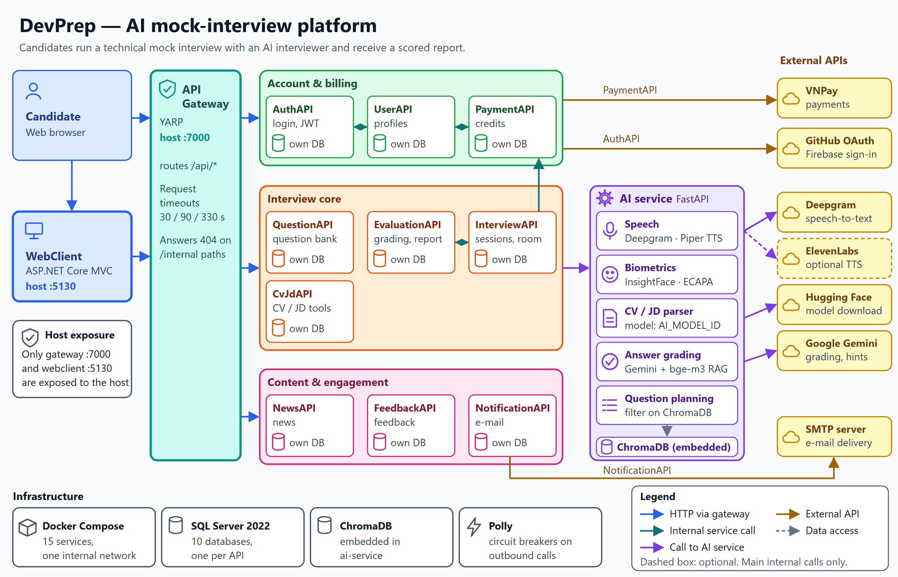
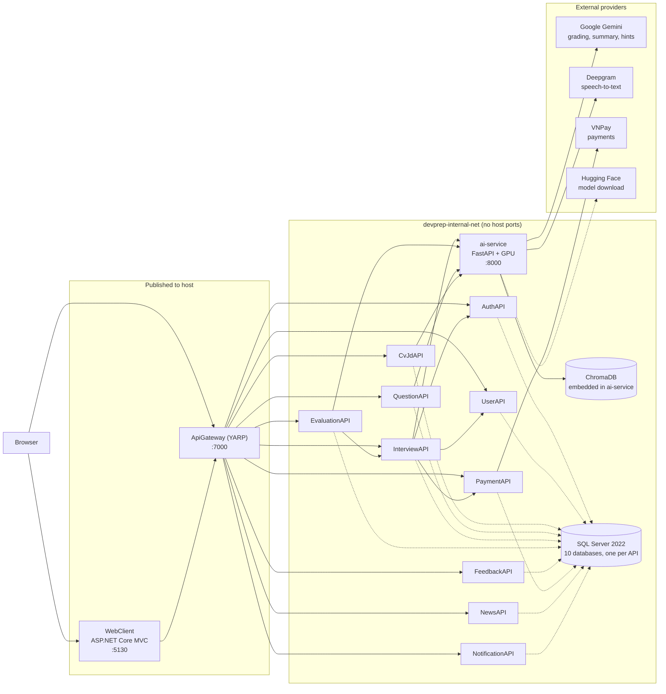

# DevPrep

DevPrep is an AI mock-interview platform for IT candidates: you configure a technical interview, answer an AI interviewer by text or voice, and get a scored report with per-question feedback.

SEP490 capstone project, FPT University. .NET 8 microservices, a FastAPI AI service, SQL Server.

<!-- No license file and no CI workflow exist in this repository, so no badges. -->

## Screenshots

<!--
Add the screenshots, then remove this comment. File names are fixed:



-->

Screenshots are pending. Expected files: `.github/assets/readme/room.png`, `report.png`, `biometric-gate.png`, `architecture.png`.

## Features

- **Interview room.** Chat with an AI interviewer in text or voice mode (speech-to-text in, spoken questions out). Each question allows one hint. You can skip a question (10 s cooldown by default) and pause up to 3 times per session.
- **Question planning.** Questions come from a bank of 34,678 entries, filtered by role, level and chosen technologies. Problem-Solving questions are woven into every session. System-Design questions are added for Middle and Senior.
- **Rubric grading and feedback.** Each answer is graded against a reference answer on three weighted axes (knowledge 50%, problem solving 30%, communication 20%). You see strengths, weaknesses and a suggested improvement per question.
- **Evaluation report.** One report per session: overall score, letter grade, category scores and an AI-written summary.
- **Biometric anti-cheating.** Enrol your face and voice once. A face match gates room entry (3 attempts). During the session the system checks your face per question, detects tab switches, and checks your voice on spoken answers. Repeated flags end the session.
- **Credits.** A session costs 2 credits per minute. Buy credits through VNPay. A one-time 100-credit bonus applies when both face and voice are enrolled. Failed session starts refund the charge.
- **CV and JD tools.** Upload a CV or job description, parse it into structured fields, and compute a match score.
- **Admin and Manager areas.** Question bank and tech-stack management (edits sync to the search index), news, payments, feedback and user management.

## Architecture



- **Host ports.** `docker-compose.yml` publishes only `7000` (gateway) and `5130` (WebClient). `docker-compose.override.yml` adds `1433` (SQL Server) and `8080` to `8000` (ai-service) for local development. Use `-f docker-compose.yml` to exclude it.
- **Piper TTS** runs inside ai-service and needs no external call. ElevenLabs is implemented but only used if `TTS_PROVIDER=elevenlabs`.
- **Database per service.** Ten databases (`DevPrep_Auth` to `DevPrep_Notification`) on one SQL Server container. SQL Server is the source of truth for interview progress. ai-service keeps no session state for the .NET flow.
- The diagram shows the main call paths, not every service-to-service call.

## Engineering highlights

- **Atomic session activation and credit charge.** A conditional `UPDATE ... WHERE Status = 'Initialized'` moves the session to `InProgress` only once. The credit deduction follows, with rollback on failure and a refund if the first chat message cannot be saved. `source/InterviewAPI/Repositories/SessionRepository.cs:250`, `source/InterviewAPI/Services/SessionService.cs:710-784`.
- **Race-safe credit ledger.** The balance is read under `UPDLOCK, HOLDLOCK` inside a transaction. Filtered unique indexes allow one refund per reference and one bonus per user. `source/PaymentAPI/Repositories/LedgerRepository.cs:19-33`, `db/baseline/08_DevPrep_Payment.sql:185-200`.
- **Duplicate answer submissions.** A conditional increment of `AnsweredQuestions` lets only one concurrent request claim a turn. Losers get the current state back. `source/InterviewAPI/Repositories/SessionRepository.cs:322`, `source/InterviewAPI/Services/SessionService.cs:883`.
- **IDOR protection.** EvaluationAPI asks InterviewAPI whether the JWT user owns the session before it returns data. If InterviewAPI cannot answer, access is refused, not assumed. `source/EvaluationAPI/Controllers/EvaluationController.cs:32-35`, `source/InterviewAPI/Controllers/InterviewSessionController.cs:203`.
- **No duplicate grading or reports.** An answer that already has an evaluation returns the stored one. Report creation runs in a `Serializable` transaction behind a unique index on `SessionId`. `source/EvaluationAPI/Services/EvaluationService.cs:60-86`, `source/EvaluationAPI/Repositories/EvaluationRepository.cs:48-66`, `db/baseline/06_DevPrep_Evaluation.sql:119`.
- **Circuit breakers and timeouts.** InterviewAPI and EvaluationAPI wrap ai-service, PaymentAPI and InterviewAPI calls in a Polly breaker (opens after 5 consecutive failures, 30 s break). Payment calls are not retried, so a lost response cannot charge twice. The gateway applies per-route request timeouts of 30 s, 90 s (AI routes) and 330 s (documents). `source/InterviewAPI/Http/ResiliencePolicies.cs:27-60`, `source/EvaluationAPI/Http/ResiliencePolicies.cs`, `source/ApiGateway/appsettings.json:20-22`, `source/ApiGateway/Program.cs:57-65`.
- **Locked-down network.** Only the gateway and WebClient publish ports. The gateway also returns 404 for any path containing an `internal` segment, so service-to-service endpoints are unreachable from outside. `infra/docker-compose.yml:26-32,387,413`, `source/ApiGateway/Program.cs:106-118`.
- **Bounded grading queue.** Answers are graded in the background by 4 workers over a 256-item bounded channel. A recovery endpoint re-queues lost work with a per-session cooldown. `source/InterviewAPI/Services/Grading/GradingQueueOptions.cs:5-6`, `source/InterviewAPI/Controllers/InterviewSessionController.cs:227`.
- **Cleaned question data.** HTML and markdown residue is stripped from answers at index time, and near-duplicate questions (cosine similarity 0.92 or higher) are dropped from each session's pool. `ai-service/app/services/chroma_store.py:37-50,197-215`.
- **Reference answers stay server-side.** They are stored per session question and used only for grading. The API response for the next question omits them. `source/InterviewAPI/Services/SessionService.cs` (Step F in `GenerateQuestionAsync`).

## How the AI parts actually work

| Part | What runs |
|---|---|
| Question selection | Metadata filter (position, level, technology) on ChromaDB, then random sample. No semantic search. |
| RAG | Used in grading only: the 2 most similar bank Q&A pairs (BAAI/bge-m3 embeddings) are added to the grading prompt. `ai-service/app/services/evaluator.py:481`, `chroma_store.py:288` |
| Grading, summary, hints | Google Gemini (`GEMINI_JUDGE_MODEL`). Grading takes the median of `SELF_CONSISTENCY_RUNS` runs per axis. |
| Speech-to-text | Deepgram (`nova-3` by default) |
| Text-to-speech | Piper, local (`TTS_PROVIDER` defaults to `piper`) |
| Face match | InsightFace `buffalo_l`, cosine similarity, threshold 0.35 |
| Voice match | SpeechBrain ECAPA-TDNN, cosine similarity, threshold 0.25 |
| CV and JD parsing | The Hugging Face model named by `AI_MODEL_ID`, loaded at ai-service startup (code default `google/gemma-4-E4B-it`). Our fine-tuned Gemma-2-2B parser is trained by `ai-service/training/train_kaggle.py`. |

## Limitations

- **The Gemma-2B LoRA interviewer is trained but not deployed.** `GemmaChat` runs only behind ai-service's own `/interview/start`. No .NET service or WebClient code calls it. The adapter files are git-ignored (`ai-service/models/`).
- **Liveness is not part of face pass/fail.** The head-turn measurement was unreliable on real hardware (yaw range of 0.55 to 1.61 degrees during a deliberate turn; direction wrong in about 80% of tests, per the comments in `ai-service/biometrics/liveness_face.py` and `router.py`). The entry gate is face match only. A printed photo is not specifically defended against.
- **Biometric thresholds are uncalibrated.** FAR, FRR and EER were not measured. No `calibration.json` exists. The values are fixed defaults.
- **JD text does not influence questions.** InterviewAPI sends the JD to the planner, but the planner does not use it. The CV is not sent (`CvText = null`).
- **Challenge-based verification has no UI.** The server-issued phrase and head-turn challenge endpoints exist, but no shipped view triggers them. `FusionDecisionHelper` (face plus voice score fusion) has no callers.
- **English only.** Hints and voice transcription default to English.
- **Throughput.** ai-service runs one uvicorn worker with synchronous handlers. The grading queue is in memory with no dead-letter store.
- **No automated test suite.** The solution has no test projects. `IntegrationTest/` holds a PowerShell script.
- **GPU host required.** The ai-service container reserves NVIDIA devices in `docker-compose.yml`.
- **Search index is seeded by hand.** ChromaDB is not populated by `docker compose up` (see Quickstart).

## Quickstart

**Requirements:** Docker with Compose v2, an NVIDIA GPU with the NVIDIA Container Toolkit, Python 3.11 for the one-time index seeding, API keys for Gemini and Deepgram, a Hugging Face token. The first ai-service build downloads CUDA and models and takes a long time.

1. Create the environment files from the templates and fill in values.
   - `infra/.env.docker` from `infra/.env.docker.example`: `MSSQL_SA_PASSWORD`, `INTERNAL_API_KEY`, `JWT_KEY`, `JWT_ISSUER`, `JWT_AUDIENCE`, `VNPAY_TMNCODE`, `VNPAY_HASHSECRET`, `VNPAY_PAYMENTURL`, `HF_TOKEN`, `SEED_SAMPLE_DATA`, `DEMO_SESSION_ENABLED`.
   - Repo-root `.env` from `.env.example` (read by ai-service): `GEMINI_API_KEY`, `GEMINI_JUDGE_MODEL`, `DEEPGRAM_API_KEY`, `DEEPGRAM_STT_MODEL`, `AI_MODEL_ID`, `INTERNAL_API_KEY`, `SELF_CONSISTENCY_RUNS`, `TTS_PROVIDER`, `ALLOWED_ORIGINS`, `HF_TOKEN`. Optional: `ELEVENLABS_API_KEY`, `ELEVENLABS_VOICE_ID`, `ELEVENLABS_TTS_MODEL`, `GEMMA_MODEL_DIR`.
2. Start the stack. The `--env-file` flag is required.
   ```powershell
   cd infra
   docker compose --env-file .env.docker -f docker-compose.yml up -d --build
   ```
   `db-init` creates the ten databases, applies `db/baseline/*.sql` (schema plus the question bank) and exits.
3. Seed the search index once. Run from `ai-service/` in a Python environment with `requirements.txt` installed, then copy the result where the container mounts it:
   ```powershell
   python build_index.py
   Copy-Item -Recurse -Force chroma_data\* chroma_data_docker\
   cd ..\infra
   docker compose --env-file .env.docker -f docker-compose.yml restart ai-service
   ```
   Without this step, starting an interview fails because no questions are indexed.
4. Optional sample accounts and credit packages: set `SEED_SAMPLE_DATA=true`, paste three bcrypt hashes into `db/seed/01_DevPrep_Auth.sql`, then run `docker compose --env-file .env.docker up db-init`. Steps are in `db/seed/README.md`.
5. Open **http://localhost:5130**. The gateway is at http://localhost:7000.

**Demo accounts** (only after step 4): `admin@local.devprep.test` (Admin), `manager@local.devprep.test` (Manager), `candidate@local.devprep.test` (User). The password is set by you when you generate the hashes. See `db/seed/README.md`.

## Team

SEP490 capstone, FPT University.

| Member (GitHub) | Area |
|---|---|
| DuyenTQ2003 | <!-- fill in from team assignment --> |
| ho-thanh-duy | <!-- fill in from team assignment --> |
| Duong Nguyen | <!-- fill in from team assignment --> |
| HaoNam | <!-- fill in from team assignment --> |
| Usopp204 | <!-- fill in from team assignment --> |
| HuynhAnh181405 | <!-- fill in from team assignment --> |

## Documentation

- [`db/README.md`](db/README.md): database bootstrap, baselines, migration policy.
- [`db/seed/README.md`](db/seed/README.md): optional sample accounts and credit packages.
- [`contracts/README.md`](contracts/README.md): shared contracts between services.
- [`infra/docker-compose.yml`](infra/docker-compose.yml): full stack, with the port-lockdown rules in its header.

There is no end-user manual in the repository.
