# DevPrep Microservice Architecture Compliance Audit

**Scope:** entire repository (`source/*`, `ai-service/`, `infra/`, `contracts/`), including services owned by other team members. **Type:** read-only audit — no code, config, or dependency changes were made in this pass. **Author's own services** (per `CLAUDE.md`): `InterviewAPI`, `EvaluationAPI`, `ai-service`, `WebClient`. All other services were read for evidence only.

**Method:** every finding below is backed by a `path:line` citation or a quoted config snippet. Where a claim could not be fully verified by static reading (e.g. exact library override semantics, whether a background job exists), it is explicitly marked **UNVERIFIED** with what would be needed to confirm it.

---

## A. Service Inventory

| Service | Tech | Port (default) | Database | Dockerfile | In compose | Health endpoint | Upstream deps (called by) | Downstream deps (calls) |
|---|---|---|---|---|---|---|---|---|
| ApiGateway | ASP.NET Core + YARP | 7000 (binds `0.0.0.0`) | none | `source/Dockerfile` (orphaned, not wired into compose) | No | none (proxy only) | Browser, WebClient | All 10 backend APIs |
| AuthAPI | ASP.NET Core | 7001 | `DevPrep_Auth` | No | No | `/health` (`Program.cs:191`) | Gateway, PaymentAPI, InterviewAPI(admin) | UserAPI, NotificationAPI, GitHub/Firebase/Google (external) |
| UserAPI | ASP.NET Core | 7002 | `DevPrep_User` (+ duplicate `DefaultConnection`, see F-02) | No | No | `/health` (`Program.cs:162`) | Gateway, AuthAPI | AuthAPI, InterviewAPI, PaymentAPI (all hardcoded URLs, see F-06); direct SQL reads into `DevPrep_Auth`, `DevPrep_Interview`, `DevPrep_Payment` |
| CvJdAPI | ASP.NET Core (minimal API) | 7003 | `DevPrep_CvJd` | No | No | `/health` (`Program.cs:53`) | Gateway | ai-service (named `HttpClient("ai")`, `Program.cs:22-25`) |
| QuestionAPI | ASP.NET Core | 7004 | `DevPrep_Question` | No | No | `/health` (`Program.cs:141`) | Gateway | ai-service (`QuestionIndexClient`) |
| InterviewAPI | ASP.NET Core | 7005 | `DevPrep_Interview` | No | No | `/health` (`Program.cs:187`) | Gateway, EvaluationAPI, FeedbackAPI | AuthAPI, UserAPI, ai-service, PaymentAPI, EvaluationAPI (widest fan-out in the system) |
| EvaluationAPI | ASP.NET Core | 7006 | `DevPrep_Evaluation` | No | No | `/health` (`Program.cs:142`) | Gateway, InterviewAPI | ai-service, InterviewAPI |
| FeedbackAPI | ASP.NET Core | 7007 | `DevPrep_Feedback` | No | No | `/health` (`Program.cs:161`) | Gateway | UserAPI, AuthAPI, InterviewAPI |
| PaymentAPI | ASP.NET Core | 7008 | `DevPrep_Payment` | No | No | `/health` (`Program.cs:175`) | Gateway, InterviewAPI | AuthAPI (`AuthAccountClient`), VNPay (external); direct SQL reads into `DevPrep_User`, `DevPrep_Auth` |
| NewsAPI | ASP.NET Core | 7009 | `DevPrep_News` | No | No | `/health` (`Program.cs:121`) | Gateway | none observed |
| NotificationAPI | ASP.NET Core (minimal API) | 7010 | `DevPrep_Notification` | No | No | `/health` (`Program.cs:69`) | Gateway, AuthAPI | SMTP (external) |
| StatisticsAPI | ASP.NET Core (stub) | 7011 (assumed, unverified — no `Program.cs` in source tree) | `DevPrep_Statistics` | No | No | UNVERIFIED | none | none — **no route in ApiGateway config at all** (see F-04) |
| WebClient | ASP.NET Core MVC + Razor | 5130 (per `CLAUDE.md`; not independently re-verified) | none (pure HTTP client) | No | No | UNVERIFIED | Browser | ApiGateway only (`appsettings.json:4`, `BaseUrl: http://localhost:7000/`) |
| ai-service | Python FastAPI | 8080→8000 (Docker-mapped) | none (stateless; ChromaDB is a local file index, not a service) | `ai-service/Dockerfile` | **Yes — the only service in compose** | `/health` (compose healthcheck, `infra/docker-compose.yml:46-51`) | InterviewAPI, EvaluationAPI, QuestionAPI, CvJdAPI | Gemini, Deepgram, ElevenLabs/Piper, HuggingFace (all external) |

**StatisticsAPI note:** `source/StatisticsAPI/` contains only `bin/`/`obj/` build artifacts (compiled `StatisticsAPI.dll` from a prior build) — no `Program.cs`, no `Controllers/`, no source file of any kind exists in the tracked source tree. It is a stub in the most literal sense: a compiled binary with no accompanying source.

**FrontendClient note:** `CLAUDE.md` references `source/FrontendClient/` as "old React SPA (reference only)"; the directory does not exist in the current working tree (`ls source/FrontendClient` → no such file or directory). The `CLAUDE.md` description is stale.

---

## B. Scorecard

| # | Criterion | Score /3 | Justification |
|---|---|---|---|
| 1 | Service decomposition & bounded contexts | **2** | Boundaries are drawn by business capability (Auth, User, Document, Question, Interview, Evaluation, Feedback, Payment, News, Notification), which is correct in intent. Undermined by: StatisticsAPI being a capability with no implementation or gateway route, and by the DB-per-service boundary being routinely crossed at the SQL level (see #2), which means the "bounded context" is nominal, not enforced. |
| 2 | Database-per-service | **1** | Connection-string level: clean 1:1, no two services share a catalog (`.env:1-11`). Practice level: **PaymentAPI and UserAPI issue raw three-part-name cross-database SQL JOINs directly into each other's and other services' schemas** (F-01), which is a direct bounded-context violation regardless of the clean connection-string table. |
| 3 | Independent deployability | **1** | Code coupling is genuinely minimal — one shared library (`contracts/auth`, DTOs only, referenced by 3 services) and no shared `DbContext`/domain entities. But deployability itself is absent: no per-service Dockerfile, no CI/build pipeline evidence, one service (UserAPI) has hardcoded peer URLs baked into source (F-06) that would need a code change (not just config) to redeploy elsewhere. All 12 backend projects + WebClient live in one `DevPrep.sln` built as a unit. |
| 4 | Inter-service communication | **1** | Every call is synchronous HTTP/JSON. Explicit per-client timeouts exist on most `HttpClient` registrations (positive — `InterviewAPI/Program.cs:64,73,82,92,102`). No retry policies, no circuit breakers, no bulkheads anywhere in the solution (zero Polly references). No message broker exists anywhere in the system (F-07). Synchronous call chains of depth ≥3 exist inside user-blocking request paths (F-08). |
| 5 | API Gateway & service exposure | **1** | YARP routing is thorough and includes a genuine defense-in-depth measure (blocking any path segment literally named `internal`, `ApiGateway/Program.cs:68-83`) and origin-restricted CORS. But the gateway performs **zero authentication/authorization** — no `AddAuthentication`, `AddAuthorization`, or `[Authorize]` anywhere in `ApiGateway/Program.cs`. Internal endpoints are explicitly designed to be reachable by hitting a service's own port directly, bypassing the gateway. StatisticsAPI has no gateway route at all. |
| 6 | Data consistency across services | **1** | One genuine hand-rolled compensating-action pattern exists for credit deduction (F-09) and one explicitly-documented idempotent operation (biometrics bonus award). But there is no saga/outbox framework, no idempotency keys on the network calls themselves, and one flow (account registration → profile creation) is fire-and-forget with only a log warning on failure and no visible reconciliation mechanism (F-10). |
| 7 | Containerization & deployability | **0** | **Only `ai-service` is containerized and orchestrated.** All 12 .NET projects (including the one `Dockerfile` that exists, which only builds ApiGateway) are absent from `docker-compose.yml`. The one .NET Dockerfile that exists is not referenced by compose and would not function as configured (F-11). SQL Server runs as a native Windows named instance, not a container. `docker-compose up` brings up exactly 1 of the system's 13 runtime components. |
| 8 | Configuration & secrets | **1** | No real secrets are committed to git — `.env` and `infra/.env` (which hold real API keys, a DB password, and the JWT signing key) are correctly `.gitignore`d and confirmed absent from `git ls-files`. But: secrets live in a single plaintext `.env` file with no vault/secret manager, the DB password is trivially weak (`12345`), and **every one of the 11 backend `Program.cs` files loads `.env.example` at startup before the real `.env`** (F-12), which is exactly the pattern the audit brief called out. |
| 9 | Observability | **0** | Every service exposes a `/health` endpoint, but each is a hardcoded `{status:"ok"}` literal with no dependency/DB check (liveness only, not readiness). No structured logging framework (no Serilog), no correlation/trace ID generated at the gateway or anywhere else (zero matches for `CorrelationId`, `X-Correlation`, `X-Request-Id`, `TraceId`, `Activity.Current`, `OpenTelemetry` across the entire `source/` tree), no metrics, no centralized log sink. |
| 10 | Resilience & fault isolation | **1** | Explicit per-call timeouts (positive) and a genuine in-process retry-with-delay background queue for AI grading (`InterviewAPI/Services/Grading/GradingBackgroundService.cs`, positive — decouples a slow AI call from the request path). No circuit breakers anywhere. Several failure paths degrade *silently* rather than gracefully — e.g. `PaymentApiClient.GetBalanceAsync` returns `0` on any HTTP failure (`InterviewAPI/Clients/PaymentApiClient.cs:175`), which is indistinguishable from a real zero balance. |
| 11 | Service-to-service security | **0** | JWT validation is copy-pasted into 8 separate `Program.cs` files rather than centralized (F-13). The internal-call trust mechanism (`X-Internal-Api-Key`) is implemented four inconsistent ways across the codebase, one of which fails open (F-14). Most severely: **`PaymentAPI`'s `/credits/balance` endpoint trusts a caller-supplied `X-User-Id` header with no authentication of any kind, and is reachable from the public Internet through the gateway** (F-05, Critical). `CvJdAPI` has no authentication on any endpoint (F-15). |
| 12 | API contracts & versioning | **1** | Swagger/OpenAPI is wired into all 10 backend APIs (positive, consistent convention). No URL or header API versioning exists anywhere (no `/v1/`, no `ApiVersion` attribute in `source/`). `contracts/README.md` documents an informal "update together" convention, but only for the 3 JSON-schema files under `contracts/`, not for the REST APIs themselves — no documented breaking-change policy for endpoints. |

**Total: 11 / 36 (≈31%). Overall verdict: not a compliant microservice architecture.** The system is decomposed *by name* into services with separate databases and a gateway, which is the right skeleton. But nearly every property that makes that skeleton actually behave like microservices — enforced data ownership, deployment independence, a real trust/authN boundary at the edge, resilience under partial failure, and observability across a distributed call — is absent or only partially, inconsistently implemented. This matches a **monolith-shaped codebase physically split into processes**, not a system designed around independent, fault-isolated services. The review board's judgment is well-supported by the evidence below.

---

## C. Findings (ordered by severity)

### Critical

**F-01 — Cross-database SQL queries break bounded-context isolation**
- Evidence: `source/PaymentAPI/Controllers/ManagerPaymentsController.cs:210-215`, `source/PaymentAPI/Program.cs:456-460`, `source/UserAPI/Controllers/ManagerUsersController.cs:59-92,171-175,213-229,255-266`
- Example (`PaymentAPI/Program.cs:456-460`):
  ```sql
  SELECT a.AccountId, COALESCE(NULLIF(p.FullName, ''), a.Email) AS DisplayName
  FROM DevPrep_Auth.dbo.Accounts a
  LEFT JOIN DevPrep_User.dbo.UserProfiles p ON p.AccountId = a.AccountId
  WHERE a.AccountId IN ({inClause});
  ```
  Example (`UserAPI/Controllers/ManagerUsersController.cs:213-216`):
  ```sql
  SELECT SUM(CreditChange) FROM DevPrep_Payment.dbo.CreditLedger WHERE UserId = @UserId
  ```
- Why it violates microservice principles: the whole point of database-per-service is that a service's schema is a private implementation detail, changeable without coordinating other teams. These queries hardcode other services' database and table names directly into SQL strings, which only works because every database happens to sit on the same physical SQL Server instance (`localhost\MSSQLSERVER01`, confirmed in `.env:1-11`). Any schema change to `Accounts`, `UserProfiles`, `InterviewSessions`, or `CreditLedger` silently breaks a sibling service with no compile-time or API-contract warning.
- Blast radius: PaymentAPI and UserAPI's admin/manager read paths break silently on any schema change in AuthAPI, InterviewAPI, or PaymentAPI. Also a portability blocker — this only works if all databases stay co-located on one SQL Server instance, which blocks any future move to per-service database hosting (a stated goal implied by criterion 2 and by `infra/docker-compose.yml` not containerizing SQL Server yet).
- Effort estimate: M (replace with calls to the owning service's `/internal/*` API; requires new read endpoints on AuthAPI/InterviewAPI/PaymentAPI/UserAPI).

**F-05 — Unauthenticated endpoint discloses any user's credit balance via a spoofable header**
- Evidence: `source/PaymentAPI/Program.cs:235-251`
  ```csharp
  app.MapGet("/credits/balance", async (HttpContext ctx, ILedgerRepository ledgerRepo, IOrderRepository orderRepo) =>
  {
      var userIdStr = ctx.Request.Headers["X-User-Id"].FirstOrDefault();
      if (!Guid.TryParse(userIdStr, out var userId))
          return Results.BadRequest("Missing or invalid X-User-Id header.");
      // ... queries balance for that userId, no auth check ...
  ```
  No `[Authorize]`, no JWT validation, no `X-Internal-Api-Key` check on this route. It is also **not** covered by PaymentAPI's own internal-key middleware, which only guards paths starting with `/api/internal` (`PaymentAPI/Program.cs:151`, `StartsWithSegments("/api/internal", ...)`) — `/credits/balance` does not match that prefix.
  Reachability: `ApiGateway/appsettings.json:86-96` routes `/api/payment/{**catch-all}` to PaymentAPI with `PathRemovePrefix: /api/payment`, so `GET /api/payment/credits/balance` through the public gateway forwards straight to this handler.
- Why it violates microservice principles: this is not really an architecture-pattern violation so much as a broken trust boundary — the endpoint trusts a client-supplied identity header instead of deriving identity from a validated JWT (exactly the failure mode criterion 11 asks to check for).
- Blast radius: **any unauthenticated caller can read any other user's credit balance, purchase total, and last-changed timestamp** by sending `GET /api/payment/credits/balance` with an arbitrary `X-User-Id` header. This is an IDOR / broken-authentication vulnerability reachable from the public Internet through the gateway, not just an internal-network issue.
- Effort estimate: S (add `[Authorize]` + derive `userId` from `ClaimTypes.NameIdentifier` per the team's documented JWT convention, matching how every other user-facing endpoint in the codebase already does it).

**F-15 — CvJdAPI has no authentication on any endpoint**
- Evidence: `source/CvJdAPI/Program.cs` (full file, 73 lines) contains no `AddAuthentication`, `AddAuthorization`, or `[Authorize]` call; `grep -r "RequireAuthorization|Authorize" source/CvJdAPI` returns no matches anywhere in the project. Its endpoints are mapped via `app.MapCvEndpoints(); app.MapJdEndpoints(); app.MapMatchEndpoints();` (`Program.cs:61-63`).
- Reachability: `ApiGateway/appsettings.json:27-37` routes `/api/document/{**catch-all}` to CvJdAPI with prefix removal, and the gateway itself performs no authentication (see F-13/criterion 5). So CV/JD upload and parsing endpoints are open to any caller, with no rate limiting either.
- Why it violates microservice principles: this endpoint proxies to `ai-service` via a 5-minute-timeout `HttpClient` (`Program.cs:22-25`) — an expensive AI operation exposed with zero access control is both a security gap and a cost/DoS-abuse vector (an unauthenticated caller can trigger unlimited AI parsing calls).
- Blast radius: public unauthenticated access to CV/JD parsing; potential compute-cost abuse against the GPU-backed `ai-service`.
- Effort estimate: S–M (add the same JWT bearer setup used by the other 8 services; CvJdAPI is explicitly marked a stub in `CLAUDE.md`, so this may be intentionally deferred — confirm before treating as a live incident).

### High

**F-02 — Internal-endpoint auth is implemented four inconsistent ways, one of which fails open**
- Evidence:
  1. Fail-closed, constant-time comparison, no bypass: `AuthAPI/Program.cs:234-240`, `UserAPI/Program.cs:229-234`, `NotificationAPI/Program.cs:205-211`.
  2. Global middleware protecting the entire `/api/internal/*` prefix at once: `PaymentAPI/Program.cs:139-169` (the most robust pattern in the repo — its own comment explains *why*: `PaymentAPI/Program.cs:140-147`).
  3. **Fails open when the key is unconfigured:** `QuestionAPI/Controllers/InternalQuestionController.cs:40-45`
     ```csharp
     private bool IsInternalCallAuthorized()
     {
         if (string.IsNullOrEmpty(_internalApiKey)) return true;   // <-- open by default
         return Request.Headers.TryGetValue("X-Internal-Api-Key", out var provided)
             && string.Equals(provided.ToString(), _internalApiKey, StringComparison.Ordinal);
     }
     ```
     The same class's own doc comment (`InternalQuestionController.cs:7-9`) claims it follows *"the same convention as UserAPI/NotificationAPI /internal/* endpoints"* — but UserAPI and NotificationAPI both fail **closed** (NotificationAPI in fact refuses to even start without a configured key — see the positive note below). The comment overstates parity with the sibling services.
     The identical fail-open pattern is mirrored in `ai-service/app/api/internal.py:21-24` (`if config.INTERNAL_API_KEY and x_internal_api_key != config.INTERNAL_API_KEY: raise ...` — an empty configured key silently disables the check there too).
  4. A completely different mechanism — JWT + role claim instead of the internal key: `AuthAPI/Controllers/InternalAccountsController.cs:24-25` (`[Authorize(Roles = "Admin,Manager")]`).
- Positive counter-example worth crediting: `NotificationAPI/Program.cs:47-56` explicitly **fails closed** — the service refuses to start at all if `INTERNAL_API_KEY` is missing, with a comment explaining exactly the risk this audit is flagging: *"fail-closed, thiếu khoá thì từ chối khởi động thay vì để endpoint gửi email mở cho bất kỳ ai gọi"* ("fail closed — refuse to start rather than leave the send-email endpoint open to anyone"). This is the strongest security-conscious code in the repository and is the pattern the other services should be brought in line with.
- Why it matters: "internal-only" has four different, non-interoperable definitions across the codebase. A misconfiguration (unset `INTERNAL_API_KEY` in one service's environment, while others are configured correctly) silently reopens only that one service's internal surface, which is exactly what happened conceptually with F-01's sibling finding on QuestionAPI.
- Blast radius: if `INTERNAL_API_KEY` is ever left unset for QuestionAPI specifically (a plausible per-service misconfiguration, since each service reads it independently from its own `.env`), `/internal/questions/export` — the full question bank including reference answers — becomes world-readable to anything that can reach QuestionAPI's port.
- Effort estimate: S (standardize all internal auth on PaymentAPI's global-middleware, fail-closed pattern).

**F-03 — Gateway performs no authentication or authorization; JWT validation is fully duplicated 8 times**
- Evidence: `ApiGateway/Program.cs` (full 87-line file) has no `AddAuthentication`, `AddAuthorization`, or `[Authorize]` call anywhere — its only cross-cutting concerns are CORS (`:39-45`), a body-size/timeout limit (`:14-28`), and the internal-path blocklist (`:68-83`).
  Meanwhile `AddAuthentication(JwtBearerDefaults.AuthenticationScheme).AddJwtBearer(...)` with its own `TokenValidationParameters` block is copy-pasted independently into: `NewsAPI/Program.cs:38-41`, `PaymentAPI/Program.cs:45-48`, `AuthAPI/Program.cs:104-107`, `FeedbackAPI/Program.cs:77-80`, `QuestionAPI/Program.cs:41-44`, `InterviewAPI/Program.cs:115-118`, `EvaluationAPI/Program.cs:70-73`, `UserAPI/Program.cs:88-91`.
- Why it violates microservice principles: criterion 5(c)/11 asks whether auth is enforced at the gateway, duplicated per service, or both — the answer here is "duplicated per service, not at the gateway at all." This means 8 independent, hand-maintained copies of the same security-critical configuration must all be kept in sync manually (same signing key, same issuer/audience, same clock-skew tolerance); a future edit applied to one and forgotten in another creates a silent inconsistency.
- Blast radius: every downstream service is independently responsible for correctly validating tokens; the gateway provides no safety net if any one of the 8 gets it wrong.
- Effort estimate: L (centralizing JWT validation at the gateway is a real architectural change, not a config tweak, and touches every service's request pipeline).

**F-04 — StatisticsAPI has no route in the gateway at all**
- Evidence: `grep -i "statistics" source/ApiGateway/appsettings.json` returns no matches; the `ReverseProxy.Routes`/`Clusters` sections (`ApiGateway/appsettings.json:13-413`, full file read) contain routes for all 10 other backend services but none for Statistics. This contradicts `docs/architecture/pure-microservices-baseline.md:39` (`/api/statistics/*` -> StatisticsAPI`) and `contracts/README.md:31` (lists Statistics as one of the 11 business boundaries).
- Why it matters: this is either (a) undocumented drift between the design docs and the actual gateway config, or (b) evidence that StatisticsAPI was descoped without updating the docs that claim otherwise. Either way it's a decomposition/documentation-integrity gap.
- Blast radius: none currently (no client can reach it, and there's no source code to reach), but it misleads anyone reading the baseline doc into thinking the route exists.
- Effort estimate: S (either remove Statistics from the docs, or add the route once the service is implemented).

### Medium

**F-06 — UserAPI hardcodes peer service URLs in source instead of reading them from configuration**
- Evidence: `source/UserAPI/Program.cs:47-54,71-73`
  ```csharp
  builder.Services.AddHttpClient("AuthServiceClient", client => { client.BaseAddress = new Uri("http://localhost:7001/"); ... });
  builder.Services.AddHttpClient("InterviewServiceClient", client => { client.BaseAddress = new Uri("http://localhost:7005/"); ... });
  ...
  builder.Services.AddHttpClient("PaymentServiceClient", client => { client.BaseAddress = new Uri("http://localhost:7008/"); ... });
  ```
  Contrast with every other service's pattern of reading the peer's base URL from configuration, e.g. `InterviewAPI/Program.cs:61-68` (`client.BaseAddress = new Uri(authBaseUrl!)` where `authBaseUrl` comes from `builder.Configuration`).
- Why it matters: this breaks independent deployability (criterion 3) — moving AuthAPI, InterviewAPI, or PaymentAPI to a different host/port requires a source change and rebuild of UserAPI, not a config change.
- Effort estimate: S.

**F-07 — No message broker exists anywhere; "event" terminology is used for what are actually synchronous RPC calls**
- Evidence: `contracts/auth/AccountRegistered.cs:3-6` doc comment: *"Sự kiện AuthAPI phát ra khi một tài khoản mới được tạo... UserAPI lắng nghe"* ("The event AuthAPI emits when a new account is created... UserAPI listens"). In reality, `AuthAPI/Services/AuthService.cs:874-889` shows this is a direct, synchronous `HttpClient` POST:
  ```csharp
  private async Task PublishAccountRegisteredAsync(Guid accountId, string email, string? fullName)
  {
      try { await _userApiClient.CreateProfileAsync(new AccountRegistered { ... }); }
      catch (Exception ex) { _logger.LogWarning(ex, "Failed to call UserAPI (create profile) for {Email}.", email); }
  }
  ```
  The method is even named `PublishAccountRegisteredAsync` and its comment says *"Best-effort: nếu broker lỗi vẫn không chặn luồng đăng ký"* ("best-effort: if the broker fails, it doesn't block registration") — but there is no broker. `infra/docker-compose.yml` (full file read) defines exactly one service (`ai-service`); no RabbitMQ, Kafka, Azure Service Bus, or any other broker appears anywhere in the repository (`grep`-checked across `source/`, `infra/`, `ai-service/`).
- Why it matters: the vocabulary ("publish", "event", "broker", "listen") implies asynchronous, decoupled, at-least-once delivery semantics that the code does not actually provide. This is a readability/correctness-of-mental-model issue as much as an architecture one — a future maintainer reading these comments will assume guarantees (retry, durability, ordering) that do not exist.
- Blast radius: see F-10 for the concrete consistency consequence.
- Effort estimate: M if actually introducing a broker; S if just correcting the terminology to describe what the code does today.

**F-08 — Synchronous call chains of depth ≥3 exist inside user-blocking request paths**
- Evidence: `Browser → ApiGateway → InterviewAPI → EvaluationAPI → ai-service` (`InterviewAPI/Clients/EvaluationApiClient.cs`, `EvaluationAPI/Clients/AiServiceClient.cs`) is a 4-hop synchronous chain. `Browser → ApiGateway → InterviewAPI → PaymentAPI` (`InterviewAPI/Services/SessionService.cs:659-667`, credit deduction) is a 3-hop synchronous chain that occurs on the interview-session-start request path, with a combined worst-case wait of the AuthAPI/UserAPI (15s) + PaymentAPI (30s) + AI service (60s) timeouts if calls are sequential rather than parallel (`InterviewAPI/Program.cs:64,73,82,92,102`).
- Why it matters: criterion 4 explicitly asks for this; each hop compounds latency and failure probability, and none of these calls have a circuit breaker, so a slow/degraded ai-service directly stalls the user-facing request rather than failing fast.
- Blast radius: user-facing latency and cascading timeouts during interview session start / answer submission if any one dependency in the chain is slow.
- Effort estimate: M (requires either async decoupling of the credit step, or a circuit breaker + faster-fail timeout tuning).

**F-09 / F-10 — Data consistency across services is hand-rolled and inconsistent**
- F-09 (partial positive): credit deduction has a real compensating-action pattern. `InterviewAPI/Services/SessionService.cs:654-667` deducts credit and rolls back the session status if deduction fails; `SessionService.cs:706-716` refunds the credit if a *later* step (persisting the chat message) fails after a successful deduction:
  ```csharp
  catch (Exception ex)
  {
      if (isFirstEntry && statusChanged && creditCost > 0)
      {
          _logger.LogError(ex, "Failed to save chat message after credit deduction. Refunding credit.");
          await _paymentApiClient.RefundCreditAsync(userId, creditCost, sessionId, "Refund: failed to initialize session", ct);
      }
      throw;
  }
  ```
  Gap: this refund call itself has no retry and no dead-letter/reconciliation path — if it fails, the failure is only logged (`PaymentApiClient.cs:104-112`, catch-and-log), and the credit is lost with no automated recovery. There is also no idempotency key on `DeductCreditAsync`/`RefundCreditAsync`, so a client-side timeout followed by an application-level retry could double-deduct (UNVERIFIED whether any caller currently retries this specific call — no retry code was found, but nothing prevents one being added later without also adding idempotency).
  Positive contrast: the one-time biometrics-enrollment bonus is explicitly documented and built as idempotent — `PaymentAPI/Controllers/InternalCreditController.cs:40-41` (*"One-time bonus... Idempotent — see InternalCreditService.AwardCreditAsync for the two-layer guard"*).
- F-10 (negative): account-registration → profile-creation (see F-07) has **no compensating action and no reconciliation job found**. If `UserApiClient.CreateProfileAsync` fails, the account exists in `DevPrep_Auth` permanently with no `UserProfiles` row in `DevPrep_User`, and the only trace is a `LogWarning` (`AuthService.cs:885-888`). The comment claims the profile "can be created again later" (*"hồ sơ có thể tạo lại sau"*) but no code path that re-attempts this was found in the codebase (**UNVERIFIED** — a background reconciliation job may exist outside the files searched; recommend confirming via `grep -r "CreateProfileIfNotExists" source/` and checking for any scheduled/hosted service that sweeps orphaned accounts).
- Why it matters: criterion 6 asks for saga/outbox/idempotency-key patterns; none exist as a reusable mechanism — every cross-service consistency concern is solved ad hoc, with inconsistent rigor, by whoever wrote that particular code path.
- Effort estimate: M (per flow) to add idempotency keys and a reconciliation sweep; L to introduce a proper outbox pattern across all flows.

**F-11 — The one .NET Dockerfile that exists is orphaned and would not function as configured**
- Evidence: `source/Dockerfile` builds only `ApiGateway/ApiGateway.csproj` (`source/Dockerfile:8`) and sets `ENV ASPNETCORE_URLS=http://0.0.0.0:5000` / `EXPOSE 5000` (`source/Dockerfile:11-12`). But: (1) `infra/docker-compose.yml` never references this Dockerfile — it is not built or run by compose; (2) even if run, ApiGateway's own code defaults to port 7000 (`ApiGateway/Program.cs:10`, `GLOBAL_API_GATEWAY_PORT` default `7000`), a mismatch with the Dockerfile's hardcoded 5000; (3) the gateway's cluster destinations are hardcoded to `http://localhost:700x/` (`ApiGateway/appsettings.json:340-412`), which inside a container would not resolve to sibling containers (Docker networking requires service-name DNS, not `localhost`) — and no sibling containers exist regardless, since no other service has a Dockerfile.
- Why it matters: this is dead/misleading configuration — it looks like partial containerization progress but is neither wired in nor would work if it were.
- Effort estimate: S to delete or clearly mark as WIP; L to actually make it functional (requires Dockerizing all 11 other .NET services and switching to compose service-name addressing).

**F-12 — Every backend service loads `.env.example` before the real `.env` at startup**
- Evidence: identical two-line pattern at the top of all 11 backend `Program.cs` files (list: `ApiGateway:4-5`, `AuthAPI:16-17`, `UserAPI:16-17`, `CvJdAPI:6-7`, `QuestionAPI:13-14`, `InterviewAPI:16-17`, `EvaluationAPI:15-16`, `FeedbackAPI:16-17`, `PaymentAPI:17-18`, `NewsAPI:13-14`, `NotificationAPI:12-13`):
  ```csharp
  try { Env.TraversePath().Load(".env.example"); } catch { }
  try { Env.TraversePath().Load(); } catch { }
  ```
  This is precisely the pattern the audit brief asked to flag. `.env.example` (tracked in git, `git ls-files` confirms) contains placeholder values including a JWT signing key of exactly the rejected-by-AuthAPI-if-used-literally form (`.env.example:58`, `Jwt__Key=change-me-32-chars-min-random-secret-here`) and placeholder DB credentials (`.env.example:5-6`, `Password=your-sql-password-here`). The real `.env` (confirmed **not** tracked in git — absent from `git ls-files` output, correctly excluded by `.gitignore:3`) contains real values (`.env:1-63`), including a genuinely weak local DB password (`Password=12345`, `.env:1-11`) and live third-party API keys (Gemini, Deepgram, HuggingFace).
  **UNVERIFIED:** whether DotNetEnv 3.2.0's (`AuthAPI/AuthAPI.csproj:11`, `PackageReference Include="DotNetEnv" Version="3.2.0"`) second `.Load()` call overwrites variables already set by the first, or leaves them as first-loaded. This determines whether the pattern is inert dead code (if the second load always wins) or a live risk (if a key present in `.env.example` but *absent* from `.env` — or if `.env` fails to load at all, e.g. wrong working directory — silently falls back to the placeholder value). Confirming this requires either reading the DotNetEnv 3.2.0 source/changelog directly (not available in this offline read-only pass) or a runtime test, which the audit's hard rules prohibit running.
- Why it matters: regardless of the override-precedence answer, this is worth flagging per the audit brief specifically, and at minimum represents confusing, unexplained dead code that increases the risk of a future accidental regression (e.g. someone "cleans up" the `.env.example` load thinking it's unused, or the DotNetEnv default behavior changes in a future version bump).
- Effort estimate: S (remove the `.env.example` load, or add a code comment explaining why it's intentionally there, once the precedence question is resolved).

### Low

**F-13 — CORS is independently configured on 8 backend services despite none of them being meant to be called directly by a browser**
- Evidence: `AddCors`/`UseCors` appears in `QuestionAPI/Program.cs:74`, `UserAPI/Program.cs:110`, `FeedbackAPI/Program.cs:112`, `InterviewAPI/Program.cs:137`, `EvaluationAPI/Program.cs:92`, `AuthAPI/Program.cs:158`, `NewsAPI/Program.cs:66`, in addition to the gateway's own CORS policy (`ApiGateway/Program.cs:39-45`). All use an origin allowlist (`WithOrigins`, no remaining `AllowAnyOrigin` found anywhere in `source/` — a positive prior fix, evidenced by `ApiGateway/Program.cs:31` comment: *"Trước đây là AllowAnyOrigin... Nay chỉ mở cho đúng origin"*).
- Why it matters: per the architecture (`CLAUDE.md`: "Browser KHÔNG gọi thẳng ai-service... chỉ qua Gateway"), backend services should only ever be called by the gateway or by each other server-side, neither of which is subject to browser CORS. Configuring CORS per-service is redundant duplication (DRY smell) and implies these services are at least sometimes expected to be hit directly by browser JavaScript, which contradicts the documented architecture.
- Effort estimate: S (no functional bug, just a consistency/architecture-clarity cleanup).

**F-14 — Health endpoints are liveness-only static literals, not real readiness checks**
- Evidence: every service's `/health` handler is a hardcoded literal, e.g. `PaymentAPI/Program.cs:175`: `app.MapGet("/health", () => Results.Ok(new { service = "Payment", status = "ok" }))` — same shape across all 10 backend services (`CvJdAPI:53`, `EvaluationAPI:142`, `NewsAPI:121`, `NotificationAPI:69`, `FeedbackAPI:161`, `AuthAPI:191`, `UserAPI:162`, `QuestionAPI:141`, `InterviewAPI:187`). None of them touch the database or any downstream dependency.
- Why it matters: criterion 9 explicitly distinguishes liveness from readiness — these endpoints answer "is the process running" but not "is this instance actually able to serve requests" (e.g. DB unreachable). ai-service's healthcheck (`infra/docker-compose.yml:46-51`) is the same shallow shape (`/health` HTTP 200 check), by its own comment acknowledging model loading happens lazily and separately.
- Effort estimate: S per service (add a lightweight `DbContext` connectivity check).

---

## D. Gap List by Ownership

### (A) Fixable entirely inside owned services (`InterviewAPI`, `EvaluationAPI`, `ai-service`, `WebClient`)
- F-08 (InterviewAPI↔EvaluationAPI↔ai-service call chain depth / lack of circuit breaker) — InterviewAPI and EvaluationAPI are both owned.
- F-09/F-10's InterviewAPI-side half (credit deduct/refund idempotency, retry-safe compensation) — the PaymentAPI side needs teammate coordination, but the calling code and its resilience posture live in InterviewAPI.
- The `ai-service` half of F-02 (`app/api/internal.py:21-24` fail-open pattern) — owned, fixable unilaterally.
- InterviewAPI/EvaluationAPI's own JWT-duplication instance (part of F-03) — cannot fix the *centralization* alone (needs the gateway, bucket C), but can at minimum ensure their own `TokenValidationParameters` stay correct.
- Health-endpoint depth for InterviewAPI/EvaluationAPI (part of F-14) — fixable unilaterally.
- WebClient has comparatively few findings — it correctly has no DB access and no ProjectReference to any API project (clean single-purpose HTTP client to the gateway), which is worth noting as a positive baseline to preserve.

### (B) Requires teammate services (`AuthAPI`, `UserAPI`, `PaymentAPI`, `QuestionAPI`, `NotificationAPI`, `NewsAPI`) — needs team agreement
- F-01 (PaymentAPI + UserAPI cross-database SQL) — both services are teammate-owned; requires them to expose internal read APIs instead.
- F-05 (PaymentAPI unauthenticated balance endpoint) — Critical, teammate-owned, should be raised immediately regardless of whose "turn" it is architecturally.
- F-02 (QuestionAPI fail-open internal auth; standardizing on PaymentAPI's pattern) — both teammate-owned.
- F-04 (StatisticsAPI missing gateway route / doc drift) — needs whoever owns StatisticsAPI and gateway routing.
- F-06 (UserAPI hardcoded peer URLs) — teammate-owned.
- F-15 (CvJdAPI no authentication) — teammate-owned; confirm whether intentional given its stub status.

### (C) Shared infrastructure / cross-cutting (gateway, compose, broker, observability stack)
- F-03 (centralizing JWT validation at the gateway) — architectural change affecting every service's request pipeline; needs a team-wide decision (e.g. gateway-level auth + a trusted-header/claims-forwarding convention downstream, replacing the current 8x duplication).
- F-07 (introducing a real broker, or renaming "event" vocabulary to match reality) — cross-cutting decision.
- F-11 / criterion 7 as a whole (containerizing all 12 .NET services + SQL Server, fixing/removing the orphaned `source/Dockerfile`, extending `docker-compose.yml` to bring up the full system) — the single largest remediation item in this audit, affects every service.
- F-12 (`.env.example` load-order pattern, and secrets management strategy more broadly — e.g. moving to a real secret store for anything beyond local dev) — cross-cutting.
- Criterion 9 (observability: correlation-ID propagation from the gateway, structured logging, centralized log sink, tracing) — inherently a shared-infrastructure decision, since a correlation ID is only useful if the gateway generates it and every service propagates it.
- Criterion 10 (circuit breakers / Polly) — could be added per-service, but a shared base/convention (e.g. a common `HttpClient` resilience extension) would avoid re-inventing it 8 times, similar to the JWT duplication problem.

---

## E. Current-State Architecture Diagram

```mermaid
graph TD
    Browser["Browser"] --> WebClient["WebClient :5130<br/>(MVC, no DB)"]
    WebClient -->|"HTTP, server-side"| GW["ApiGateway :7000<br/>YARP — binds 0.0.0.0<br/>NO auth/authZ here"]

    GW --> Auth["AuthAPI :7001"]
    GW --> User["UserAPI :7002"]
    GW --> CvJd["CvJdAPI :7003<br/>(no auth — F-15)"]
    GW --> Question["QuestionAPI :7004"]
    GW --> Interview["InterviewAPI :7005"]
    GW --> Evaluation["EvaluationAPI :7006"]
    GW --> Feedback["FeedbackAPI :7007"]
    GW --> Payment["PaymentAPI :7008"]
    GW --> News["NewsAPI :7009"]
    GW --> Notification["NotificationAPI :7010"]
    GW -.->|"NO ROUTE CONFIGURED — F-04"| Stats["StatisticsAPI :7011<br/>(stub, no source code)"]

    Auth -->|sync HTTP| User
    Auth -->|sync HTTP| Notification
    Auth -.->|external| GitHub["GitHub OAuth"]
    Auth -.->|external| Firebase["Firebase"]
    Auth -.->|external| Google["Google"]

    Interview -->|sync HTTP| Auth
    Interview -->|sync HTTP| User
    Interview -->|sync HTTP, F-08 chain| Evaluation
    Interview -->|sync HTTP, credit deduct/refund| Payment
    Interview -->|sync HTTP| AI["ai-service :8080<br/>(only containerized service)"]

    Evaluation -->|sync HTTP, F-08 chain| AI
    Evaluation -->|sync HTTP| Interview

    Feedback -->|sync HTTP| User
    Feedback -->|sync HTTP| Auth
    Feedback -->|sync HTTP| Interview

    Question -->|sync HTTP| AI
    CvJd -->|sync HTTP| AI

    Payment -->|sync HTTP| Auth
    Payment -.->|external| VNPay["VNPay"]

    AI -.->|external| Gemini["Gemini"]
    AI -.->|external| Deepgram["Deepgram"]
    AI -.->|external| Eleven["ElevenLabs/Piper"]
    AI -.->|external| HF["HuggingFace"]

    subgraph SQL["Single SQL Server instance — localhost\\MSSQLSERVER01"]
        DBAuth[("DevPrep_Auth")]
        DBUser[("DevPrep_User")]
        DBCvJd[("DevPrep_CvJd")]
        DBQuestion[("DevPrep_Question")]
        DBInterview[("DevPrep_Interview")]
        DBEvaluation[("DevPrep_Evaluation")]
        DBFeedback[("DevPrep_Feedback")]
        DBPayment[("DevPrep_Payment")]
        DBNews[("DevPrep_News")]
        DBNotification[("DevPrep_Notification")]
        DBStats[("DevPrep_Statistics<br/>(unused)")]
    end

    Auth --> DBAuth
    User --> DBUser
    CvJd --> DBCvJd
    Question --> DBQuestion
    Interview --> DBInterview
    Evaluation --> DBEvaluation
    Feedback --> DBFeedback
    Payment --> DBPayment
    News --> DBNews
    Notification --> DBNotification
    Stats -.-> DBStats

    User ==>|"CROSS-DB READ — F-01"| DBAuth
    User ==>|"CROSS-DB READ — F-01"| DBInterview
    User ==>|"CROSS-DB READ — F-01"| DBPayment
    Payment ==>|"CROSS-DB READ — F-01"| DBAuth
    Payment ==>|"CROSS-DB READ — F-01"| DBUser

    classDef crossdb stroke:#d32f2f,stroke-width:3px;
    class DBAuth,DBUser,DBInterview,DBPayment crossdb;
```



Thick red-highlighted edges (`==>`) are the cross-database reads documented in F-01. Dashed edges (`-.->`) are either external third-party calls or the missing StatisticsAPI route/DB.

---

## F. Clarifying Questions for a Remediation Plan

This section merges the original 10-question pass with a second, code-grounded 8-question pass. Each entry is tagged **[ORIGINAL]** (unchanged from the first pass, reproduced verbatim — original question number noted), **[NEW]** (surfaced only in the second pass), or **[MERGED]** (two questions found to be the same fork; combined, with both source phrasings preserved for traceability). Deduplication was applied only where two questions gate the *same* plan decision — related-but-distinct questions were kept separate rather than force-merged. Confirmed-decided topics (SQL Server containerization, GPU availability, CvJdAPI ownership) are excluded from the NEW pass; two ORIGINAL questions below touch adjacent ground and are flagged inline rather than removed, since the exclusion applied to writing new questions, not to pruning the recovered originals.

**1. [MERGED — ORIGINAL Q9 + NEW Q5] Given the credit-refund failure mode in F-09, what is the acceptable business tolerance — occasional manual reconciliation, or an automated retry/dead-letter mechanism?**
> Original Q9 phrasing: *"Given the credit-refund failure mode in F-09 (silent loss on refund-call failure), what is the acceptable business tolerance here — is occasional manual reconciliation by an admin acceptable, or does this need an automated retry/dead-letter mechanism before the feature is considered production-ready?"*
> New Q5 phrasing: *"Given the credit-refund failure mode in F-09 (a failed refund is only logged, never retried), what's the acceptable business tolerance — manual reconciliation, or a guaranteed-automated recovery?"*
- *Why it blocks:* this is a product/business risk decision, not a technical one, and it determines whether the fix is a small addition or a structurally different mechanism.
- *If occasional manual reconciliation by an admin is acceptable:* plan = keep the current logged-and-move-on behavior, but add an admin-visible report/alert surfaced from the existing logs (S effort) so failures are at least noticed, not silently lost.
- *If automated recovery is required before this is production-ready:* plan = a retry-with-backoff wrapper around the refund call plus a dead-letter record + sweep job (M–L effort) — and this overlaps directly with question 9 below, since a sweep job needs a defined, safe way to read "what's pending" without reintroducing F-01-style direct DB access from outside PaymentAPI.

**2. [NEW] For endpoints with mixed browser + service-to-service callers (F-05), does identity get asserted via JWT-everywhere, or does a trusted-internal-caller path stay alongside it?**
`/credits/balance` is called two different ways today: `WebClient/Services/Payment/PaymentService.cs:52-54` sends it through the gateway with an `X-User-Id` header *and* an automatically-attached JWT (`WebClient/Services/Shared/ServiceCollectionExtensions.cs:32,45`, `AddHttpMessageHandler<JwtDelegatingHandler>()` on the same `HttpClient`) — so the JWT is already present and free to use. But `InterviewAPI/Clients/PaymentApiClient.cs:164-181` calls the exact same route service-to-service with *only* `X-User-Id`, no user JWT to present, because it's InterviewAPI acting on a user's behalf, not the user's own browser session.
- *Why it blocks:* the two callers need different fixes. Get this wrong and either the WebClient balance page breaks, or InterviewAPI's balance check breaks, or the endpoint is "fixed" by moving to `[Authorize]` in a way that silently leaves the InterviewAPI call path unauthenticated because nobody noticed it doesn't send a JWT.
- *If the answer is "require a validated user JWT, drop `X-User-Id` entirely":* plan = add `[Authorize]` + derive `userId` from the token subject on PaymentAPI's side (S), **and** rework `PaymentApiClient.GetBalanceAsync` to obtain/forward the end user's JWT through InterviewAPI's own request context (`HttpContextAccessor` is already registered — `InterviewAPI/Program.cs:107` — so the caller's bearer token may already be available to forward) rather than impersonating via a header.
- *If the answer is "keep a trusted-internal-caller path for service-to-service reads":* plan = split into two routes — a JWT-protected `/credits/balance` for WebClient, and a `/api/internal/credit/balance` under PaymentAPI's existing fail-closed `/api/internal/*` middleware (`PaymentAPI/Program.cs:139-169`) for InterviewAPI — larger diff, but reuses an already-proven pattern instead of inventing token-forwarding.

**3. [ORIGINAL Q3] For F-05 (unauthenticated `/credits/balance`) — is this endpoint currently reachable in any deployed/shared environment, or only ever exercised on a single developer's machine? This affects urgency, not correctness of the finding.**

**4. [ORIGINAL Q2] Is `CvJdAPI`'s missing authentication (F-15) an intentional, temporary state because the service is a stub (per `CLAUDE.md`), or was auth simply never added? This determines whether F-15 is a Critical live gap or a deferred-but-tracked TODO.**
> Note: this touches ground adjacent to "CvJdAPI ownership," which is confirmed-decided and excluded from the NEW pass. It is kept here, unedited, because it asks about *intent behind the current gap* (a fact question), not *who owns fixing it* (the decided question) — but flagging the overlap so it isn't mistaken for a live open item if ownership already answers it.

**5. [NEW] Replacing the cross-database SQL in F-01 — do the new internal read APIs need to support batch/paginated multi-row fetch, or is a 1:1 per-row call acceptable?**
The offending queries (`PaymentAPI/Program.cs:456-460`, `UserAPI/Controllers/ManagerUsersController.cs:59-266`) are admin/manager list-and-detail pages doing multi-table joins in a single round trip, not single-record lookups.
- *Why it blocks:* if the replacement internal APIs are designed for single-ID lookups (matching the existing `/internal/accounts/lookup` style already used elsewhere, e.g. `AuthAPI/Controllers/InternalAccountsController.cs:24-25`), a list page that today issues one SQL query becomes N sequential HTTP calls at render time — a real latency regression, not just a refactor. Wrong assumption here produces a "fixed" F-01 that's technically decoupled but functionally slower or timeout-prone under load.
- *If batch fetch is required:* plan = design new `POST /internal/.../batch` endpoints accepting an ID list and returning a keyed result set (mirrors the existing `AccountLookupRequest`/`AccountLookupItem` shape in `AuthAPI/DTOs`) — M effort, new DTOs, but preserves current page performance.
- *If per-row calls are acceptable (e.g. these are low-traffic admin pages):* plan = simpler 1:1 internal endpoints, S–M effort, but should be explicitly documented as a known future scaling limit rather than discovered later.

**6. [ORIGINAL Q8] Is there an intended difference in trust level between "internal, called only by other services" (`X-Internal-Api-Key`) and "internal, called only by admins via WebClient" (`[Authorize(Roles=...)]`) — i.e. is AuthAPI's `InternalAccountsController` (JWT+role) deliberately a different category from the `X-Internal-Api-Key`-protected endpoints elsewhere, or should they be unified under one internal-auth convention?**

**7. [NEW] Does fixing credit-operation idempotency (F-09) require a database schema change, or can it be done in application code alone?**
`PaymentAPI/Sql/001_add_credit_ledger_bonus_index.sql:20-21` shows `CreditLedger` already has a unique index (`UX_Ledger_UserBonus` on `UserId`) — but it's scoped specifically to the one-time bonus-award entry type referenced in `InternalCreditController.cs:40-41`. No equivalent uniqueness constraint exists for deduct/refund entries tied to a `ReferenceId`/session.
- *Why it blocks:* "add idempotency" reads as an app-code change, but if the real guarantee needs to live at the database level (to survive concurrent requests, not just sequential ones), it's a migration touching PaymentAPI's schema — which needs PaymentAPI's data owner in the loop and changes the effort estimate from S to M, and changes *who* needs to approve the change.
- *If app-level check-before-insert is sufficient (accepted race-condition risk is low):* plan = add a lookup-by-`ReferenceId` guard in `InternalCreditService` before writing a new ledger row — S effort, no migration, owned entirely within PaymentAPI's existing code.
- *If a DB-level guarantee is required:* plan = a migration adding a unique index on `(ReferenceId, EntryType)` (or similar) to `CreditLedger`, coordinated the same way `001_...sql`/`002_...sql` were — M effort, needs schema-change sign-off, and must handle what happens to any *existing* non-unique rows before the constraint can be added.

**8. [ORIGINAL Q6] For F-10 (orphaned account after failed profile creation) — does any reconciliation job exist outside the directories searched in this audit (e.g. a scheduled task, a manual admin tool) that the static read-only pass could have missed? Recommend running `grep -r "CreateProfileIfNotExists\|orphan" source/` with write/build access to confirm.**

**9. [NEW] If a reconciliation job is built for orphaned accounts (F-10), does it read through each service's own internal API, or does it get direct database access?**
- *Why it blocks:* a reconciliation sweep needs to find accounts in `DevPrep_Auth` with no matching row in `DevPrep_User` — which is structurally the same cross-database join pattern flagged as Critical in F-01. Building the fix for one finding by reusing the exact anti-pattern flagged in another would undercut the audit's own recommendation and needs to be called out explicitly before anyone starts implementing.
- *If it must go through internal APIs:* plan = the sweep (wherever it lives — likely an `IHostedService` in AuthAPI or UserAPI) calls `AuthAPI`'s existing `/internal/accounts/lookup` and `UserAPI`'s equivalent, diffs the ID sets, and calls `CreateProfileAsync` for the gap — consistent with F-01's own recommended remediation, no schema/DB coupling added.
- *If direct DB read is accepted for this one internal, ops-only job (not user-facing):* plan = a small cross-database `SELECT` similar to what F-01 flags, but scoped to a single offline/admin tool rather than live request-path code — needs an explicit exception rationale recorded, or it will read as an unfixed instance of F-01 in the next audit.

**10. [NEW] Is introducing a real message broker (F-07) in scope for this remediation, or does "no new infrastructure" constrain every consistency fix to synchronous HTTP + retries + idempotency?**
Today the entire system has zero message-broker infrastructure, and only `ai-service` is containerized/orchestrated at all (`infra/docker-compose.yml`, one service).
- *Why it blocks:* F-07 and F-10 (orphaned accounts) and question 1 (refund recovery) all have a "proper" fix that looks like "introduce an outbox + broker" — but that means standing up and operating new infrastructure (a queue, a consumer process, its own deployment story) inside a system that currently has none, under a graduation-thesis deadline. If that's off the table, every one of those findings needs a *different*, synchronous-only remediation instead, and proposing a broker-based fix would be planning work nobody can execute in the available time.
- *If a broker is in scope:* plan = pick one (e.g. RabbitMQ, given it's the lighter operational footprint), containerize it alongside a future containerized `.NET` stack (ties to F-11/criterion 7), and rework `AccountRegistered`/credit-consistency flows as genuine async events with consumers — L effort, largest single item in the whole remediation.
- *If a broker is out of scope:* plan = every consistency fix (F-07, F-09, F-10) stays synchronous: add idempotency keys, retries with backoff, and a reconciliation sweep implemented as an in-process `IHostedService` (question 9) — smaller individually, but the vocabulary fix in F-07 (stop saying "publish"/"broker" in comments describing plain HTTP calls) becomes *more* important, not less, since there will never be a broker to grow into.

**11. [ORIGINAL Q4] Who owns the decision to centralize JWT validation at the gateway (F-03)? This is the single change with the widest blast radius (touches all 8 services with their own JWT setup) and needs explicit buy-in beyond any one feature owner.**

**12. [NEW] When JWT validation centralizes at the gateway (F-03), do the 8 backend services also stop being reachable on their own ports, or does per-service validation stay as defense-in-depth?**
Today every service binds independently (default `localhost`, overridable via `SERVICE_BIND_HOST`) and validates its own JWT. Centralizing validation at the gateway only closes the auth gap if direct-to-service traffic is also cut off; otherwise a caller that reaches a service's port directly bypasses the gateway's new auth layer entirely, which is structurally the same failure class as F-05 (a spoofable/absent identity signal reaching an endpoint with no local check) — just moved from one endpoint to every endpoint at once.
- *Why it blocks:* "centralize JWT at the gateway" sounds like it strictly removes duplication, but if ports aren't also locked down, it can net-*decrease* security instead of increasing it — precisely because JWT-checking code no longer exists downstream to catch stray direct traffic. This question is downstream of question 11 (who decides) but distinct from it — question 11 is who approves the change, this is what the change technically requires.
- *If the answer is "gateway-only, lock down service ports":* plan = network-level enforcement (container network with only the gateway exposed, or a firewall/reverse-proxy rule per host) **before** removing any per-service `AddAuthentication`/`AddJwtBearer` block — this is now coupled to the containerization work in F-11/criterion 7, not independent of it.
- *If the answer is "keep per-service validation as defense-in-depth, gateway centralization is additive":* plan = add gateway-level auth as a first-pass rejection of unauthenticated traffic, but the 8x duplication in F-03 is *not* actually removed — the finding's "L effort, one architectural change" estimate no longer applies; it becomes an addition, not a consolidation.

**13. [ORIGINAL Q1] Is StatisticsAPI actively planned, or should it (and its references in `pure-microservices-baseline.md` / `contracts/README.md`) be removed from scope entirely? This changes whether F-04 is "add the route" or "delete the stub and update docs."**

**14. [ORIGINAL Q5] Was containerizing the 11 non-ai-service .NET projects ever in scope for this thesis milestone, or is "ai-service only" an accepted, deliberate scope boundary given the Windows-named-instance SQL Server constraint? This reframes criterion 7's score from "gap" to "known limitation" if the latter.**
> Note: the "Windows-named-instance SQL Server constraint" referenced in this question's own premise is part of what is now confirmed-decided (SQL Server containerization). That part of the premise is settled; the broader question — whether containerizing the 11 .NET services themselves was ever in scope — is not the same decision and is kept open here rather than assumed answered by it.

**15. [ORIGINAL Q7] What is the actual DotNetEnv 3.2.0 override precedence for two sequential `.Load()` calls (F-12)? This needs either the library's source/changelog or a controlled runtime test (both outside this audit's read-only, no-build constraints) to resolve whether the `.env.example`-then-`.env` pattern is inert or a live risk.**

**16. [MERGED — ORIGINAL Q10 + NEW Q8] Should the remediation plan target "true microservices" (independent deployability, per-service CI/CD, a real broker), or a more modest target that hardens the current shared-solution shape?**
> Original Q10 phrasing: *"Should the remediation plan target 'true microservices' (independent deployability, per-service CI/CD, a real broker) given this is a graduation thesis with a fixed deadline, or is a more modest target — e.g. keep the shared-DB-instance/shared-solution structure but fix the Critical/High security findings and add basic observability — the realistic scope? This materially changes which of bucket (C)'s items are worth attempting at all."*
> New Q8 phrasing: *"Is the target 'true microservices' (independent deployability, per-service CI/CD, real async messaging) or 'harden the current shared-solution shape' (fix Critical/High security + add baseline observability, keep the monolith-in-processes structure)?"*
- *Why it blocks:* this is the one question that gates all the others at once. It decides whether bucket (C) items — F-03 centralization, F-07 broker, full containerization (F-11/criterion 7) — are attempted at all this cycle, or explicitly deferred, which changes the entire plan from "redesign several cross-cutting mechanisms" to "patch the security/consistency holes in the structure that already exists."
- *If "true microservices":* plan = sequence bucket (C) work first (it's the foundation everything else sits on — e.g. question 12's port-lockdown needs containerization from this question's own scope), Critical security fixes (F-05, F-01, F-15) happen in parallel since they don't depend on the bigger redesign.
- *If "harden current shape":* plan = Critical/High findings only (F-01, F-05, F-15, F-02, F-03-as-is-without-full-centralization, F-04), skip F-07's broker and F-11's full containerization as explicitly out-of-scope-for-now line items rather than unaddressed gaps, and re-score criteria 3/7 in any follow-up audit against this narrower, explicitly-agreed target rather than the textbook definition.
