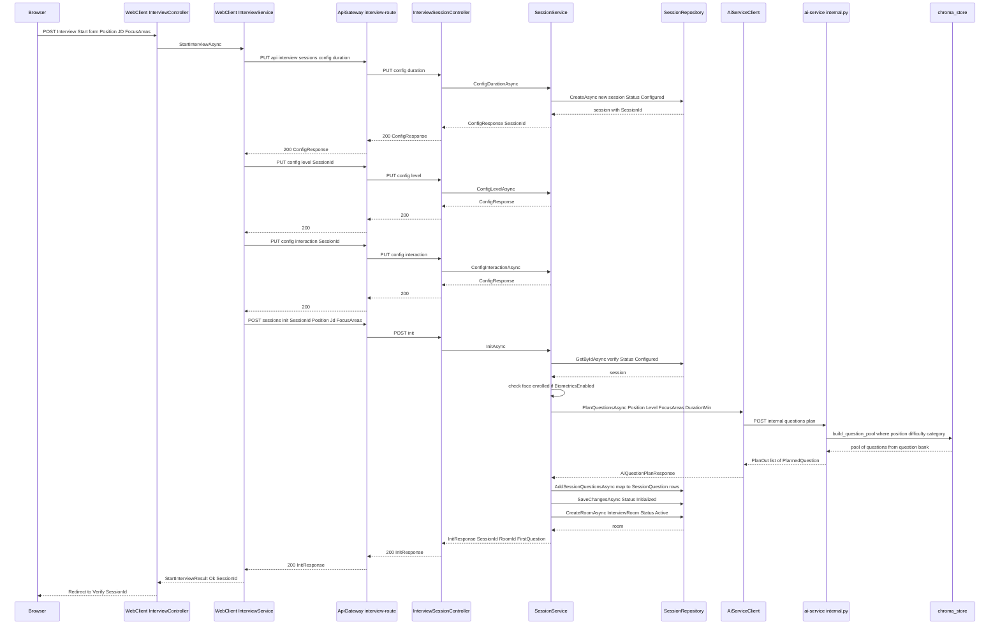
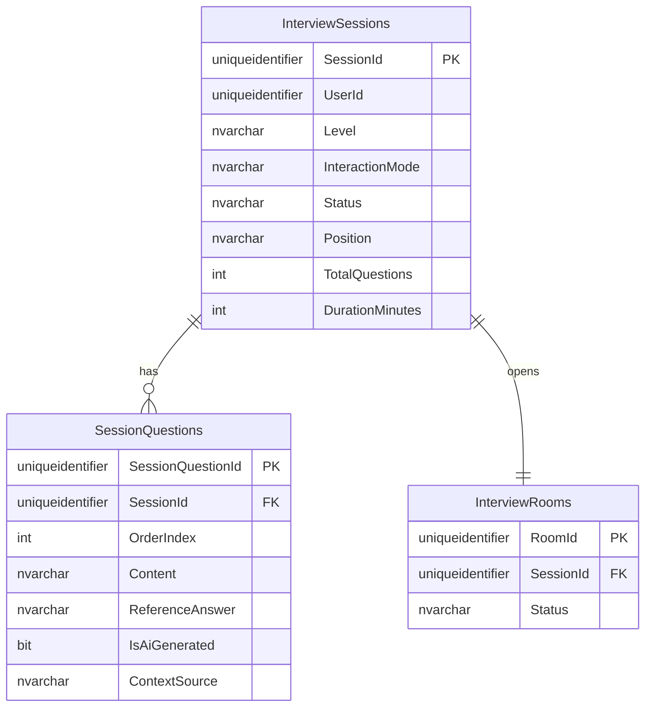
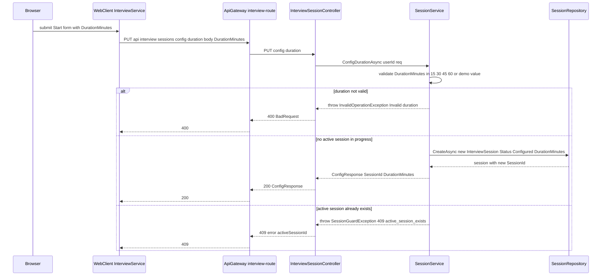
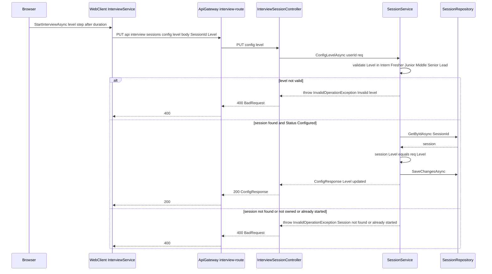
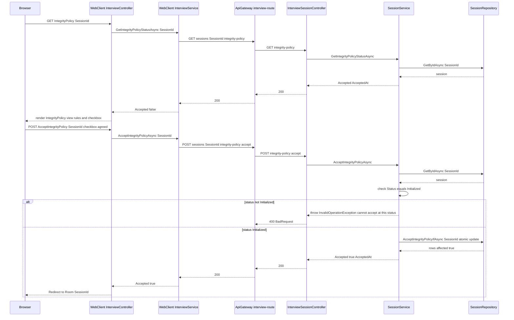

# G1 — Session Configuration

Batch: Phase 1. Components covered: InterviewAPI (`source/InterviewAPI/`), WebClient
(`source/WebClient/`), ai-service (`ai-service/`, question-bank retrieval only). All files cited
below were re-read directly for this batch, per the report's execution protocol (Phase 0 memory was
not relied on). This chapter incorporates the terminology corrections mandated after Phase 0.5
verification: question selection on this path is deterministic metadata-filtered retrieval, not
Retrieval-Augmented Generation (RAG) and not model-generated content; the Gemma-2B interviewer
model is not reachable from this or any deployed path (see F-01 §8 and `OPEN_QUESTIONS.md`).

---

## F-01. Configure Interview Session

### 1. Purpose and scope
This feature lets a candidate choose the job role, attach an optional job description (JD), and
pick technology focus areas before a mock interview begins, then commits that configuration by
creating a draft `InterviewSession` row and populating it with a question set drawn from a curated
question bank. It is the entry point of the configuration wizard; session **duration** and
**level** are configured as separate calls within the same wizard flow and are documented
separately as F-02 and F-03, because InterviewAPI exposes them as three independent `PUT`
endpoints rather than one combined form submission (`source/InterviewAPI/Controllers/
InterviewSessionController.cs:478,512,544`). This feature explicitly does **not** cover accepting
the integrity policy (F-04), starting the timer or deducting credit (both happen later, at first
question generation — see G2), or the biometric entry gate (G5).

### 2. Actors, preconditions, postconditions

| | |
|---|---|
| Actor | Authenticated candidate (JWT role not restricted beyond `[Authorize]` — no `Roles=` constraint on `InterviewSessionController`'s class attribute, `InterviewSessionController.cs:14`) |
| Precondition | Candidate is logged in (WebClient session cookie holds a valid `access_token`); candidate has no session currently in `Initialized`/`InProgress`/`Paused` status (enforced server-side, see §7 R2) |
| Precondition (soft, WebClient-side only) | Candidate has enrolled a face biometric — checked by `InterviewController.Start` before any API call (`source/WebClient/Controllers/Interview/InterviewController.cs:78-83`) and redirects to `Profile/Identity` if not; this is a UX convenience, not the enforcement point (see §10) |
| Postcondition (success) | A new `InterviewSessions` row exists with `Status="Initialized"`, an `InterviewRooms` row exists with `Status="Active"`, and `SessionQuestions` rows exist for every question in the drawn set; the browser is redirected to the biometric entry-gate screen (`Interview/Verify`), not directly into the Room |
| Postcondition (failure) | No `SessionQuestions` are persisted if ai-service failed to return questions (see §7 R4); a partially-configured `InterviewSessions` row in `Status="Configured"` may still exist, reusable on retry |

### 3. Architectural placement
Call chain: `Browser → WebClient InterviewController.Start (Controllers/Interview/
InterviewController.cs:71-117) → WebClient InterviewService.StartInterviewAsync (Services/
Interview/InterviewService.cs:120-194) → ApiGateway interview-route → InterviewAPI
InterviewSessionController → InterviewAPI SessionService → InterviewAPI SessionRepository /
Clients/AiServiceClient → ai-service app/api/internal.py plan_questions → ai-service
app/services/chroma_store.build_question_pool`.

The browser never calls the Gateway or ai-service directly. WebClient's `InterviewService` is a
typed `HttpClient` whose requests are intercepted by `JwtDelegatingHandler`
(`source/WebClient/Services/Shared/JwtDelegatingHandler.cs:38-60`), which reads the `access_token`
HttpOnly cookie, attaches it as a `Bearer` header, and refreshes it transparently if it is close to
expiry. This is the project's same-origin proxy pattern: the browser only ever talks to WebClient
over same-origin cookies, and WebClient — not client-side JavaScript — is the only component that
ever holds or forwards the JWT to the Gateway. The pattern exists so that a bearer token capable of
calling privileged internal-facing routes (e.g. the credit-deduction path in G2) never has to live
in browser-accessible storage. At the Gateway, `interview-route` maps `/api/interview/{**catch-all}`
to `interview-cluster` (InterviewAPI) **without** stripping the `/api/interview` prefix — because
`InterviewSessionController` declares its own `[Route("api/interview/sessions")]`
(`InterviewSessionController.cs:13`), the full path must reach the controller unmodified — and is
tagged with the `ai-backed` timeout policy (`source/ApiGateway/appsettings.json:66-73`), a longer
budget (90s in the base config, 300s in the Development override) reserved for routes whose
downstream call chain includes an ai-service round trip, which `init` does via question planning.

InterviewAPI's `InitAsync` (`source/InterviewAPI/Services/SessionService.cs:478-649`) is the
orchestration point: it re-validates ownership and session state, enforces the biometric
precondition server-side (defense-in-depth behind WebClient's own check, §10), calls ai-service to
draw the question set, persists the result as `SessionQuestion` rows, flips the session to
`Initialized`, and opens the `InterviewRoom`. ai-service's role here is narrow: it exposes a single
stateless endpoint, `POST /internal/questions/plan` (`ai-service/app/api/internal.py:49-63`), that
turns a `(position, level, focus_areas, duration_min, jd_text)` request into an ordered question
list — it holds no session state of its own for this flow (consistent with the project-wide rule
that SQL Server, not ai-service, is the single source of truth for question progress).

### 4. Interface contract

**WebClient-internal**: `POST /Interview/Start` (`InterviewController.cs:71-73`), form-encoded
`DashboardViewModel` (`Position`, `Level`, `DurationMinutes`, `Jd`, `JdId`, `FocusAreas`),
`[ValidateAntiForgeryToken]`. Not itself a JSON API — it re-renders `Views/Interview/Index.cshtml`
on failure or redirects on success/conflict.

**Gateway-facing** (three calls WebClient makes internally as part of one logical "Start"):

| Method | Route | Request DTO | Response DTO | Status codes |
|---|---|---|---|---|
| PUT | `api/interview/sessions/config/duration` | `ConfigDurationRequest {SessionId?, DurationMinutes}` (`DTOs/Session/ConfigDurationRequest.cs`) | `ConfigResponse {SessionId, UpdatedField, UpdatedValue}` | 200 (created/updated); 400 invalid duration or session-state guard failure; 409 `active_session_exists` with `activeSessionId` (only reachable when `SessionId` is omitted — see F-02); 503 unexpected |
| PUT | `api/interview/sessions/config/level` | `ConfigLevelRequest {SessionId?, Level}` | `ConfigResponse` | 200; 400 invalid level or guard failure; 503 unexpected |
| POST | `api/interview/sessions/init` | `InitRequest {SessionId, Position?, Jd?, JdId?, FocusAreas?}` (`DTOs/Session/InitRequest.cs:1-16`) | `InitResponse {SessionId, TotalQuestions, RoomId, FirstQuestion}` (`InitResponse.cs`) | 200; 503 `SessionInitDependencyException` ("Interview setup is temporarily unavailable"); 400 generic ("Could not start the interview session.") for every other failure — see §9 |

`InitRequest.Jd` carries the resolved JD text (shared with the Profile CV/JD page); `JdId` is
informational only on the InterviewAPI side (`InitRequest.cs:11-13`). `FocusAreas` is a free list of
technology strings validated only by the ai-service side matching them against indexed categories —
InterviewAPI performs no whitelist check on focus-area values.

Validation performed at `SessionService.InitAsync`: session must belong to the caller and be in
`Status="Configured"` (`SessionService.cs:481-485`); if `Biometrics:Enabled` is true, a `Face`-modality
row must already exist in `ProfileBiometrics` for the caller (`SessionService.cs:490-497`).

### 5. Processing flow
1. Candidate submits the dashboard form; `InterviewController.Start` first checks biometric
   enrollment status and redirects away if the face modality is missing
   (`InterviewController.cs:78-83`).
2. `InterviewService.StartInterviewAsync` issues `PUT config/duration` with no `SessionId`, which
   (via `SessionService.ConfigDurationAsync`, `SessionService.cs:365-408`) creates a new
   `InterviewSession` row (`Status="Configured"`) after confirming no active session exists
   (`ResolveSessionAsync`, `SessionService.cs:1799-1824`).
3. `StartInterviewAsync` issues `PUT config/level` with the new `SessionId`
   (`InterviewService.cs:169-174`); `SessionService.ConfigLevelAsync` (`SessionService.cs:410-442`)
   updates `InterviewSession.Level` in place.
4. `StartInterviewAsync` issues `PUT config/interaction` with a fixed literal `Text` or `Voice`
   mode (`InterviewService.cs:176-179`); `SessionService.ConfigInteractionAsync`
   (`SessionService.cs:444-476`) updates `InterviewSession.InteractionMode`.
5. `StartInterviewAsync` issues `POST sessions/init` (`InterviewService.cs:183-186`).
   `SessionService.InitAsync` loads and re-verifies the session (`SessionService.cs:481-485`),
   checks the biometric gate again server-side (`:490-497`), and persists the caller's chosen
   `Position`/`JdId` onto the session (`:505-508`).
6. `InitAsync` calls `AiServiceClient.PlanQuestionsAsync` (`SessionService.cs:531`, client at
   `Clients/AiServiceClient.cs:25`), which `POST`s to ai-service `/internal/questions/plan`
   (`ai-service/app/api/internal.py:49-63`).
7. ai-service's `plan_questions` builds a `SessionConfig` and calls
   `interviewer.build_interview_plan(cfg, chroma_store)` (`internal.py:52-56`). This function
   composes the pool from three tracks — core (by role or by chosen focus-area technologies),
   Problem-Solving (always present), and System-Design (only for Middle/Senior/Techlead levels) —
   each drawn via `chroma_store.build_question_pool`, an **exact-match ChromaDB metadata filter**
   (`_collection.get(where=...)`, `ai-service/app/services/chroma_store.py:219-251`); tracks are
   interleaved by `_weave` (`interviewer.py:345-363`) so a time-truncated session still sees a mix.
   **No embedding model computes a new vector and no language model generates or rewrites
   anything in this step** — see §8.
8. `InitAsync` maps each returned question to a `SessionQuestion` entity, storing the AI-service
   reference answer server-side only (`SessionService.cs:589-601`; `ReferenceAnswer` is never
   returned to the browser, matching the project-wide rule) and persists them in one batch
   (`AddSessionQuestionsAsync`, `Repositories/SessionRepository.cs:55-59`).
9. The session transitions to `Status="Initialized"` and `TotalQuestions` is set
   (`SessionService.cs:624-627`); an `InterviewRoom` row is created with `Status="Active"`
   (`:630-637`).
10. `InitResponse` is returned; WebClient redirects the browser to `Interview/Verify` (the entry
    gate), not the Room (`InterviewController.cs:113-116`) — the comment there notes credit is
    deducted only later, when the Room requests the first question (see G2).

*Figure 1.1 — Configure Interview Session, end-to-end sequence from Start to the entry-gate redirect.*

### 6. Data model impact
Tables written: `InterviewSessions` (INSERT at duration-config, UPDATE at level/interaction-config
and again at Init — `Level`, `InteractionMode`, `Position`, `JdId`, `Status`, `TotalQuestions`,
`UpdatedAt`; schema at `db/baseline/05_DevPrep_Interview.sql:91-124`, confirmed in Phase 0 §B),
`SessionQuestions` (batch INSERT, one row per planned question — `SessionQuestionId`, `SessionId`,
`OrderIndex`, `Content`, `ReferenceAnswer`, `IsAiGenerated=true`, `ContextSource="QuestionBank"`,
`AskedAt=null` — `SessionService.cs:591-601`), `InterviewRooms` (single INSERT,
`ChannelName="room-"+SessionId`, `Status="Active"` — `SessionService.cs:630-637`). No table is read
across a service boundary in this feature — everything above lives in InterviewAPI's own
`DevPrep_Interview` database (Phase 0 §A.1).

Concurrency: `ResolveSessionAsync`'s "no active session" check (`SessionService.cs:1802-1815`) is a
read-then-decide, not an atomic claim — two concurrent Start clicks from the same browser tab (e.g.
a double-submit) could both pass the check before either inserts. No unique constraint on
`(UserId, Status)` exists in the schema to close this race at the database level; the practical
mitigation is the WebClient form's normal single-submit behavior, not a server-side guarantee. This
is noted as a residual risk in §10, not asserted as exploited.

*Figure — ER fragment for F-01's write set (informal figure, embedded in this section only).*

### 7. Business rules and invariants
- **R1** — A session can only be initialized from `Status="Configured"`; re-calling `init` on an
  already-initialized session throws `InvalidOperationException("Session already initialized.")`
  (`SessionService.cs:484-485`). Not idempotent by design: a second `init` call for the same
  session does not return the existing question set, it fails.
- **R2** — At most one non-terminal session (`Configured` is exempt — only `Initialized`/
  `InProgress`/`Paused` count) per user at a time, enforced only at the point a *new* session would
  be created (`ResolveSessionAsync`, `SessionService.cs:1802-1815`), by a read of
  `GetActiveSessionAsync` immediately before insert — not by a database constraint. See §6 for the
  race-condition caveat.
- **R3** — The biometric entry precondition is checked twice: once for UX in WebClient
  (`InterviewController.cs:78-83`) and once, authoritatively, server-side in `InitAsync`
  (`SessionService.cs:490-497`) — the code comment explicitly frames the second check as unbypassable
  by direct API calls (`SessionService.cs:487-488`).
- **R4** — If ai-service returns zero questions, `InitAsync` aborts before any `SessionQuestion` is
  persisted and before the session status changes (`SessionService.cs:580-587`), leaving the
  session in `Status="Configured"` so the candidate can retry rather than being left with a
  half-initialized, unusable session.
- **R5** — `ReferenceAnswer` is persisted on `SessionQuestion` but is never included in any
  response DTO returned by this feature's endpoints — confirmed by reading `InitResponse.cs` (only
  `FirstQuestion` text, no reference answer field) and the explicit comment at
  `SessionService.cs:590`.

### 8. AI/ML component
**AI/ML component: none on the primary path — question selection in this feature is deterministic.**
`build_interview_plan` → `build_question_pool` (`ai-service/app/services/interviewer.py:366-420`,
`ai-service/app/services/chroma_store.py:219-251`) selects questions by an **exact-match metadata
filter** (`_collection.get(where={"position": ..., "difficulty": ..., "category": {"$in": [...]}})`)
against a curated, pre-indexed question bank — no embedding of the request is computed, no
similarity ranking is performed, and no language model writes, rewrites, or generates any question
text. The correct term for this mechanism is **deterministic metadata-filtered retrieval from a
curated question bank**; it is not Retrieval-Augmented Generation (RAG — reserved in this report for
the genuine semantic-similarity retrieval used in answer grading, documented in G3/G6), it does not
"generate" questions, and no model "selects" anything — the selection logic is ordinary
conditional/filter code. The vector store (ChromaDB) is used here purely as a filtered document
store keyed on structured metadata, not as a semantic index.

**Design trade-off** (stated plainly, not from a code comment): drawing exclusively from a
human-curated, pre-vetted question bank buys provenance and quality control — every question a
candidate sees has been reviewed and tagged by position/difficulty/category ahead of time, with no
risk of a generative model inventing an incorrect or nonsensical question — at the cost of item
diversity and adaptivity: the same bank serves every candidate at a given (position, level, focus)
combination, and the pool cannot expand itself to cover a JD's specific wording or a focus area with
few indexed items.

**The one genuine ML touch on this path** is `_drop_near_duplicates`
(`chroma_store.py:197-216`), which removes paraphrase-duplicate questions from a single session's
drawn pool:
- **a. Model identity**: `BAAI/bge-m3` via `chromadb.utils.embedding_functions.
  SentenceTransformerEmbeddingFunction` (`chroma_store.py:26,34`) — the same embedding model used
  to index the question bank at ingestion time (Hugging Face Hub, multilingual, no query/passage
  prefix convention required per the code comment at `chroma_store.py:24`).
- **b. Architectural family, plain language**: a sentence-embedding transformer maps a passage of
  text to a fixed-length vector such that texts with similar meaning end up as nearby vectors;
  BGE-M3 is trained with a contrastive objective (pulling paraphrase/translation pairs together,
  pushing unrelated text apart) so cosine similarity between two vectors approximates semantic
  similarity between the two texts.
- **c. Input pipeline**: no live embedding is computed during this feature's request — the vectors
  compared were computed **once, at question-bank ingestion time**, and are simply fetched back
  alongside each candidate row (`res = _collection.get(..., include=["documents","metadatas",
  "embeddings"])`, `chroma_store.py:242`).
- **d. Output representation**: dense float vectors, L2-normalized inside `_drop_near_duplicates`
  before comparison (`v = v / norm`, `chroma_store.py:211`); dimensionality is BGE-M3's native
  output size, not independently re-verified in this pass; stored inside ChromaDB's own on-disk
  index, not in any InterviewAPI table.
- **e. Decision rule**: greedy pairwise cosine similarity against every question already kept in
  the pool; a candidate is dropped if $\mathrm{sim}(\mathbf{v}, \mathbf{v}_{\text{kept}}) \geq
  \tau$ for any kept vector, computed as `(kept_mat @ v).max() >= NEAR_DUP_THRESHOLD`
  (`chroma_store.py:212`).
- **f. Threshold provenance**: `NEAR_DUP_THRESHOLD = 0.92` (`chroma_store.py:31`), with an
  in-code comment stating only "Tune 0.85-0.95 if needed" (`chroma_store.py:30`) — **heuristic,
  not derived from a labelled paraphrase-detection evaluation**; no FAR/FRR/EER-style calibration
  evidence exists for this value in the repository. Reported honestly as uncalibrated.
- **g–h. Prompt/RAG pipeline**: not applicable — this is a similarity filter over pre-computed
  vectors, not a prompted generation step and not a retrieval-into-a-prompt step.
- **i. Runtime characteristics**: runs inside ai-service's single-worker process
  (`ai-service/Dockerfile:76`, `--workers 1`), on CPU or GPU depending on host availability for the
  embedding model load (`SentenceTransformerEmbeddingFunction` defaults follow the installed
  `sentence-transformers`/`torch` device selection; not independently re-verified for this specific
  call path in this pass). No per-call timeout specific to this step was found; it is bounded only
  by the Gateway's `ai-backed` route timeout (90s base / 300s Development).
- **j. Known weaknesses**: the near-duplicate filter only compares within a single freshly-drawn
  pool (`interviewer.py:407-409` comment: "does not see across tracks or the top-up pass"), so a
  second, separate top-up query can reintroduce a duplicate that a later exact-ID/text pass then
  catches (`SessionService`-side dedup is not present; the text-level fallback dedup happens in
  `build_interview_plan` itself, `interviewer.py:410-419`).
- **k. Academic grounding**: BGE-M3 — Chen et al., "BGE M3-Embedding: Multi-Lingual, Multi-Functionality,
  Multi-Granularity Text Embeddings Through Self-Knowledge Distillation" `[CITATION TO VERIFY]`.

**On the Gemma-2B interviewer model**: this feature does **not** invoke `GemmaChat`
(`ai-service/app/services/interviewer.py:276-335`). That model is instantiated only inside
`create_session` (`interviewer.py:423-430`), which is called exclusively from ai-service's own
`POST /interview/start` handler (`ai-service/app/api/interview.py:73-75`) — a separate, stateful,
unauthenticated router that this feature's call chain never reaches (`AiServiceClient.cs`'s only
`/interview/*` call is `/interview/tts`, used elsewhere for voice playback, not here).
**Status: Trained and evaluated; not integrated into the deployed request path.** No VRAM-capacity
or other rationale for this is recorded anywhere in the codebase — `ai-service/Dockerfile:75-76`
reserves GPU access with `deploy.resources.reservations.devices: count: all` (no VRAM limit stated),
and no comment near `create_session`, `GemmaChat`, or the Dockerfile explains why the conversational
model was left unwired. This is logged as an open question rather than assumed
(`OPEN_QUESTIONS.md` §7); it is not re-argued here.

### 9. Failure modes and edge cases

| Scenario | System behaviour | Evidence | User-visible result |
|---|---|---|---|
| Invalid `DurationMinutes` (not 15/30/45/60, demo flag off) | `ConfigDurationAsync` throws `InvalidOperationException`, controller returns 400 with the specific message | `SessionService.cs:378-379`, `InterviewSessionController.cs:498-501` | "Invalid duration. Must be 15, 30, 45, or 60." |
| Invalid `Level` | Same pattern | `SessionService.cs:412-413`, `InterviewSessionController.cs:530-533` | "Invalid level." |
| Second Start while a session is `Initialized`/`InProgress`/`Paused` | `ResolveSessionAsync` throws `SessionGuardException(409, "active_session_exists", ...)` carrying the existing `SessionId` | `SessionService.cs:1809-1813` | WebClient sets `TempData["RoomInfoMessage"]` and redirects straight into the existing Room (`InterviewController.cs:89-98`) — not an error page |
| Face not enrolled, WebClient's own pre-check somehow bypassed (e.g. direct API call to `init`) | `InitAsync` throws `InvalidOperationException("Please enroll your face before starting an interview.")` — but the **`Init` controller action has no dedicated `catch(InvalidOperationException)`**, only `SessionInitDependencyException` and a generic catch-all | `SessionService.cs:495-496`; `InterviewSessionController.cs:752-766` (only two catch blocks) | Browser receives a **generic** 400 "Could not start the interview session." — the specific reason is logged server-side only, not surfaced to the user |
| ai-service unreachable/timeout during `PlanQuestionsAsync` | `SessionInitDependencyException` thrown and mapped explicitly | `SessionService.cs:528-543`; `InterviewSessionController.cs:752-758` | 503 "Interview setup is temporarily unavailable. Please try again shortly." |
| ai-service responds with zero questions | Init aborts before persisting anything, session stays `Configured` | `SessionService.cs:580-587` | Generic 400 "Could not start the interview session." (falls into the same catch-all as the biometric case above — same limitation) |
| Gateway `ai-backed` timeout exceeded (90s base config) before ai-service responds | Gateway itself returns a timeout response before InterviewAPI's own exception handling can run | `source/ApiGateway/appsettings.json:66-73` (route-level `TimeoutPolicy`) | Generic error surfaced by WebClient's own HTTP failure handling, not a purpose-authored message from this feature — `[UNVERIFIED: exact WebClient behavior on a Gateway-level timeout was not traced in this pass]` |
| Rapid double-submit of the Start form | Two `ConfigDurationAsync` calls may both pass the "no active session" read before either writes, per §6 | `SessionService.cs:1802-1815` (read-then-decide, no DB constraint) | Two `Configured` sessions could be created; no observed crash, but a residual data-quality risk, not exercised in this pass — `[UNVERIFIED: not reproduced, reasoned from code structure only]` |

### 10. Security and integrity considerations
Authentication is enforced by `[Authorize]` at the controller class level
(`InterviewSessionController.cs:14`) with no role restriction, so any authenticated account may
configure a session. IDOR protection: `ResolveSessionAsync` and `InitAsync` both check
`session.UserId != userId` before allowing any mutation (`SessionService.cs:1819-1820,482-483`),
so a caller cannot configure or initialize a session that belongs to another account even with a
guessed `SessionId`. Input validation is a hardcoded whitelist for `DurationMinutes` and `Level`
(§7), not a shared validation library, consistent with the project convention of inline validation.
The biometric-enrollment gate is enforced twice — once for UX (WebClient) and once authoritatively
server-side (InterviewAPI) — which is the correct pattern precisely because the WebClient check
alone would be trivially bypassable by calling the Gateway API directly with a valid JWT.

`FocusAreas` values are not validated against the ai-service catalog on the InterviewAPI side; an
arbitrary string list is forwarded as-is to `/internal/questions/plan`. This is a low-severity gap
(worst case, an unmatched focus area simply contributes nothing to the drawn pool via
`build_question_pool`'s `$in` filter finding no matches) but is noted for completeness.

### 11. Limitations and future work
- No database-level uniqueness constraint prevents two concurrent Start requests from creating two
  `Configured` sessions for the same user (§6, §9) — grounded in the absence of any unique index on
  `(UserId, Status)` in `db/baseline/05_DevPrep_Interview.sql` (cross-checked against the full
  schema read in Phase 0).
- The generic 400 response on `Init` failure paths that are not `SessionInitDependencyException`
  discards the specific, already-authored error message thrown by `SessionService.InitAsync`
  (§9) — a code-hygiene gap, not a functional one, since WebClient's own pre-checks make most of
  these paths unreachable through the normal UI.
- The Gemma-2B LoRA interviewer model exists in the repository, fully trained, but is not
  integrated into this or any other deployed feature (§8); no rationale for this is recorded in
  the codebase (`OPEN_QUESTIONS.md` §7).
- `NEAR_DUP_THRESHOLD=0.92` is an uncalibrated heuristic (§8f).

### 12. Figures
Figure 1.1 (sequence diagram, `diagrams/FIG-1.1.mmd`); ER fragment in §6 (inline only, not
separately numbered); Figure 1.5 (screenshot — session-configuration form, see
`SCREENSHOT_CHECKLIST.md`).

---

## F-02. Configure Session Duration

### 1. Purpose and scope
Lets the candidate pick how long the interview should run (15/30/45/60 minutes, plus a
flag-gated 5-minute demo duration), which InterviewAPI translates into both a question-pool size
target (via ai-service, in F-01) and a fixed credit cost (`CreditConfig.GetCreditCost`,
`source/InterviewAPI/Helpers/CreditConfig.cs:30-36`). It does not perform the credit deduction
itself — deduction happens later, at first question generation (documented in G2) — this feature
only records the chosen duration and, when called with no existing session, creates the draft
`InterviewSession` row that the rest of the configuration wizard (F-01 steps 3–5) then updates.

### 2. Actors, preconditions, postconditions

| | |
|---|---|
| Actor | Authenticated candidate, `[Authorize]` (`InterviewSessionController.cs:14`) |
| Precondition | No non-terminal session already exists, **only when this call is the one creating a new session** (i.e. no `SessionId` supplied) |
| Postcondition | A `Configured`-status `InterviewSession` row exists (new or updated) with `DurationMinutes` set to the requested value |

### 3. Architectural placement
Same call chain as F-01: `Browser → WebClient InterviewController.Start → WebClient
InterviewService.StartInterviewAsync (first of the three config calls) → ApiGateway interview-route
→ InterviewSessionController.ConfigDuration → SessionService.ConfigDurationAsync →
SessionRepository`. This is the only one of the three `config/*` calls WebClient makes without
a `SessionId` (`InterviewService.cs:128-131`), which is why it is the only one that can observe the
409 "already have a session in progress" guard in the Start flow's normal usage pattern — the
guard itself is generic to all three endpoints' shared `ResolveSessionAsync` helper
(`SessionService.cs:1799-1824`), so a direct API call to `config/level` or `config/interaction`
without a `SessionId` would trigger the identical 409, it simply does not happen through the
WebClient UI.

### 4. Interface contract
`PUT api/interview/sessions/config/duration`, body `ConfigDurationRequest {SessionId?: Guid,
DurationMinutes: int}` (`DTOs/Session/ConfigDurationRequest.cs`). Response `ConfigResponse
{SessionId, UpdatedField="DurationMinutes", UpdatedValue}` (`DTOs/Session/ConfigResponse.cs`).
Status codes: 200 success; 400 `"Invalid duration. Must be 15, 30, 45, or 60."` when the value is
outside the whitelist (or the demo value while `DEMO_SESSION_ENABLED` is off — see §7); 400
`"Session not found."` / `"Session already started."` when a supplied `SessionId` fails ownership
or status checks (`SessionService.cs:1818-1823`); 409 `active_session_exists` (only when
`SessionId` is omitted and an active session already exists); 503 unexpected server error.

### 5. Processing flow
1. WebClient sends the raw `PUT` with only `DurationMinutes` (no `SessionId` yet) —
   `InterviewService.cs:128-131`.
2. `ConfigDurationAsync` first checks whether the demo duration path applies
   (`DemoSession.IsDemoDuration`, `SessionService.cs:376`, gated on config key
   `DEMO_SESSION_ENABLED`, default false — `Helpers/DemoSession.cs:26-27`), otherwise validates
   against the fixed whitelist `{15, 30, 45, 60}` (`SessionService.cs:59,378-379`).
3. `ResolveSessionAsync` is called with `factory` producing a brand-new `InterviewSession` with
   sensible defaults (`Level="Junior"`, `InteractionMode="Text"`, `QuestionType="Mixed"`,
   `Status="Configured"`) and the requested `DurationMinutes` (`SessionService.cs:381-393`).
4. Since no `SessionId` was supplied, `ResolveSessionAsync` checks for an existing active session
   via the service-level `GetActiveSessionAsync` (which itself first auto-closes any session whose
   time has already expired, `SessionService.cs:1806-1809` comment) and, finding none, persists the
   new row (`Repositories/SessionRepository.cs:48-53`).
5. `ConfigResponse` is returned with the new `SessionId`, which WebClient threads through the
   subsequent level/interaction/init calls (§F-01 steps 3–5).

*Figure 1.2 — Configure Session Duration sequence, including the two guarded branches.*

### 6. Data model impact
Writes `InterviewSessions.DurationMinutes` (and, on the create branch, the full row). No other
table is touched. No cross-table relationship is exercised by this feature alone (single-table
write), so no ER fragment is included here beyond the one already shown in F-01 §6.

### 7. Business rules and invariants
- **R1** — `DurationMinutes` must be exactly one of `{15, 30, 45, 60}`, or `5` when
  `DEMO_SESSION_ENABLED=true` (`Helpers/DemoSession.cs:33-34`; the demo path is explicitly marked
  in-code as temporary, "TEMPORARY CODE FOR ONE PRESENTATION... Delete this whole file when the
  defence is over" — `DemoSession.cs:5`). With the flag off, `5` is rejected exactly as any other
  out-of-whitelist value (`DemoSession.cs:30-31` comment).
- **R2** — Calling this endpoint with a `SessionId` on a session that is not `Status="Configured"`
  fails with `"Session already started."` (`SessionService.cs:1821-1822`) — a session's duration
  cannot be changed once configuration is complete and the session has moved on.
- **R3** — Idempotent when a `SessionId` is supplied and the session is still `Configured`: calling
  it twice with the same duration produces the same end state (an `UPDATE` to the same value).
  **Not** idempotent when `SessionId` is omitted: each such call, if it succeeds, creates a new
  session row.
- **R4** — Credit cost is derived from duration via a fixed lookup table, not charged at this step:
  `CreditConfig.DurationToCreditCost` maps `15→30, 30→60, 45→90, 60→120` credits (`2 credits/minute`,
  `Helpers/CreditConfig.cs:16-27`), mirrored (and explicitly noted as manually kept in sync, since
  WebClient and InterviewAPI share no assembly) in `WebClient/Helpers/CreditPricing.cs:3-16` for
  display purposes on the dashboard only.

### 8. AI/ML component
Not applicable — no model, embedding, or ai-service call occurs anywhere in this feature's own
processing path.

### 9. Failure modes and edge cases

| Scenario | System behaviour | Evidence | User-visible result |
|---|---|---|---|
| Duration outside whitelist | 400 with specific message | `SessionService.cs:378-379` | "Invalid duration. Must be 15, 30, 45, or 60." |
| Demo duration (5) requested while flag off | Falls through to the whitelist check and is rejected identically to any invalid value | `DemoSession.cs:30-34` | Same 400 as above — no distinct message for the demo case |
| Concurrent Start clicks (double-submit) with no `SessionId` | Both may pass the active-session read before either writes (read-then-decide, no DB constraint) | `SessionService.cs:1802-1815` | Possible duplicate `Configured` sessions — `[UNVERIFIED: not reproduced]`, same caveat as F-01 §9 |
| Balance insufficient for the chosen duration | **Not enforced by this endpoint at all** — affordability is only checked client-side for UI purposes (`Views/Interview/Index.cshtml:147-150`, disables the `<option>`); the authoritative credit check happens later, at first question generation (G2) | `Index.cshtml:144-166` (client-side disabling only); no server-side balance check found in `ConfigDurationAsync` | A crafted direct API call with a duration the user cannot afford is accepted here and only rejected later, at Room entry — see G2 |

### 10. Security and integrity considerations
IDOR protection via `session.UserId != userId` on the update branch (`SessionService.cs:1819-1820`).
No credit/affordability check at this layer (§9) is a deliberate layering choice, not an oversight —
the authoritative check is documented to live at question-generation time (G2) — but it does mean
this endpoint alone offers no evidence of insufficient-balance handling; that must be verified in
the G2 chapter rather than assumed here.

### 11. Limitations and future work
Same double-submit / missing unique-constraint caveat as F-01 §11. The demo-duration branch is
explicitly temporary, in-code, and should be deleted after the thesis defence per its own comment
(`DemoSession.cs:5-6`, referencing a `docs/architecture/demo-session-removal.md` follow-up not
independently verified in this pass — `[UNVERIFIED: file existence not checked]`).

### 12. Figures
Figure 1.2 (sequence diagram, `diagrams/FIG-1.2.mmd`).

---

## F-03. Configure Level

### 1. Purpose and scope
Lets the candidate pick the seniority level the interview should target (Intern through Lead),
which InterviewAPI stores on the draft session and later passes to ai-service's question-bank
filter (F-01) to select difficulty-appropriate questions and to decide whether the System-Design
track is included (`SYSTEM_DESIGN_LEVELS = {middle, senior, techlead}`,
`ai-service/app/services/interviewer.py:37`). It does not itself talk to ai-service.

### 2. Actors, preconditions, postconditions

| | |
|---|---|
| Actor | Authenticated candidate, `[Authorize]` |
| Precondition | If a `SessionId` is supplied, that session must belong to the caller and be `Status="Configured"` |
| Postcondition | `InterviewSession.Level` is set to one of the six valid values |

### 3. Architectural placement
Identical chain shape to F-02: `Browser → WebClient InterviewController.Start →
InterviewService.StartInterviewAsync (second call, always with the SessionId from F-02) →
ApiGateway interview-route → InterviewSessionController.ConfigLevel →
SessionService.ConfigLevelAsync → SessionRepository`.

### 4. Interface contract
`PUT api/interview/sessions/config/level`, body `ConfigLevelRequest {SessionId?: Guid, Level:
string}`. Response `ConfigResponse {SessionId, UpdatedField="Level", UpdatedValue}`. Status codes:
200; 400 `"Invalid level."` for any value outside the whitelist; 400 `"Session not found."` /
`"Session already started."` on ownership/state failure; 409 `active_session_exists` if called
without a `SessionId` while an active session exists (see F-02 §3 for why this branch is not
exercised by WebClient's own usage pattern); 503 unexpected.

### 5. Processing flow
1. WebClient calls this endpoint with the `SessionId` returned by the duration step
   (`InterviewService.cs:169-172`).
2. `ConfigLevelAsync` validates `req.Level` against the fixed array `{"Intern", "Fresher",
   "Junior", "Middle", "Senior", "Lead"}` (`SessionService.cs:60,412-413`). **Correction (previously
   claimed to match the SQL `CK_Sess_Level` check constraint — this was wrong.** Before migration
   `013_widen_ck_sess_level_add_fresher.sql`, the constraint
   (`db/baseline/05_DevPrep_Interview.sql:427-429`) allowed only `{Intern, Junior, Middle, Senior,
   Lead}` — `Fresher` was missing. A request with `Level="Fresher"` passed this C# check and then
   failed at `SaveChangesAsync` with a `CHECK` constraint violation, caught by the generic
   `catch (Exception)` in `InterviewSessionController.ConfigLevel` and surfaced to the user as a
   503 `"Could not save the interview level."` — not the 400 `"Invalid level."` this section
   originally implied. Git history shows `"Fresher"` was in `ValidLevels` from the first commit
   that added `SessionService.cs` (2026-07-04), five weeks before the baseline SQL file entered the
   repo (2026-08-12) already missing it — the constraint was the stale side, now fixed by migration
   013.)
3. `ResolveSessionAsync` loads the existing session by id, checks ownership and
   `Status="Configured"` (`SessionService.cs:1818-1823`).
4. `session.Level` is updated and saved (`SessionService.cs:429-434`).

*Figure 1.3 — Configure Level sequence.*

### 6. Data model impact
Writes `InterviewSessions.Level` only. The SQL-level `CHECK` constraint `CK_Sess_Level`
(`db/baseline/05_DevPrep_Interview.sql:427-429`) is a second enforcement layer beneath the
application whitelist — even a write that bypassed `SessionService` entirely would be rejected by
the database. As of migration `013_widen_ck_sess_level_add_fresher.sql`
(`source/InterviewAPI/Sql/013_widen_ck_sess_level_add_fresher.sql`) the two layers agree; before
that migration is applied to a given database, this layer silently rejected `Level="Fresher"` even
though the application whitelist accepted it (see §5.2 correction above).

### 7. Business rules and invariants
- **R1** — `Level ∈ {Intern, Fresher, Junior, Middle, Senior, Lead}`, enforced in application code
  (`SessionService.cs:412-413`) and, once migration 013 is applied, identically in the database
  schema (`CK_Sess_Level`). **Do not re-derive this pairing without checking the live constraint
  definition** — the two were out of sync (DB missing `Fresher`) from the constraint's first
  appearance in the repo until migration 013; a database that has not run that migration still
  disagrees with the application whitelist.
- **R2** — Only callable on a `Configured` session; not idempotent across session states for the
  same reason as F-02 R2/R3 (idempotent while `Configured`, otherwise rejected).
- **R3** — The chosen level later gates the System-Design question track
  (`SYSTEM_DESIGN_LEVELS = {"middle","senior","techlead"}`, `interviewer.py:37`) — note the
  lowercase, non-`Lead`-inclusive set on the ai-service side versus the six-value, `Lead`-inclusive
  set validated on the InterviewAPI side; `techlead` does not appear anywhere in InterviewAPI's
  `ValidLevels` array. **This is a naming mismatch worth flagging**: InterviewAPI's whitelist has
  no `"techlead"` value, so `SYSTEM_DESIGN_LEVELS`'s `"techlead"` member can never be matched by a
  level that actually reaches ai-service through this feature's validated input — only `"middle"`
  and `"senior"` (lowercased from `"Middle"`/`"Senior"`) are reachable. Logged as a new open
  question rather than silently reconciled (`OPEN_QUESTIONS.md` §8).

### 8. AI/ML component
Not applicable to this feature's own processing (no model call). The level value it stores is
consumed by a model-free filter in a later feature (F-01), not by this one.

### 9. Failure modes and edge cases

| Scenario | System behaviour | Evidence | User-visible result |
|---|---|---|---|
| Level outside whitelist | 400 specific message | `SessionService.cs:412-413` | "Invalid level." |
| Called on an already-`Initialized` session | Rejected | `SessionService.cs:1821-1822` | "Session already started." |
| `"Lead"` selected (System-Design track) | Reaches ai-service as `level="Lead"`, lowercased to `"lead"`, which is **not** in `SYSTEM_DESIGN_LEVELS` | `interviewer.py:37`, `interviewer.py:341` (`level.lower() in SYSTEM_DESIGN_LEVELS`) | A candidate configured at `Lead` level does not receive System-Design questions, only `Middle`/`Senior` candidates do — counter to what a reader might expect from the level name alone; see R3 |

### 10. Security and integrity considerations
Same IDOR/ownership protection pattern as F-02 (`session.UserId != userId` check inside
`ResolveSessionAsync`). No additional considerations specific to this feature.

### 11. Limitations and future work
The `Lead`/`techlead` mismatch (§7 R3, §9) means the System-Design track's level gate does not
behave as its own naming would suggest; recommend either adding `"techlead"` as a distinct level
value the UI can select, or renaming `SYSTEM_DESIGN_LEVELS`'s member to `"lead"` to match
InterviewAPI's actual whitelist — a decision for the code owner, not made here.

### 12. Figures
Figure 1.3 (sequence diagram, `diagrams/FIG-1.3.mmd`).

---

## F-04. Accept Integrity Policy

### 1. Purpose and scope
Presents the candidate with the platform's exam-integrity rules (camera visibility, single
participant, no external assistance, voice-answer verification, non-pausable timer semantics, and
a stated 3-violation termination cap) and records explicit consent before the candidate can enter
the interview Room. It does not itself enforce any of the rules it describes — camera/voice/tab
monitoring are separate features (G5) — this feature is purely the consent gate.

### 2. Actors, preconditions, postconditions

| | |
|---|---|
| Actor | Authenticated candidate, `[Authorize]` |
| Precondition | Session exists, belongs to the caller, and is `Status="Initialized"` (i.e. F-01 has already run) |
| Postcondition | `InterviewSessions.IntegrityPolicyAccepted=true` and `IntegrityPolicyAcceptedAt` is set; browser proceeds to the Room |

### 3. Architectural placement
`Browser → WebClient InterviewController.IntegrityPolicy / AcceptIntegrityPolicy
(Controllers/Interview/InterviewController.cs:166-201) → WebClient InterviewService → ApiGateway
interview-route → InterviewSessionController.GetIntegrityPolicyStatus / AcceptIntegrityPolicy
(InterviewSessionController.cs:250-282) → SessionService.GetIntegrityPolicyStatusAsync /
AcceptIntegrityPolicyAsync (SessionService.cs:1995-2029) → SessionRepository`. This is a pure
InterviewAPI feature with no ai-service or cross-service dependency, which is why it carries no
`ai-backed` significance at the Gateway beyond the route-wide `interview-route` timeout policy
already assigned to the whole `/api/interview/*` prefix.

### 4. Interface contract

| Method | Route | Response | Status codes |
|---|---|---|---|
| GET | `api/interview/sessions/{id}/integrity-policy` | `IntegrityPolicyStatusResponse {Accepted, AcceptedAt}` | 200; 404 if session not found for caller (`KeyNotFoundException`, `InterviewSessionController.cs:259-262`) |
| POST | `api/interview/sessions/{id}/integrity-policy/accept` | `IntegrityPolicyStatusResponse` | 200; 404 not found; 400 `"Session cannot accept policy at this status."` if not `Initialized` |

No request body on either call — `id` is a route parameter, the caller is identified from the JWT.

### 5. Processing flow
1. After F-01's redirect chain passes through the biometric entry gate (G5), WebClient's
   `IntegrityPolicy` action calls `GetIntegrityPolicyStatusAsync`
   (`InterviewController.cs:166-169`).
2. `SessionService.GetIntegrityPolicyStatusAsync` loads the session, verifies ownership, and
   returns the current `Accepted`/`AcceptedAt` values as-is (`SessionService.cs:1995-2006`) — no
   state change on the GET.
3. If already accepted, WebClient redirects straight to the Room without re-showing the dialog
   (`InterviewController.cs:176-179`); otherwise it renders `Views/Interview/IntegrityPolicy.cshtml`
   with explicit no-cache headers (`InterviewController.cs:181-184`) so a back-button navigation
   cannot show a stale cached copy of the page after acceptance.
4. The candidate must check the consent checkbox before the "Enter Interview" submit button is
   enabled — enforced client-side only, by inline `<script>` toggling `enter-btn.disabled`
   (`Views/Interview/IntegrityPolicy.cshtml`, checkbox `#agree-checkbox` gating button `#enter-btn`).
5. On submit, `AcceptIntegrityPolicyAsync` re-verifies ownership and re-checks
   `Status="Initialized"` (`SessionService.cs:2010-2015`), then performs an atomic conditional
   update, `AcceptIntegrityPolicyIfAsync` (`Repositories/SessionRepository.cs:261-270`), which only
   flips the flag if it is not already true (`WHERE ... && !s.IntegrityPolicyAccepted`) — making the
   write itself idempotent at the database layer regardless of how many times the endpoint is hit.
6. WebClient redirects to the Room.

*Figure 1.4 — Accept Integrity Policy sequence, GET status then POST accept.*

### 6. Data model impact
Writes `InterviewSessions.IntegrityPolicyAccepted` and `IntegrityPolicyAcceptedAt` via
`AcceptIntegrityPolicyIfAsync`'s `ExecuteUpdateAsync` (`SessionRepository.cs:263-267`) — a
single-statement conditional UPDATE, not a read-then-save, which is what makes the acceptance
itself race-safe under concurrent duplicate submits (unlike F-01/F-02's session-creation race).

### 7. Business rules and invariants
- **R1** — Acceptance is only possible from `Status="Initialized"` (`SessionService.cs:2014-2015`)
  — cannot be accepted before F-01 has run, and (implicitly) cannot be re-accepted once the session
  has moved past `Initialized` into `InProgress`.
- **R2** — The write is idempotent at the database layer: `AcceptIntegrityPolicyIfAsync`'s `WHERE`
  clause excludes rows where `IntegrityPolicyAccepted` is already true
  (`SessionRepository.cs:264`), so a duplicate POST (e.g. a double-click or a replayed request)
  updates zero rows on the second call rather than overwriting `IntegrityPolicyAcceptedAt` with a
  later timestamp.
- **R3** — This check is the second of two server-side integrity gates a request must clear before
  question content can be served — the first being the biometric entry gate (G5), the second being
  this policy acceptance, both re-verified independently inside `GenerateQuestionAsync`
  (`SessionService.cs:661-677`, cross-referenced from G1 to G2) so that neither can be skipped by a
  direct API call that jumps straight to requesting a question.

### 8. AI/ML component
Not applicable — no model or ai-service call in this feature. (The "AI Monitoring Active" info
panel shown in the policy dialog, `Views/Interview/IntegrityPolicy.cshtml:88-94`, is descriptive
copy about *other* features — G5's camera/voice checks — not something this feature itself invokes.)

### 9. Failure modes and edge cases

| Scenario | System behaviour | Evidence | User-visible result |
|---|---|---|---|
| Session not found / not owned | `KeyNotFoundException` → 404 | `SessionService.cs:1998-1999,2011-2012`; `InterviewSessionController.cs:259-262,274-276` | WebClient sets `TempData["ErrorMessage"]` and redirects to the dashboard (`InterviewController.cs:172-174`) |
| Accept called before `Initialized` (e.g. session still `Configured`) | 400 with specific message | `SessionService.cs:2014-2015`; `InterviewSessionController.cs:278-281` | "Session cannot accept policy at this status." |
| Back-button navigation after acceptance | Explicit no-cache headers on the GET prevent a stale unaccepted view from rendering | `InterviewController.cs:181-184` | Browser re-fetches; since `Accepted=true` server-side, the action redirects straight to the Room instead of re-showing the form |
| Double-submit of the Accept form | Second write is a no-op at the DB layer (§7 R2) | `SessionRepository.cs:261-270` | No error, no duplicate side effect — silently idempotent |

### 10. Security and integrity considerations
IDOR protection via the same `session.UserId != userId` ownership check pattern used throughout
InterviewAPI (`SessionService.cs:1998,2011`). The consent checkbox gating the submit button is
client-side only (§5 step 4) — there is no server-side check that a checkbox was ever "checked";
the server only records that the `accept` endpoint was called while the session was `Initialized`.
This is consistent with how consent UIs are typically implemented (the button being clickable *is*
the consent action being enabled), but it means a scripted client could call `accept` without ever
rendering the rules to a human — a residual risk inherent to any client-side-gated consent flow,
not specific to a coding defect here.

### 11. Limitations and future work
No mechanism exists to re-prompt or re-record consent if the integrity policy text changes after a
candidate has already accepted an earlier version for a given session — `IntegrityPolicyAcceptedAt`
records only when acceptance happened, not which policy version was shown. Out of scope to fix here;
noted as a gap grounded in the schema (`IntegrityPolicyAccepted` is a plain `bit`, no version
column, `db/baseline/05_DevPrep_Interview.sql`).

### 12. Figures
Figure 1.4 (sequence diagram, `diagrams/FIG-1.4.mmd`); Figure 1.6 (screenshot — integrity policy
consent dialog, see `SCREENSHOT_CHECKLIST.md`).
