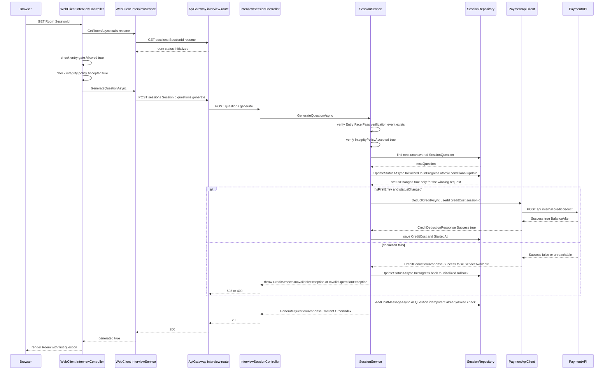
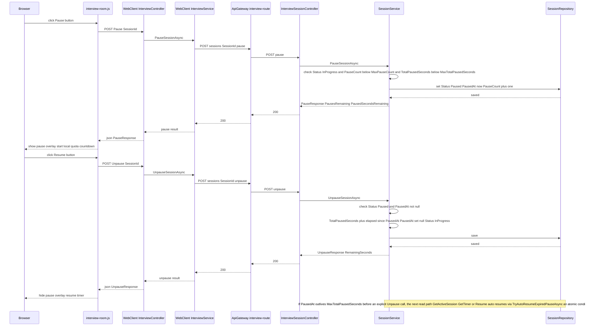
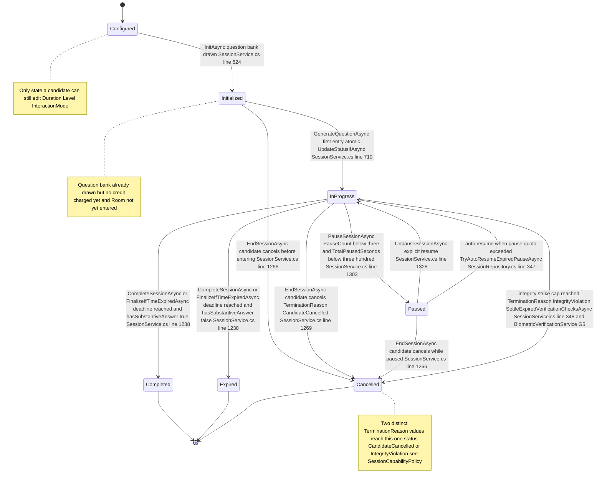
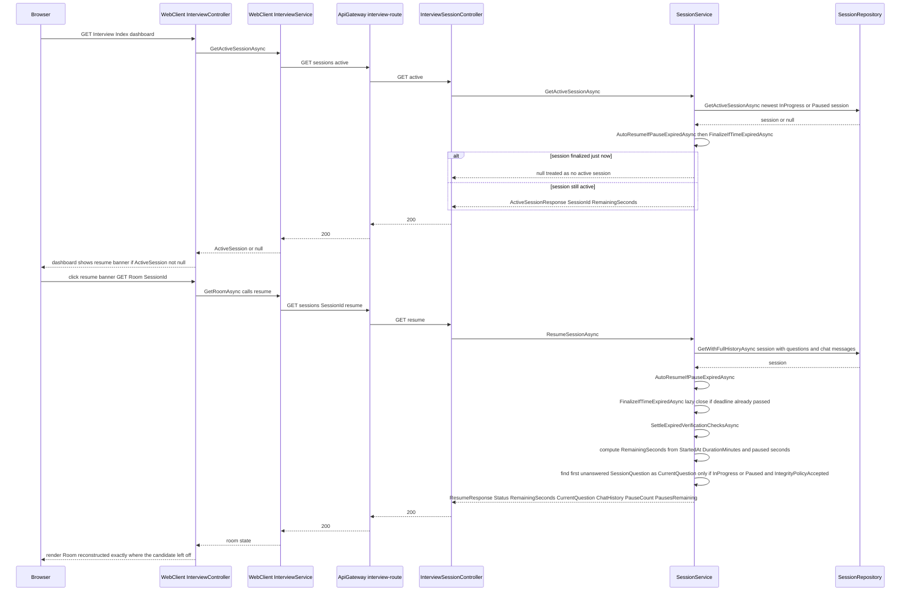
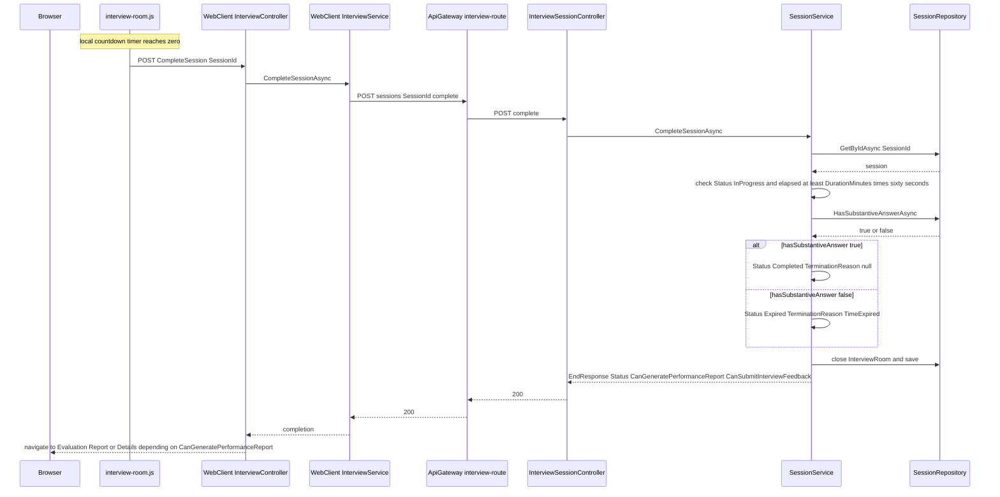
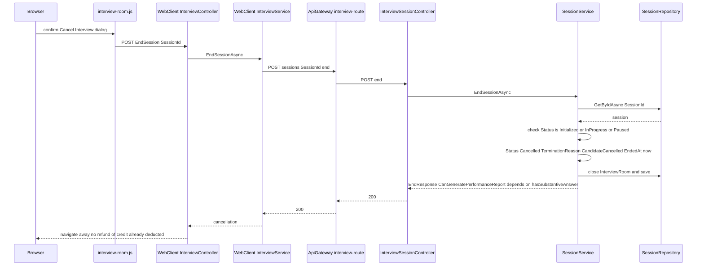

# G2 — Session Lifecycle & Credit

Batch: Phase 2. Component covered: InterviewAPI (`source/InterviewAPI/`), with WebClient
(`source/WebClient/`) as the same-origin proxy layer and PaymentAPI as a teammate-owned dependency
documented only at the integration-contract level, per the project's ownership boundary. All files
cited below were re-read directly for this batch. T1–T6 terminology rules from the Phase 0.5
addendum remain in force; none of G2's features touch a generative or retrieval model, so §8 of
every feature in this chapter is `Not applicable`.

---

## F-05. Start Interview & Charge Credit

### 1. Purpose and scope
Deducts the credit cost of a configured interview from the candidate's PaymentAPI-held balance and
transitions the session from `Initialized` to `InProgress`, at the exact moment the candidate's
first question is actually served — not earlier, at session creation (F-01), and not gated by
duration/level choice alone. This feature is the financial commitment point of the whole
configuration wizard: everything in G1 can be configured, and even fully initialized with a drawn
question set, without a single credit leaving the account, until this feature runs.

### 2. Actors, preconditions, postconditions

| | |
|---|---|
| Actor | Authenticated candidate, no role restriction (`InterviewSessionController.cs:14`) |
| Precondition | Session belongs to the caller; session is `Status="Initialized"` or already `"InProgress"` (§7 R1); if `Biometrics:Enabled`, an `Entry`-phase `Face` verification event with `Decision="Pass"` already exists for the session (G5); `IntegrityPolicyAccepted=true` (G1 F-04) |
| Postcondition (first entry, success) | `InterviewSessions.Status="InProgress"`, `CreditCost` set to the duration's fixed price, `StartedAt` set to the current time, one `ChatMessages` row inserted (`SenderType="AI"`, `MessageType="Question"`) for the first question |
| Postcondition (first entry, deduction fails) | `Status` is rolled back to `"Initialized"`; no `ChatMessages` row is inserted; no charge is left standing (§9) |
| Postcondition (any later call, same session) | No status change, no charge — simply serves the next unanswered question (§7 R1) |

### 3. Architectural placement
Call chain: `Browser → WebClient InterviewController.Room (Controllers/Interview/
InterviewController.cs:207-300) → WebClient InterviewService.GenerateQuestionAsync → ApiGateway
interview-route (ai-backed timeout policy) → InterviewSessionController.GenerateQuestion
(InterviewSessionController.cs:609-641) → SessionService.GenerateQuestionAsync
(SessionService.cs:651-801) → SessionRepository (atomic status CAS) + Clients/PaymentApiClient
(cross-service call to PaymentAPI)`.

`InterviewController.Room` is the true orchestration point on the WebClient side (§5): before it
ever calls `GenerateQuestionAsync`, it independently re-checks the session's status, the biometric
entry-gate result (`VerificationService.GetEntryGateAsync`), and the integrity-policy acceptance
status, each via its own Gateway round trip, and only calls `GenerateQuestionAsync` — the credit-
charging call — if all three already show a passing state (`InterviewController.cs:224-270,
278-285`). This WebClient-side ordering is a UX convenience only; the same three checks are
re-verified authoritatively, and independently of WebClient, inside `SessionService.
GenerateQuestionAsync` itself (§5 step 2), which is what actually prevents a direct API call from
skipping the gates.

PaymentAPI is a teammate-owned stub service (per `CLAUDE.md`'s ownership boundary); this report
documents only the contract InterviewAPI observes as a caller — see §4's cross-service table and
§10 — never PaymentAPI's own internal deduction/ledger logic.

### 4. Interface contract

**Gateway-facing**: `POST api/interview/sessions/{id}/questions/generate`, no request body beyond
the route id (caller identified from JWT). Response `GenerateQuestionResponse
{SessionQuestionId, OrderIndex, Content, TotalQuestions, Ended, IdleReminderSeconds, IdleHardSeconds,
IdleElapsedSeconds}`. Status codes: 200 (question served, `Ended=false`, or all questions already
answered, `Ended=true`); 503 `CreditServiceUnavailableException` mapped explicitly
(`InterviewSessionController.cs:627-633`, "The payment service is temporarily unavailable. Please
try again shortly."); 503 generic catch-all for every other exception, including the specific
`InvalidOperationException("Credit deduction failed: {Message}")` thrown when PaymentAPI answers
with a genuine business refusal — this message is **not** surfaced distinctly by the controller (it
falls into the same generic "Could not load the next question. Please try again shortly." as any
other unexpected failure, `InterviewSessionController.cs:634-639`, since there is no dedicated
`catch(InvalidOperationException)` on this action, unlike `ConfigDuration`/`ConfigLevel` in G1).

**Cross-service integration contract — InterviewAPI → PaymentAPI** (caller-observed only, per
project boundary rules):

| InterviewAPI call | HTTP | PaymentAPI endpoint | Request shape | Response shape (`CreditDeductionResponse`) | InterviewAPI's handling |
|---|---|---|---|---|---|
| `DeductCreditAsync(userId, amount, sessionId, description, ct)` | POST | `/api/internal/credit/deduct` (`Clients/PaymentApiClient.cs:30-31`) | `{UserId, Amount, ReferenceId=sessionId, Description}` (`:22-27`) | `{Success, BalanceAfter, AmountDeducted, Message, ServiceAvailable}` (`Clients/IPaymentApiClient.cs:47-70`) | `Success=true` → proceed (§5); `Success=false, ServiceAvailable=false` → non-2xx or transport exception, treated as "PaymentAPI never answered" (`PaymentApiClient.cs:38-46,62-69`), rolled back and reported as 503; `Success=false, ServiceAvailable=true` → PaymentAPI answered with a business refusal (e.g. insufficient credits), rolled back and reported as 400 with PaymentAPI's own message text |
| `RefundCreditAsync(userId, amount, sessionId, description, ct)` | POST | `/api/internal/credit/refund` (`PaymentApiClient.cs:86-87`) | same shape as deduct | same shape as deduct | see §5/§9 — the only call site is a post-deduction failure recovery, not a general-purpose refund |

The `ServiceAvailable` flag is the load-bearing design choice documented in-code
(`IPaymentApiClient.cs:24-33,54-69`): it exists specifically so a PaymentAPI outage is never
rendered to the user as "you have 0 credits" — a documented prior bug the current shape was built
to eliminate.

### 5. Processing flow
1. WebClient's `InterviewController.Room` action re-verifies session status, entry-gate result, and
   integrity-policy acceptance (each its own Gateway call), and only then calls
   `GenerateQuestionAsync` (`InterviewController.cs:224-285`).
2. `SessionService.GenerateQuestionAsync` loads the session with its questions
   (`GetWithQuestionsAsync`, `SessionService.cs:655`), checks ownership and that
   `Status ∈ {Initialized, InProgress}` (`:656-659`).
3. **Biometric entry gate, re-checked server-side**: if `Biometrics:Enabled`, queries
   `SessionVerificationEvent` rows for `Phase="Entry"` and requires at least one `Modality="Face",
   Decision="Pass"` (`:665-671`) — throws before any further step if absent.
4. **Integrity policy, re-checked server-side**: `RequireIntegrityPolicyAccepted(session)`
   (`:677`, helper at `:52-57`) — throws before any further step if not accepted.
5. Finds the first `SessionQuestion` with no `User`/`Answer` `ChatMessage` yet (`:680-693`); if none
   remain, returns `Ended=true` without touching credit at all.
6. Sets `AskedAt` on first serve (`:700-704`).
7. **The atomic status claim**: `bool isFirstEntry = session.Status == "Initialized"` is read from
   the in-memory session object (`:707`), then unconditionally `bool statusChanged = await
   _repo.UpdateStatusIfAsync(userId, sessionId, "Initialized", "InProgress", ct)` is called
   (`:710`) — a single conditional `UPDATE ... WHERE Status='Initialized'`
   (`SessionRepository.cs:250-259`). Only the request whose `UPDATE` actually matches a row (i.e.
   won the race, if any) gets `statusChanged=true`.
8. **Only if `isFirstEntry && statusChanged`** (`:715`): computes `creditCost` from
   `CreditConfig.GetCreditCost(session.DurationMinutes)` (`:717`, `Helpers/CreditConfig.cs:30-36`)
   and calls `PaymentApiClient.DeductCreditAsync` (`:718-719`).
9. On deduction failure (`!deductResult.Success`, `:721`): rolls the status back with a second
   atomic conditional update, `UpdateStatusIfAsync(..., "InProgress", "Initialized", ct)` (`:725`),
   then throws `CreditServiceUnavailableException` (transport/unavailable case, `:729-730`) or
   `InvalidOperationException` carrying PaymentAPI's own refusal message (`:734`) — **before** any
   `ChatMessage` is written.
10. On deduction success: re-fetches the session fresh, sets `CreditCost` and `StartedAt`, saves
    (`:740-747`) — this is the point `StartedAt` (the timer's true zero) is set, deliberately later
    than `Init`, per the in-code rationale that Verify + IntegrityPolicy can take real human time
    that should not count against the interview clock (`SessionService.cs:619-623`, cross-referenced
    from G1).
11. Inserts the `ChatMessages` row for the AI's question, guarded by an `alreadyAsked` idempotency
    check so a racing/duplicate call never inserts it twice (`:755-773`).
12. **If step 11's insert itself throws**, and only if a deduction actually happened in this same
    call (`isFirstEntry && statusChanged && creditCost > 0`), a refund is issued
    (`PaymentApiClient.RefundCreditAsync`, `:778-783`) before the exception is rethrown — this is
    the **only** call site of `RefundCreditAsync` in the entire codebase (confirmed by a repo-wide
    grep; see §9 for what this does and does not cover).
13. Returns `GenerateQuestionResponse` with the question content (never the reference answer).

*Figure 2.1 — Start Interview & Charge Credit sequence, including both the success and
deduction-failure branches.*

### 6. Data model impact
Writes `InterviewSessions.{Status, CreditCost, StartedAt, UpdatedAt}` and one row in `ChatMessages`.
No new table relative to G1; the significant change here is *when* `CreditCost`/`StartedAt` are
populated (previously `null`/`0` since F-01), not a new schema element. No transaction wraps steps
7 through 12 as a single unit — the status flip (step 7), the external PaymentAPI call (step 8-10),
and the `ChatMessages` insert (step 11) are three separate database/network round trips, which is
exactly why the refund logic in step 12 exists as a targeted compensation for one specific failure
window rather than a database rollback.

### 7. Business rules and invariants — **Charge idempotency, answered precisely**

- **R1 (idempotent re-entry)** — Calling this endpoint again for a session already `InProgress`
  performs **no** status change and **no** charge: `isFirstEntry` evaluates `false` against a fresh
  DB read at the top of every call (`GetWithQuestionsAsync`, `:655`), so the `if (isFirstEntry &&
  statusChanged)` block (`:715`) is skipped entirely — it simply serves the next unanswered
  question. This is what makes a **retried request** (client resend after a dropped response, or a
  page reload) safe: the retry reads the already-updated status and never re-attempts the charge.
- **R2 (the true concurrency guard)** — The mechanism preventing a double charge under **two
  simultaneous requests** (e.g. two browser tabs) is the atomic conditional `UPDATE` at
  `SessionRepository.cs:250-259` (`UpdateStatusIfAsync`), executed as a single SQL statement filtered
  on `Status='Initialized'`. Under SQL Server's default `READ COMMITTED` locking behavior, the second
  concurrent `UPDATE` targeting the same row blocks on the row lock held by the first, and — once
  the first commits — re-evaluates its own `WHERE` clause against the now-current `Status='InProgress'`
  and matches zero rows. Only the winner gets `statusChanged=true`, and only the winner enters the
  `if` block that calls `DeductCreditAsync`. **This guard is real and present, not merely intended.**
- **R3 (the narrow window this guard does *not* close)** — `isFirstEntry` is read from an
  **in-memory snapshot taken before** the atomic update runs (`:707`, before `:710`). If two
  requests read the session in the same instant (both see `Status="Initialized"`), both compute
  `isFirstEntry=true` locally — but only one wins the atomic update at step 7. The **loser**'s own
  `statusChanged` is `false`, so the loser correctly skips charging — this is R2's guarantee working
  as intended. However, since the loser's own fresh read (at the very top of its own call, `:655`)
  happens *after* the DB round trip that produced its `session` object, the loser's request as a
  whole will, in the overwhelming majority of real timings, simply see `Status` already
  `"InProgress"` from the start and never even compute `isFirstEntry=true` — the race window
  described here requires two requests' initial reads to land within the same open transaction
  window before either write commits, which is narrow but not architecturally impossible under
  concurrent load. **No double charge results either way**, because the charge itself is gated on
  the atomic `statusChanged` result (R2), not on the in-memory `isFirstEntry` flag alone.
- **R4 (a genuine, evidence-based gap: charge-then-persist window)** — Between the status flip
  (`:710`, committed) and the `PaymentApiClient.DeductCreditAsync` call resolving (`:718`), the
  session already shows `Status="InProgress"` to any other reader (e.g. a second tab's
  `GenerateQuestionAsync` call, or `ResumeSessionAsync`). A second request landing in this specific
  window reads `isFirstEntry=false` (status already flipped) and proceeds straight to serving the
  question (step 11) **without itself charging or waiting for the first request's deduction to
  resolve**. If the first request's deduction subsequently **fails** and rolls the status back to
  `"Initialized"` (step 9), the second request has already returned question content to its own
  caller before that rollback happened. No double charge occurs (the failed deduction never
  completed), and the ChatMessage idempotency guard (step 11) prevents any duplicate insert on a
  later successful retry — so this is self-healing rather than a lost-money bug, but it is a real,
  narrow window where "session shows InProgress" and "credit has been successfully charged" are not
  the same atomic fact. Not exercised or reproduced in this pass — reported as a structural
  observation from the code, per instruction to state guards (or their absence) plainly.
- **R5 (deduction-then-persist-failure window, uncovered by any refund)** — If
  `PaymentApiClient.DeductCreditAsync` succeeds (step 8) but the subsequent
  `_repo.SaveChangesAsync` persisting `CreditCost`/`StartedAt` (`:746`) then throws (e.g. a
  transient DB error), the exception propagates **without any refund**, because the refund logic
  (step 12) only wraps the *later*, separate `ChatMessages` insert try/catch (`:760-785`), not this
  earlier save. The credit has already left the account at PaymentAPI. **This scenario does self-heal
  on retry**, however: the status is already `"InProgress"` (that update committed independently and
  is not rolled back by this failure), so a retried call reads `isFirstEntry=false`, skips charging
  again, and proceeds to serve the question normally — the candidate is not charged twice and does
  receive a usable session, just via an extra client-side retry rather than in one round trip. No
  scenario was found in this pass that leaves a candidate **permanently** charged with a genuinely
  unusable session; the closest gaps (R4, R5) are both narrow timing windows that a normal retry
  resolves.

### 8. AI/ML component
Not applicable — no model or ai-service call in this feature.

### 9. Failure modes and edge cases

| Scenario | System behaviour | Evidence | User-visible result |
|---|---|---|---|
| PaymentAPI unreachable/times out | `DeductCreditAsync` returns `ServiceAvailable=false`; status rolled back; `CreditServiceUnavailableException` thrown | `PaymentApiClient.cs:59-70`; `SessionService.cs:721-730` | 503 "The payment service is temporarily unavailable. Please try again shortly." (`InterviewSessionController.cs:627-633`) |
| PaymentAPI answers with a business refusal (e.g. insufficient credits) | `Success=false, ServiceAvailable=true`; status rolled back; `InvalidOperationException` with PaymentAPI's own message | `SessionService.cs:721,734` | Falls into the **generic** 503 catch-all ("Could not load the next question...") since `InterviewSessionController.GenerateQuestion` has no dedicated `catch(InvalidOperationException)` — the specific refusal reason (e.g. "insufficient credits") is **not** distinctly surfaced to the browser, unlike the pattern used in G1's `ConfigDuration`/`ConfigLevel` actions |
| `ChatMessages` insert fails immediately after a successful deduction | Refund issued via the sole `RefundCreditAsync` call site, then exception rethrown | `SessionService.cs:775-784` | Generic 503/error from the outer catch, but the credit is restored server-side before the response is sent |
| Entry gate not yet passed (direct API call or a stale Room state) | `InvalidOperationException("Identity verification required...")`, thrown before any credit logic runs | `SessionService.cs:665-671` | Generic 503 (no dedicated catch for this specific message either) |
| Integrity policy not yet accepted | `SessionGuardException(403, "integrity_policy_not_accepted", ...)` | `SessionService.cs:52-57,677` | 403 with the specific machine-readable code and message (this path, unlike the two above, **is** explicitly caught — `SessionGuardException` is not caught by name in `GenerateQuestion`'s controller action though; confirmed by re-reading `InterviewSessionController.cs:609-641`, which has only a generic `catch (Exception ex)` — so even this exception, despite carrying a structured `StatusCode`/`ErrorCode`, is **not** specially unwrapped here and instead returns the generic 503 message, losing its 403/`integrity_policy_not_accepted` structure on this particular endpoint) |
| Concurrent double-charge attempt (two tabs) | Prevented by the atomic conditional update | §7 R2 | Both tabs eventually see the same `InProgress` session and the same question; only one deduction occurs |
| DB failure persisting `CreditCost`/`StartedAt` after a successful deduction | No refund issued (outside the refund's try/catch scope); self-heals on retry | §7 R5 | One transient 503 on the affected click; retry succeeds without double-charging |

### 10. Security and integrity considerations
IDOR protection via `session.UserId != userId` (`SessionService.cs:656`, and again implicitly by
loading the session scoped to the authenticated caller throughout). The entry-gate and
integrity-policy checks are both re-verified server-side independently of WebClient's own checks
(§3, §5 steps 3-4), which is the correct defense-in-depth pattern — a direct API call cannot skip
either gate to reach the charge. The `X-Internal-Api-Key`-style trust boundary does not apply to
this specific InterviewAPI→PaymentAPI call (`DeductCreditAsync` uses the same typed `HttpClient`
configured in `Program.cs` with the internal API key header attached at the client level, per Phase
0 evidence — not re-verified line-by-line in this pass beyond what §4 already cites). The
`ServiceAvailable` distinction (§4) is itself a security-adjacent correctness property: it prevents
an outage from being misreported as "0 balance," which could otherwise mislead a candidate into
believing they need to purchase credits they already have.

### 11. Limitations and future work
- R4 and R5 (§7) are narrow, self-healing timing windows, not exploitable for a double charge in
  any scenario traced in this pass — but they do mean "status is InProgress" and "credit
  successfully charged" are not guaranteed to be the same instant, which a future reconciliation job
  (comparing `InterviewSessions.CreditCost` against PaymentAPI's own ledger) could close entirely.
  Not built today; no code reference exists for such a job.
- The generic 503 swallowing of several distinctly-authored `InvalidOperationException`/
  `SessionGuardException` messages (§9) is a repeated pattern across this and the G1 `Init` action —
  worth a single, consistent fix (e.g. a shared exception-to-response mapper) rather than one-off
  per-action catch blocks, though that is a recommendation, not something this report implements.

### 12. Figures
Figure 2.1 (sequence diagram, `diagrams/FIG-2.1.mmd`).

---

## F-06. Pause / Resume

### 1. Purpose and scope
Lets a candidate voluntarily freeze the interview clock mid-session (e.g. a bathroom break or a
brief interruption) and later unfreeze it, within a fixed quota, without losing their place in the
question sequence. This is distinct from F-07 (Resume Active Session), which covers reconnecting to
a session after leaving the browser entirely — F-06 is the in-Room Pause/Resume button pair used
while the tab stays open.

### 2. Actors, preconditions, postconditions

| | |
|---|---|
| Actor | Authenticated candidate, no role restriction on `Pause`/`Unpause` (`InterviewSessionController.cs:364,383` — only class-level `[Authorize]`, no `Roles=` constraint, unlike `CompleteSession`/`EndSession`) |
| Precondition (Pause) | Session belongs to caller, `Status="InProgress"`, `PauseCount < 3`, `TotalPausedSeconds < 300` |
| Precondition (Unpause) | Session belongs to caller, `Status="Paused"`, `PausedAt` is set |
| Postcondition (Pause) | `Status="Paused"`, `PausedAt=now`, `PauseCount += 1` |
| Postcondition (Unpause) | `Status="InProgress"`, `TotalPausedSeconds += (now - PausedAt)`, `PausedAt=null` |

### 3. Architectural placement
`Browser → interview-room.js (Pause/Resume buttons) → WebClient InterviewController.Pause/Unpause →
WebClient InterviewService → ApiGateway interview-route → InterviewSessionController.Pause/Unpause
(InterviewSessionController.cs:364-399) → SessionService.PauseSessionAsync/UnpauseSessionAsync
(SessionService.cs:1290-1345) → SessionRepository`. A pure InterviewAPI feature with no
cross-service dependency.

### 4. Interface contract

| Method | Route | Response | Status codes |
|---|---|---|---|
| POST | `api/interview/sessions/{id}/pause` | `PauseResponse {Status, PauseCount, PausesRemaining, PausedSecondsRemaining}` | 200; 503 generic for **every** failure — no dedicated `catch(InvalidOperationException)` on this action (`InterviewSessionController.cs:365-380`), so the specific messages below are all swallowed |
| POST | `api/interview/sessions/{id}/unpause` | `UnpauseResponse {Status, RemainingSeconds, PauseCount, PausesRemaining, PausedSecondsRemaining}` | 200; 503 generic, same pattern (`:384-399`) |

### 5. Processing flow
**Pause** (`SessionService.PauseSessionAsync`, `SessionService.cs:1290-1316`):
1. Load session, verify ownership, verify `Status="InProgress"` (`:1292-1296`).
2. Verify `PauseCount < MaxPauseCount` (3, `:106`) and `TotalPausedSeconds < MaxTotalPausedSeconds`
   (300, `:107`) — throws a specific message for each limit if exceeded (`:1298-1301`).
3. Set `Status="Paused"`, `PausedAt=VietnamTime.Now`, increment `PauseCount`, save (`:1303-1307`).
4. Return quota remainders, computed as `Math.Max(0, MaxPauseCount - PauseCount)` and
   `Math.Max(0, MaxTotalPausedSeconds - GetEffectivePausedSeconds(session))` (`:1313-1314`).

**Unpause** (`SessionService.UnpauseSessionAsync`, `SessionService.cs:1318-1345`):
1. Load session, verify ownership, verify `Status="Paused"` and `PausedAt` is set (`:1320-1324`).
2. Add the elapsed pause duration to the running total: `TotalPausedSeconds += (int)(VietnamTime.Now
   - PausedAt.Value).TotalSeconds` (`:1326`), clear `PausedAt`, set `Status="InProgress"`, save
   (`:1327-1330`).
3. Recompute and return `RemainingSeconds` (§7 formula below).

**Pause-quota arithmetic** (both directions, tying together `StartedAt`, `DurationMinutes`,
`TotalPausedSeconds`):
- Effective paused time so far, whether or not a pause is currently ongoing:
  `GetEffectivePausedSeconds(session) = TotalPausedSeconds + (PausedAt is null ? 0 : (Now -
  PausedAt).TotalSeconds)` (`SessionService.cs:112-118`). While a pause is ongoing, this grows in
  lock-step with wall-clock time, which is exactly what keeps the remaining-time countdown frozen —
  see §6.
- Remaining time (used by `Unpause`, `GetTimer`, `Resume`, and the Dashboard's active-session
  banner, all via the same formula): `remaining = Max(0, DurationMinutes*60 - ((Now - StartedAt) -
  GetEffectivePausedSeconds(session)))` (`SessionService.cs:1332-1335` for `Unpause`; the identical
  shape recurs at `:1230-1234` in `CompleteSessionAsync`, `:1469-1470` in `ResumeSessionAsync`, and
  `:1171-1172` in `GetActiveSessionAsync`).

### 6. Data model impact
Writes `InterviewSessions.{Status, PausedAt, PauseCount, TotalPausedSeconds, UpdatedAt}`. Both
writes are plain `SaveChangesAsync` calls on a tracked entity (`:1307,1330`) — **not** atomic
conditional updates, unlike the `Initialized→InProgress` transition in F-05. This is a real
asymmetry worth naming: `PauseSessionAsync`/`UnpauseSessionAsync` re-check `PauseCount`/
`TotalPausedSeconds` against the values read at the top of the same call, then write
unconditionally — two concurrent Pause clicks (a double-click) could, in principle, both pass the
`PauseCount < 3` check before either increments, resulting in `PauseCount` exceeding 3 by one on the
losing request's write. Not reproduced in this pass; noted as a structural asymmetry against F-05's
CAS-guarded transition, not asserted as an observed bug.

### 7. Business rules and invariants — **Pause-quota arithmetic and concurrency, answered
   precisely**
- **R1** — `PauseCount` is capped at 3 per session (`MaxPauseCount`, `SessionService.cs:106`);
  `TotalPausedSeconds` is capped at 300 (`MaxTotalPausedSeconds`, `:107`) — both flat, per-session
  caps, not scaled by `DurationMinutes` (comment confirms this is deliberate, `:105`).
- **R2** — The atomic conditional update that **does** exist for pause state is
  `TryAutoResumeExpiredPauseAsync` (`SessionRepository.cs:342-355`), used **only** by the
  self-healing auto-resume path (`AutoResumeIfPauseExpiredAsync`, `SessionService.cs:135-150`), not
  by the voluntary `PauseSessionAsync`/`UnpauseSessionAsync` calls themselves (§6). Its `WHERE`
  clause is keyed on the **exact `PausedAt` value the caller read** (`s.PausedAt == expectedPausedAt`,
  `SessionRepository.cs:346`), so if two concurrent callers both observe the same expired pause, only
  the first to commit its `UPDATE` succeeds — the second's `WHERE` no longer matches (`PausedAt` has
  already changed), and its update affects zero rows. This auto-resume runs at the top of
  `GetActiveSessionAsync`, `GetTimerAsync`, and `ResumeSessionAsync` (§5's call sites, cross-referenced
  to F-07) — i.e. on every read path a client is likely to hit, not on a background timer, so an
  expired pause is corrected lazily on the next request rather than by any scheduled job.
- **R3** — A pause that outlives its quota (`GetEffectivePausedSeconds >= MaxTotalPausedSeconds`) is
  **not** force-ended by `PauseSessionAsync`/`UnpauseSessionAsync` themselves — it is corrected the
  next time any read path runs `AutoResumeIfPauseExpiredAsync` (R2). Until that next read happens,
  the session's persisted `Status` can remain `"Paused"` past its quota; the correction is lazy, not
  proactive.
- **R4 (voluntary Pause/Unpause concurrency gap, stated plainly)** — Unlike F-05's credit-charging
  transition, **no atomic guard exists** for the voluntary Pause or Unpause writes themselves (§6).
  This is stated plainly per the instruction not to describe an absent guard as present: a
  double-click or two-tab race on Pause could, in the narrow window described in §6, allow
  `PauseCount` to be incremented past 3 by one. Not reproduced; a structural observation.

*Figure 2.2 — Pause / Resume sequence, plus the lazy auto-resume note.*

`InterviewSession.Status`'s complete transition set — spanning F-05 through F-08 — is shown once
here since Pause/Resume is the state with the richest branching (two inbound, two outbound edges):

*Figure 2.3 — `InterviewSession.Status` state diagram, all seven CHECK-constraint values
(`db/baseline/05_DevPrep_Interview.sql:439-441`), covering F-05 through F-08.*

### 8. AI/ML component
Not applicable.

### 9. Failure modes and edge cases

| Scenario | System behaviour | Evidence | User-visible result |
|---|---|---|---|
| Pause limit reached (4th attempt) | `InvalidOperationException($"Pause limit reached ({MaxPauseCount} pauses per session).")` | `SessionService.cs:1298-1299` | Generic 503 "Could not pause this interview. Please try again shortly." — the specific "3 pauses" message is not surfaced, same swallowing pattern as F-05 |
| Total pause time limit reached | `InvalidOperationException($"Total pause time limit reached ({MaxTotalPausedSeconds} seconds per session).")` | `SessionService.cs:1300-1301` | Same generic 503 |
| Unpause called on a non-`Paused` session | `InvalidOperationException("Session is not paused.")` | `SessionService.cs:1323-1324` | Generic 503 |
| Pause quota silently expires while the tab is closed | No forced transition happens until a read path runs; the session may sit `Status="Paused"` past its 300s budget until then | §7 R2, R3 | No user-visible effect until the next Resume/Dashboard/Timer request, which then reports `Status="InProgress"` retroactively |
| Double-click Pause (two near-simultaneous requests) | No atomic guard on the voluntary write path | §6, §7 R4 | Not reproduced; a structural, unverified risk of `PauseCount` exceeding 3 by one |

### 10. Security and integrity considerations
IDOR protection via `session.UserId != userId` (`SessionService.cs:1293,1321`). Neither `Pause` nor
`Unpause` carries a `[Authorize(Roles=...)]` restriction beyond the controller's class-level
`[Authorize]` — any authenticated account, of any role, can pause/unpause its own session; this is
consistent with the rest of the session-lifecycle actions except `CompleteSession`/`EndSession`,
which add `Roles="User"` (§F-08 §10).

### 11. Limitations and future work
The voluntary Pause/Unpause writes are not protected by the same atomic-conditional-update pattern
used everywhere else quota/state is enforced in this codebase (`UpdateStatusIfAsync`,
`TryConsumeHintAsync`, `TryConsumeSkipCooldownAsync`, `IncrementAnsweredIfAsync`,
`TryAutoResumeExpiredPauseAsync` — all in `SessionRepository.cs:250-355`). Converting `PauseCount`'s
increment to the same `ExecuteUpdateAsync`-with-expected-value pattern used for `AnsweredQuestions`
(`IncrementAnsweredIfAsync`, `SessionRepository.cs:322-332`) would close the gap in §7 R4; not
implemented today.

### 12. Figures
Figure 2.2 (sequence diagram, `diagrams/FIG-2.2.mmd`); Figure 2.3 (state diagram,
`diagrams/FIG-2.3.mmd`); Figure 2.7 (screenshot — pause overlay, see `SCREENSHOT_CHECKLIST.md`).

---

## F-07. Resume Active Session

### 1. Purpose and scope
Lets a candidate who left the browser mid-interview (closed the tab, lost the connection, or
simply navigated away) find their way back to the exact point they left off — the same question,
the same remaining time, the same chat history — without losing progress or being charged again.
It has two parts: a discovery mechanism on the Dashboard (surfacing that an active session exists at
all) and the actual state-reconstruction call the Room page uses every time it loads, whether that
load is the very first entry after F-05 or a reconnect days later.

### 2. Actors, preconditions, postconditions

| | |
|---|---|
| Actor | Authenticated candidate |
| Precondition | A session exists with `Status ∈ {InProgress, Paused}` and belongs to the caller (discovery); for the full reconstruction, no additional precondition beyond ownership — `ResumeSessionAsync` is documented to never throw on session state (§3) |
| Postcondition | Client receives enough state (`Status`, `RemainingSeconds`, `CurrentQuestion`, `ChatHistory`, pause quota) to redraw the Room exactly as it was; if the session's deadline had silently passed while the candidate was away, it is finalized in place as a side effect of this same call |

### 3. Architectural placement
Two related but distinct call chains:
- **Discovery**: `Browser → WebClient InterviewController.Index/BuildDashboardAsync
  (Controllers/Interview/InterviewController.cs:53-69) → InterviewService.GetActiveSessionAsync →
  ApiGateway interview-route → InterviewSessionController.GetActiveSession
  (InterviewSessionController.cs:102-108) → SessionService.GetActiveSessionAsync
  (SessionService.cs:1150-1183) → SessionRepository.GetActiveSessionAsync`.
- **Reconstruction**: `Browser → WebClient InterviewController.Room (same action documented in F-05
  §3) → InterviewService.GetRoomAsync → ApiGateway interview-route →
  InterviewSessionController.ResumeSession (InterviewSessionController.cs:424-448) →
  SessionService.ResumeSessionAsync (SessionService.cs:1444-1520+) → SessionRepository`.

`InterviewController.Room` calls the reconstruction endpoint (`resume`) **unconditionally** on every
load (`InterviewController.cs:224`), not only when the candidate is "resuming" in an intuitive
sense — it is the single source of session state the Room page always starts from, which is why
`ResumeSessionAsync` is documented in its own code comment to deliberately never throw on session
status (`SessionService.cs:1478-1488`): a throw here would strand a client on every fresh Room
entry, not just a genuine reconnect.

### 4. Interface contract

| Method | Route | Response | Status codes |
|---|---|---|---|
| GET | `api/interview/sessions/active` | `ActiveSessionResponse? {SessionId, Status, StartedAt, DurationMinutes, RemainingSeconds}` (`null` `Data` if none) | 200 always — "no active session" is a normal state, not an error (`InterviewSessionController.cs:96-100` comment) |
| GET | `api/interview/sessions/{id}/resume` | `ResumeResponse {Status, Position, Level, QuestionType, RemainingSeconds, CurrentQuestion, TotalQuestions, AnsweredQuestions, PauseCount, PausesRemaining, PausedSecondsRemaining, HasSeenRoomTour, ChatHistory}` | 200 for any session state, including terminal ones — the caller (WebClient's `Room` action) is responsible for redirecting away based on `Status`; 503 generic on unexpected failure; `SessionGuardException` is caught explicitly by the controller (`:435-440`) though `ResumeSessionAsync` itself is documented not to throw one in normal operation |

### 5. Processing flow
**Discovery** (`SessionService.GetActiveSessionAsync`, `:1150-1183`):
1. `SessionRepository.GetActiveSessionAsync` selects the newest `Status ∈ {InProgress, Paused}`
   session for the user, ordered by `StartedAt` descending (`SessionRepository.cs:28-33`) — note
   this query **excludes `Initialized`** sessions entirely (§7 R1, resolving `OPEN_QUESTIONS.md` #10
   below).
2. Runs the same lazy self-healing pair as every other read path: `AutoResumeIfPauseExpiredAsync`
   then `FinalizeIfTimeExpiredAsync` (`:1160-1162`) — if the session gets finalized right here (its
   time had already run out), the method returns `null`, i.e. "no active session," even though one
   existed a moment ago.
3. Computes `RemainingSeconds` with the shared formula (F-06 §5) and returns it.

**Reconstruction** (`SessionService.ResumeSessionAsync`, `:1444-1520+`):
1. Loads the session with its full question and chat history in one query
   (`GetWithFullHistoryAsync`, `:1446`, `SessionRepository.cs:42-46`).
2. Runs `AutoResumeIfPauseExpiredAsync`, then `FinalizeIfTimeExpiredAsync` — in that order
   deliberately, because the latter's elapsed-time formula depends on values the former may have
   just changed (`:1450-1458` comment).
3. Runs `SettleExpiredVerificationChecksAsync` (G5-owned logic, cross-referenced not duplicated
   here) (`:1459`).
4. Computes `RemainingSeconds` (§F-06 formula; `DurationMinutes*60` outright if `StartedAt` is still
   null, i.e. the session was never actually entered — `:1463-1471`).
5. Finds the first unanswered `SessionQuestion` **only if** `Status ∈ {InProgress, Paused}` **and**
   `IntegrityPolicyAccepted` (`:1490`) — deliberately excludes `Initialized` sessions from getting
   question content back through this call, per the extensive in-code rationale that question
   content must only leak once `GenerateQuestionAsync` has actually run (credit charged, both gates
   enforced) — `Resume` itself must remain safe to call before that point without leaking anything
   (`:1481-1488`).
6. Attaches an in-session verification check token to the current question if one is due (G5,
   cross-referenced) (`:1517-1518`).
7. Best-effort loads `HasSeenRoomTour`, defaulting to "not seen" on any lookup failure so this
   never blocks Resume, which the comment calls "on the critical path to the interview itself"
   (`:1512-1516`).
8. Returns the full `ResumeResponse`.

*Figure 2.4 — Resume Active Session: Dashboard discovery, then full Room reconstruction.*

### 6. Data model impact
Read-mostly: `GetWithFullHistoryAsync` performs a single query with two nested `Include`s
(`SessionQuestions` ordered by `OrderIndex`, each with `ChatMessages` ordered by `SentAt`,
`SessionRepository.cs:42-46`) — no write occurs from Resume itself **unless** the lazy
self-healing (`AutoResumeIfPauseExpiredAsync`/`FinalizeIfTimeExpiredAsync`) fires, in which case it
writes exactly the same fields F-06/F-08 already document.

### 7. Business rules and invariants — **`OPEN_QUESTIONS.md` #10, resolved**

- **R1 (resolved, deterministic gap — not a timing race)** — `SessionRepository.GetActiveSessionAsync`
  (`:28-33`) filters on `Status ∈ {InProgress, Paused}` only; it does **not** count `Initialized`
  sessions. Combined with G1 F-01 §7 R2's `ResolveSessionAsync`, which calls this exact same
  service-level method to decide whether a *new* session may be created: **a candidate can hold
  arbitrarily many `Initialized` sessions simultaneously** — each with its own drawn question bank
  and open `InterviewRoom` — because none of them count as "active" for either the creation guard or
  the discovery banner, until one of them is actually entered (F-05, which flips it to
  `InProgress`). This is not a narrow concurrency race; it is a deterministic, always-reproducible
  consequence of which statuses the query includes, confirmed by reading the query directly.
  `OPEN_QUESTIONS.md` #10 is resolved: **the check is correctly atomic against a true two-request
  race for the InProgress/Paused case (F-05 §7 R2), but the broader "one session at a time" intent
  implied by the Dashboard's active-session banner does not, by design or oversight, extend to
  `Initialized` sessions.** Whether this is intentional (an `Initialized` session is "just
  configuration," not yet a commitment) or an oversight is not stated in any code comment found —
  reported as a design fact, not adjudicated.
- **R2** — `ResumeSessionAsync` is unconditional on session status: it returns a valid response for
  every status, including terminal ones, by design (`:1478-1488`) — the caller (WebClient's `Room`
  action) is the one that inspects `Status` and redirects away from a terminal session
  (`InterviewController.cs:231-238`).
- **R3** — Question content (`CurrentQuestion`) is withheld unless `Status ∈ {InProgress, Paused}`
  and the integrity policy has been accepted (§5 step 5) — Resume cannot be used to peek at question
  text before F-05/G1-F04 have both run.

### 8. AI/ML component
Not applicable.

### 9. Failure modes and edge cases

| Scenario | System behaviour | Evidence | User-visible result |
|---|---|---|---|
| Candidate has an `Initialized` session and starts a new one | Both new-session guards (F-01's `ResolveSessionAsync`, F-07's discovery banner) only look at `InProgress`/`Paused`, so this succeeds silently | §7 R1 | Two (or more) `Initialized` sessions can coexist; only the one actually entered ever becomes billable |
| Session's deadline passed while the browser was closed | Caught lazily on the next `GetActiveSessionAsync`/`ResumeSessionAsync` call, finalized as `Completed`/`Expired` in place | `SessionService.cs:160-190,1160-1162,1458` | Dashboard shows no active session (if discovery ran) or Room redirects to Details/Report (if reconstruction ran and WebClient's status check redirects, per F-05 §3/`InterviewController.cs:231-238`) |
| `HasSeenRoomTour` lookup fails (e.g. environment not migrated) | Falls back to "not seen," never throws | `SessionService.cs:1512-1516` | Onboarding tour shows once more; no functional impact |
| Resume called for a session that was never entered (`Initialized`, `StartedAt=null`) | `RemainingSeconds = DurationMinutes*60` (full duration), `CurrentQuestion=null` | `SessionService.cs:1463-1466,1490` | Room would show full time and no question — but WebClient's `Room` action calls `GenerateQuestionAsync` right after for exactly this status (F-05 §3), so this raw state is not what the candidate actually sees end-to-end |

### 10. Security and integrity considerations
IDOR protection via `session.UserId != userId` on both `GetActiveSessionAsync` and
`ResumeSessionAsync` (`SessionService.cs:1447` and implicit in the repository queries scoped by
`userId`). No role restriction beyond `[Authorize]`.

### 11. Limitations and future work
Whether unlimited concurrent `Initialized` sessions (§7 R1) is an intended design choice or an
oversight is not recorded in the codebase; if unintended, the fix would be extending
`SessionRepository.GetActiveSessionAsync`'s status filter to include `Initialized`, which would
also change F-01's session-creation guard (they share the same query) — a decision for the code
owner, not made here.

### 12. Figures
Figure 2.4 (sequence diagram, `diagrams/FIG-2.4.mmd`).

---

## F-08. End Session

### 1. Purpose and scope
Covers the two distinct, non-overlapping ways an interview session reaches a terminal state through
direct user or system action (as opposed to the integrity-violation forced termination documented in
G5): **`CompleteSession`**, the automatic/expected end when the interview's allotted time has
genuinely elapsed, and **`EndSession`**, the candidate's own explicit "Cancel Interview" action at
any point before that. These are two different endpoints, two different `SessionService` methods,
and two different `TerminationReason` outcomes — they are documented separately below per the
mission's explicit instruction not to merge them.

### 2. Actors, preconditions, postconditions

| | |
|---|---|
| Actor | Authenticated candidate, `[Authorize(Roles="User")]` on both actions (`InterviewSessionController.cs:325,345`) — the only two session-lifecycle actions in this chapter with an explicit role restriction beyond bare `[Authorize]` |
| Precondition (Complete) | `Status="InProgress"`; elapsed time since `StartedAt` (minus paused seconds) is at least `DurationMinutes*60` |
| Precondition (End) | `Status ∈ {Initialized, InProgress, Paused}` |
| Postcondition (Complete, had a substantive answer) | `Status="Completed"`, `TerminationReason=null` |
| Postcondition (Complete, no substantive answer) | `Status="Expired"`, `TerminationReason="TimeExpired"` |
| Postcondition (End) | `Status="Cancelled"`, `TerminationReason="CandidateCancelled"` |

### 3. Architectural placement
Both share the same shape: `Browser (interview-room.js) → WebClient InterviewController.
CompleteSession/EndSession (Controllers/Interview/InterviewController.cs:652-676) → WebClient
InterviewService → ApiGateway interview-route → InterviewSessionController.CompleteSession/EndSession
(InterviewSessionController.cs:324-361) → SessionService.CompleteSessionAsync/EndSessionAsync
(SessionService.cs:1220-1288) → SessionRepository`. Both are triggered client-side by
`interview-room.js`'s own timer/UI logic (Phase 0 evidence: `completeInterview()` at auto-expiry,
`cancelInterview()` from the confirmation dialog) — not re-verified line-by-line for this batch
beyond the controller/service pair, per the mandatory-reads scope for this chapter.

### 4. Interface contract

| Method | Route | Response | Status codes |
|---|---|---|---|
| POST | `api/interview/sessions/{id}/complete` | `EndResponse {Status, EndedAt, TerminationReason, CanGeneratePerformanceReport, CanSubmitInterviewFeedback, ShouldEndSession, Message}` | 200; 503 generic on any failure — no dedicated `catch` for the specific "cannot complete before its deadline" message |
| POST | `api/interview/sessions/{id}/end` | Same `EndResponse` shape | 200; 503 generic, same pattern |

Both actions already return successfully (not an error) if the session is **already** terminal —
`IsTerminalStatus` check (`SessionService.cs:1225,1264`) short-circuits to
`BuildEndResponseAsync(session, ct)` without re-deriving anything, making both endpoints idempotent
for a session already in its terminal state.

### 5. Processing flow

**CompleteSession** (`SessionService.CompleteSessionAsync`, `:1220-1257`):
1. Load session, verify ownership; if already terminal, return the existing end-state as-is
   (`:1222-1226`).
2. Require `Status="InProgress"` — anything else (including `Configured`/`Initialized`/`Paused`)
   throws (`:1227-1228`).
3. Compute elapsed seconds via the shared formula (F-06 §5); require it to be at least
   `DurationMinutes*60`, i.e. **this endpoint refuses to complete a session early** — throws
   `"Session cannot complete before its deadline."` if called too soon (`:1230-1234`).
4. Branch on `HasSubstantiveAnswerAsync`: `Completed`/`null` reason if true, `Expired`/`TimeExpired`
   if false (`:1237-1241`).
5. Set `EndedAt`, close the `InterviewRoom` if one exists, save (`:1242-1254`).
6. Return via `BuildEndResponseAsync`, which additionally computes
   `CanGeneratePerformanceReport`/`CanSubmitInterviewFeedback` through
   `SessionCapabilityPolicy.Evaluate` (`:66-85`, cross-referenced to §7 below and to G6).

**EndSession** (`SessionService.EndSessionAsync`, `:1259-1288`):
1. Load session, verify ownership; if already terminal, return the existing end-state as-is
   (`:1261-1265`).
2. Require `Status ∈ {Initialized, InProgress, Paused}` — **no deadline check at all**, this is the
   candidate's own explicit choice, reachable at any point after `Init` (`:1266-1267`).
3. Set `Status="Cancelled"`, `TerminationReason="CandidateCancelled"`, `EndedAt` (`:1269-1273`).
4. Close the room if one exists, save (`:1275-1285`).
5. Return via `BuildEndResponseAsync` with the message `"This interview has been cancelled."`

*Figure 2.5 — CompleteSession: automatic, deadline-gated termination.*

*Figure 2.6 — EndSession: candidate-initiated cancellation, no deadline check.*

### 6. Data model impact
Writes `InterviewSessions.{Status, TerminationReason, EndedAt, UpdatedAt}` and, if a room exists,
`InterviewRooms.{Status="Closed", ClosedAt}`. Camera-violation counting
(`InterviewSessions.CameraViolationCount`) and the strike-driven forced-`Cancelled`/
`IntegrityViolation` path belong to G5 and are not re-derived here beyond the one citation already
given in Figure 2.3's transition table.

### 7. Business rules and invariants — **Termination taxonomy, exact mapping**

The complete `TerminationReason` enumeration (`Helpers/SessionCapabilityPolicy.cs:5-7`) and its
effect via `SessionCapabilityPolicy.Evaluate` (`:9-22`) — this is the precise bridge into G6:

| `Status` | `TerminationReason` | Set by | `CanGeneratePerformanceReport` | `CanSubmitInterviewFeedback` |
|---|---|---|---|---|
| `Completed` | `null` (always, by construction — `Completed` is only reached when `hasSubstantiveAnswer=true`) | `CompleteSessionAsync`/`FinalizeIfTimeExpiredAsync` | **true** (`status=="Completed" && hasSubstantiveAnswer` — always true here) | **true** (any terminal status) |
| `Expired` | `TimeExpired` | `CompleteSessionAsync`/`FinalizeIfTimeExpiredAsync`, when no substantive answer exists at the deadline | **false** (only `Completed` or `Cancelled` branches grant it — `Expired` matches neither) | **true** |
| `Cancelled` | `CandidateCancelled` | `EndSessionAsync` | **true only if** `hasSubstantiveAnswer=true` (evaluated fresh at read time by whichever caller checks capabilities, not stored) | **true** |
| `Cancelled` | `IntegrityViolation` | `SettleExpiredVerificationChecksAsync` (`SessionService.cs:348-349`) and `BiometricVerificationService` (G5, multiple sites — not re-derived here) | **false** — the `Evaluate` condition explicitly requires `terminationReason` to be null or `CandidateCancelled` (`SessionCapabilityPolicy.cs:18-19`), so `IntegrityViolation` is excluded regardless of `hasSubstantiveAnswer` | **true** (any terminal status) |

**R1** — `CanSubmitInterviewFeedback` is simply "the session is terminal" (`terminal` in
`Evaluate`, `SessionCapabilityPolicy.cs:14,21`) — it does not depend on `TerminationReason` or on
whether any substantive answer exists. A candidate can leave interview feedback even for a session
that ended with zero answered questions or was cancelled for an integrity violation.

**R2** — `CanGeneratePerformanceReport` is strictly narrower: `Completed` always qualifies (by
construction, since `Completed` cannot occur without a substantive answer); `Cancelled` qualifies
only when both a substantive answer exists **and** the reason is `CandidateCancelled` (not
`IntegrityViolation`); `Expired` never qualifies. This is the exact gate G6's evaluation-report
feature must check before attempting to build a report — an `IntegrityViolation`-terminated session
can never produce one, regardless of how many questions were answered before the violation.

**R3** — Both `CompleteSessionAsync` and `EndSessionAsync` are idempotent for an
already-terminal session (§4) — calling either twice returns the same `EndResponse` without a second
state transition or a second `EndedAt` write.

### 8. AI/ML component
Not applicable.

### 9. Failure modes and edge cases

| Scenario | System behaviour | Evidence | User-visible result |
|---|---|---|---|
| `CompleteSession` called before the deadline | `InvalidOperationException("Session cannot complete before its deadline.")` | `SessionService.cs:1233-1234` | Generic 503 "Could not finish this interview. Please try again shortly." — specific reason not surfaced |
| `CompleteSession` called on a `Configured`/`Initialized`/`Paused` session | `InvalidOperationException("Session cannot complete from its current state.")` | `SessionService.cs:1227-1228` | Same generic 503 |
| `EndSession` called on a `Configured` session (never initialized) | `InvalidOperationException("Session cannot be cancelled from its current state.")` | `SessionService.cs:1266-1267` | Generic 503 "Could not end this interview. Please try again shortly." |
| `EndSession` called after credit was already deducted (any `InProgress`/`Paused` session) | No refund logic exists in `EndSessionAsync` — confirmed by reading the full method, which contains no call to `RefundCreditAsync` | `SessionService.cs:1259-1288` (full method read); §F-05 §5 step 12 confirms the sole refund call site is elsewhere, inside `GenerateQuestionAsync`'s own post-deduction chat-insert failure path | A candidate who cancels mid-interview keeps the deducted credit spent — no refund, by design as observed in code (not stated as a bug; simply the documented behavior) |
| Both endpoints called back-to-back (double-submit) | Second call sees `IsTerminalStatus(session.Status)==true` and returns the existing state without re-transitioning | `SessionService.cs:1225-1226,1264-1265` | No error, idempotent |

### 10. Security and integrity considerations
Both actions carry `[Authorize(Roles="User")]` — the only two lifecycle actions in this chapter
with an explicit role beyond bare `[Authorize]` (§2). IDOR protection via `session.UserId != userId`
(`SessionService.cs:1223,1262`). Confirmed directly in this batch: ending a session early forfeits
already-deducted credit with no automatic refund — a candidate-facing policy fact worth stating
plainly in any user-facing documentation, since it is not communicated anywhere in the Integrity
Policy dialog text read in G1 (F-04), which only mentions that "any credit already used is
non-refundable" in the context of pauses, not of an early cancellation.

### 11. Limitations and future work
No mechanism distinguishes "the candidate cancelled because of a genuine emergency" from any other
cancellation reason for refund purposes — `CandidateCancelled` is a single undifferentiated reason.
Not a defect; simply the current scope, noted for completeness.

### 12. Figures
Figure 2.5 (sequence diagram, `diagrams/FIG-2.5.mmd`); Figure 2.6 (sequence diagram,
`diagrams/FIG-2.6.mmd`).

---

## Cross-cutting note for this chapter — time semantics

Every timestamp in InterviewAPI (`StartedAt`, `EndedAt`, `PausedAt`, `CreatedAt`, `UpdatedAt`,
`AskedAt`, `SentAt`, `LastSkipAtUtc`, `IntegrityPolicyAcceptedAt`) is produced by
`VietnamTime.Now => DateTime.UtcNow.AddHours(7)` (`Helpers/VietnamTime.cs:9`), deliberately matched
to the SQL Server column defaults `DATEADD(HOUR,7,SYSUTCDATETIME())`
(`db/baseline/05_DevPrep_Interview.sql`, confirmed Phase 0). **This stores a naive local
wall-clock time, not a `DateTimeOffset` and not true UTC** — the `DateTime` values carry no
timezone marker at all; they are plain UTC+7 clock readings. All elapsed-time arithmetic in this
chapter (`GetEffectivePausedSeconds`, the remaining-time formulas in F-06/F-07/F-08) works correctly
*only because* every value being subtracted was produced by the same `VietnamTime.Now` function —
if any code path ever introduced a genuine UTC or `DateTimeOffset` value into one of these columns
(e.g. a future integration with a UTC-based external system), every duration calculation in this
chapter would silently be off by exactly 7 hours, with no type system warning, since `DateTime`
subtraction does not check timezone provenance.

**A specific naming trap, flagged explicitly**: `InterviewSession.LastSkipAtUtc`
(`Models/InterviewSession.cs:79`) is named as though it holds UTC, but — per the code's own comment
immediately above it (`:74-78`) — it stores `VietnamTime.Now` exactly like every other timestamp in
the schema, "named per the task spec, not a new UTC convention." A reader relying on the column name
alone would misinterpret every value in it by 7 hours. This is purely a naming issue, not a
functional bug — `EF.Functions.DateDiffSecond`, the only place this column's value is consumed
(`SessionRepository.cs:298`), compares two same-convention values and is unaffected — but it is
exactly the kind of trap this report's evidence-based approach is meant to surface rather than
paper over.

---

## Resolutions carried into `OPEN_QUESTIONS.md`

- **#9 (Gateway timeout behaviour)** — **Resolved.** WebClient's Gateway-facing `HttpClient` is
  deliberately configured with a longer timeout than the Gateway's own route policy at every tier —
  a documented "timeout ladder" (`source/WebClient/Services/Shared/ServiceCollectionExtensions.cs:40-58`):
  ai-service 60s → ApiGateway `ai-backed` 90s → WebClient default client 95s (and 300s → 330s → 335s
  for the document-parsing client). The 5-second margins are explicitly called "load-bearing, not
  decoration" in the source comment, whose stated purpose is to make the Gateway's own
  `Microsoft.AspNetCore.Http.Timeouts` middleware (`AddRequestTimeouts`/`UseRequestTimeouts`,
  `source/ApiGateway/Program.cs:57-91`) win the race deterministically: it returns a clean HTTP 504
  before WebClient's own `HttpClient.Timeout` could fire a raw client-side `TaskCanceledException`.
  On the WebClient side, `InterviewService`'s shared `SendAsync<T>` helper still has a defensive
  `catch (TaskCanceledException) when (!cancellationToken.IsCancellationRequested)` returning "The
  request timed out. Please try again." with a synthesized 504
  (`source/WebClient/Services/Interview/InterviewService.cs:653-656`) for the case this ladder
  inequality does not hold; in the documented/intended case, the Gateway's own 504 response instead
  fails JSON deserialization inside the normal envelope-parsing path (`JsonException` at
  `InterviewService.cs:641-644`) and returns "Request to {path} returned an unreadable response
  (504)." Either path reaches the user as an authored, non-raw-framework message — never a stack
  trace or the literal ".NET HttpClient.Timeout of ... elapsing" text the source comment explicitly
  says this design was built to avoid.
- **#10 (Resume TOCTOU)** — **Resolved, with a broader finding than originally suspected.** The
  "no active session" check is **correctly atomic** against a true two-request race for the
  `InProgress`/`Paused` case (F-05 §7 R2, an `ExecuteUpdateAsync` conditional CAS). However, the
  broader guard implied by "one active session at a time" does not, by design or by omission not
  recorded in any comment, extend to `Initialized` sessions at all — `SessionRepository.
  GetActiveSessionAsync`'s query (`:28-33`) simply never selects them, so a candidate can hold
  multiple `Initialized` sessions simultaneously with no guard of any kind, atomic or otherwise. See
  F-07 §7 R1 for full evidence.

New items for this batch, appended to `OPEN_QUESTIONS.md`:
- **#11** — Whether unlimited concurrent `Initialized` sessions is an intended design choice; no
  code comment states either way (F-07 §7 R1, §11).
- **#12** — No atomic guard exists on the voluntary `PauseSessionAsync`/`UnpauseSessionAsync` writes
  (F-06 §6, §7 R4) — a structural gap, not a reproduced bug.
- **#13** — F-05 §7 R4/R5: two narrow, self-healing timing windows in the credit-charge path where
  "`Status=InProgress`" and "credit successfully charged" are not the same atomic fact. Both close
  themselves on retry in every path traced; flagged for completeness, not urgency.
