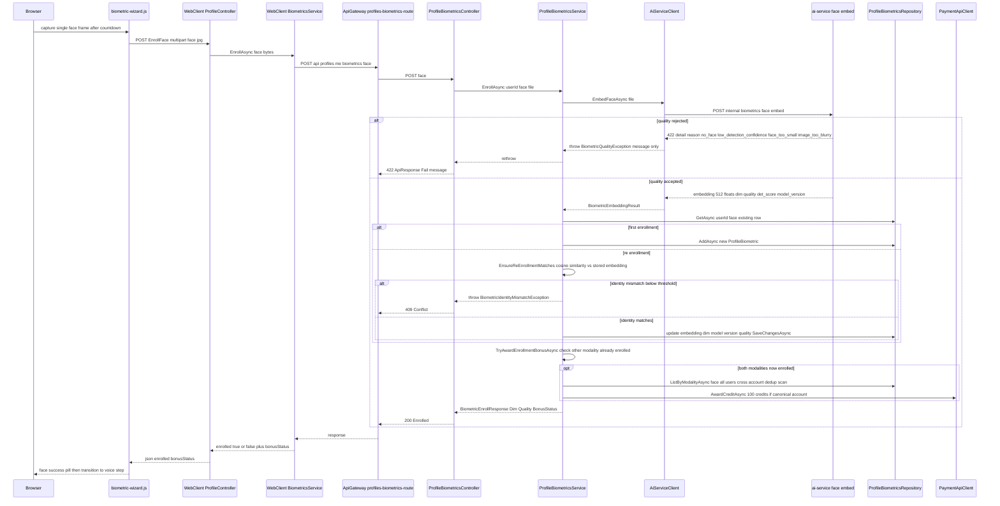
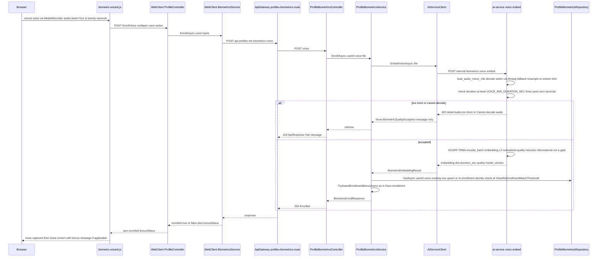
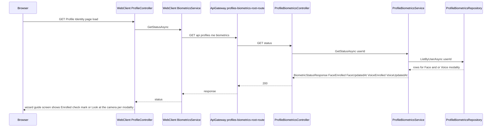

# G4 — Biometric Enrolment

Batch: Phase 4. Components covered: InterviewAPI, ai-service (`biometrics/`), WebClient. All files
cited below were re-read directly for this batch. T1–T6 terminology rules remain in force. Both
face and voice enrolment are AI-bearing features requiring the full a–k deep-dive (§8); "Check
Biometric Enrollment" is a read-only status query with no model involvement.

---

## F-12. Enroll Face Biometric

### 1. Purpose and scope
Lets a candidate capture a single face photo from their webcam and have InterviewAPI store a
numeric face-identity template (an embedding) derived from it, which later features use to verify
that the same person is present at the start of an interview (G5) and to gate the one-time
enrolment credit bonus (§ below). This feature covers capture, quality validation, embedding
extraction, and storage/upsert; it does not cover verification against a live session — that is G5.

### 2. Actors, preconditions, postconditions

| | |
|---|---|
| Actor | Authenticated candidate, `[Authorize]` (`ProfileBiometricsController.cs:14`, no role restriction) |
| Precondition | Candidate has granted camera permission in-browser; has read and checked the consent checkbox on the wizard's guide screen |
| Precondition (re-enrolment only) | The new sample's face must match the previously enrolled template above a threshold (§7) |
| Postcondition (success) | One `ProfileBiometrics` row exists for `(UserId, Modality="Face")`, holding an embedding, dimension, model version, and quality score — never the source image |
| Postcondition (re-enrolment, identity mismatch) | Existing row is untouched; enrolment rejected with 409 |

### 3. Architectural placement
`Browser (biometric-wizard.js) → WebClient ProfileController.EnrollFace
(Controllers/Profile/ProfileController.cs:165-187) → WebClient BiometricsService.EnrollAsync →
ApiGateway profiles-biometrics-route (ai-backed timeout policy, per Phase 0 gateway table) →
InterviewAPI ProfileBiometricsController.EnrollFace (ProfileBiometricsController.cs:48-50) →
ProfileBiometricsService.EnrollAsync (ProfileBiometricsService.cs:44-93) → Clients/AiServiceClient.
EmbedFaceAsync → ai-service POST /internal/biometrics/face/embed → biometrics/face_engine.py`. This
lives in InterviewAPI (not a separate BiometricAPI) and is routed through the same
`interview-cluster` at the Gateway as every other interview feature (Phase 0 evidence,
`profiles-biometrics-route` maps to `interview-cluster`) — biometrics is architecturally a facet of
the candidate's InterviewAPI-owned profile, not a standalone service. The same-origin proxy pattern
applies identically to G1/G3: `ProfileController.EnrollFace`'s own comment states the rationale
directly — "forwards the captured snapshot to the Gateway... so the browser never needs the bearer
token" (`ProfileController.cs:163-164`).

### 4. Interface contract
`POST api/profiles/me/biometrics/face`, multipart form field `file` (a single JPEG frame).
Response `BiometricEnrollResponse {Modality, Dim, Quality, BonusStatus}` — the comment on this DTO
states explicitly it "Never includes the embedding" (`BiometricEnrollResponse.cs:3`). Status codes:
200 "Enrolled."; 422 `BiometricQualityException` (ai-service rejected the sample, message is
user-facing — `ProfileBiometricsController.cs:70-73`); 409 `BiometricIdentityMismatchException`
(re-enrolment identity check failed, §7); 503 generic on any other failure. Note the explicit
in-code justification for surfacing exception messages verbatim on this endpoint —
"`ex.Message` on both typed catches below... are NOT `ex.Message` leaks. ai-service produces
genuinely actionable text here ('No face detected', 'Audio too short')... Replacing these with a
generic string would delete the only information telling the user how to retake their sample"
(`ProfileBiometricsController.cs:65-69`) — a deliberate, reasoned exception to the project's
otherwise-consistent "never leak `ex.Message`" convention seen throughout G1–G3.

### 5. Processing flow
1. Candidate reaches the wizard's face screen (`enterFaceStep`, `biometric-wizard.js:291-335`);
   camera opens (`getUserMedia({video:true})`, `:319`).
2. On "I'm ready," `runFaceCapture` (`:337-419`) runs a 3-2-1 countdown (`:342-346`), then — in
   **enrol mode** specifically (as opposed to verify mode's 8-frame burst, G5) — captures **exactly
   one** JPEG frame at quality 0.92 (`:370-376`).
3. The frame is posted as multipart form data to `WebClient ProfileController.EnrollFace`
   (`ProfileController.cs:165-187`), which reads it into a byte array and forwards to
   `BiometricsService.EnrollAsync("face", ...)`.
4. `InterviewAPI ProfileBiometricsController.EnrollFace` delegates to the shared private
   `EnrollAsync(modality, file, ct)` (`ProfileBiometricsController.cs:57-86`).
5. `ProfileBiometricsService.EnrollAsync` calls `AiServiceClient.EmbedFaceAsync(file, ct)` →
   `POST /internal/biometrics/face/embed` (`Clients/AiServiceClient.cs:119-120,125-155`).
6. ai-service's `embed_face` (`biometrics/router.py:49-56`) calls
   `extract_face_embedding` (`face_engine.py:74-95`) — see §8c for the full quality-gate sequence;
   any `FaceQualityError` becomes an HTTP 422 with `detail=str(exc)` (`router.py:54-55`).
7. `AiServiceClient.EmbedAsync`'s shared private helper (`AiServiceClient.cs:125-155`) maps a 422
   response to `BiometricQualityException(message)` — **the plain single-argument constructor**,
   carrying only a message string, **no `QualityCode`/`FaceCount`** (§9 — this is distinct from the
   structured version used only by G5's `/verify` call).
8. On success, `ProfileBiometricsService.EnrollAsync` looks up any existing row for
   `(userId, "Face")` (`ProfileBiometricsRepository.GetAsync`, `ProfileBiometricsRepository.cs:16-19`).
   If none exists, inserts a new `ProfileBiometric` row (`:59-72`). If one exists, calls
   `EnsureReEnrollmentMatches` (§7) before overwriting it in place (`:73-82`).
9. `TryAwardEnrollmentBonusAsync` runs unconditionally after every successful enrol/re-enrol call
   (§ Enrolment bonus below).
10. Returns `BiometricEnrollResponse`; the wizard shows a success pill, then auto-advances to the
    voice step after 1.1s (`biometric-wizard.js:409-418`).

*Figure 4.1 — Enroll Face Biometric sequence, including the upsert/re-enrolment branch and the
cross-account bonus check.*

### 6. Data model impact
Writes one `ProfileBiometrics` row (INSERT on first enrolment, UPDATE in place on re-enrolment) —
schema confirmed directly: `[Table("ProfileBiometrics")]`, unique index `UX_ProfileBiometrics_
User_Modality` on `(UserId, Modality)` (`Models/ProfileBiometric.cs:10-11`), columns `Id` (bigint
identity PK), `UserId`, `Modality` (`nvarchar(16)`), `Embedding` (`byte[]`/`VARBINARY(MAX)`), `Dim`
(int), `ModelVersion` (`nvarchar(128)`), `Quality` (`double?`, nullable), `CreatedAt`, `UpdatedAt`
(`:14-33`). The unique index is precisely what makes enrolment an upsert rather than an
ever-growing history table — there is structurally only ever one row per modality per user.

### 7. Business rules and invariants
- **R1 (upsert, not append)** — `UX_ProfileBiometrics_User_Modality` guarantees exactly one row per
  `(UserId, Modality)`; `EnrollAsync`'s existing-row check (`ProfileBiometricsService.cs:58-82`)
  mirrors this at the application layer.
- **R2 (re-enrolment identity guard)** — `EnsureReEnrollmentMatches`
  (`ProfileBiometricsService.cs:95-117`) first requires the new sample's `Dim`/`ModelVersion` to
  match the stored template exactly (`:100-104`, rejecting silently-incompatible model upgrades
  rather than comparing incomparable vectors), then computes
  `BiometricSimilarity.Cosine(existingEmbedding, candidateEmbedding)` and compares against
  `Biometrics:FaceReEnrollmentMatchThreshold` (default `0.35`, `:109-113`) — below threshold throws
  `BiometricIdentityMismatchException`, which the controller maps to 409
  (`ProfileBiometricsController.cs:75-77`). **This is what stops a different person from overwriting
  someone else's enrolled template** if they somehow gained access to the account.
- **R3** — `Quality` is a `double?`, nullable in the schema — for face it is always populated (§8d);
  the DTO comment claiming "Quality is face-only; null for voice" (`BiometricEmbeddingResult.cs:6`)
  is **contradicted by ai-service's own `VoiceEmbedResponse`**, which includes a computed `quality`
  field for voice too (`biometrics/schemas.py:16-21`, `voice_engine.py:70-73`). This is a stale/
  inaccurate code comment, not a functional defect — the voice quality value is in fact populated
  and stored identically to face's — flagged here rather than silently reconciled, since it could
  mislead a future reader of the .NET code into thinking voice quality is never available.

### 8. AI/ML component — full a–k treatment

**a. Model identity.** InsightFace `buffalo_l` model pack, ArcFace ResNet-50 backbone, loaded via
`insightface.app.FaceAnalysis(name=FACE_MODEL_PACK, root=FACE_MODEL_ROOT,
providers=["CPUExecutionProvider"])` (`face_engine.py:17-27`), `det_size=(640, 640)` (`:25`).
Version tag returned in every response: `FACE_MODEL_VERSION = "insightface-buffalo_l-arcface-r50-v1"`
(`config.py:11`). Runs on CPU only (`CPUExecutionProvider`), loaded from a local path
(`FACE_MODEL_ROOT = "models/insightface"`, `config.py:7`) — confirmed present locally in Phase 0's
survey, not downloaded from the Hub at request time.

**b. Architectural family and training objective, plain language first.** A face-recognition model
like this one looks at a cropped face and produces a list of numbers — an embedding — chosen so
that two photos of the *same* person end up with very similar number-lists, and two photos of
*different* people end up with clearly different ones, no matter the lighting, angle, or expression
in either photo. Precisely: ArcFace-style models are convolutional networks trained with an
**angular-margin loss**, which pushes same-identity embeddings to cluster tightly around a shared
direction on a hypersphere while enforcing an explicit angular margin against the nearest other
identity's cluster — this margin is what makes plain cosine similarity between two embeddings a
reliable same-person/different-person signal at inference time, without ever needing to re-run the
network on both photos together.

**c. Input pipeline.** `_decode` (`face_engine.py:52-57`) opens the uploaded bytes via PIL, converts
to RGB, then to OpenCV BGR — raises `FaceQualityError("Cannot decode image", "cannot_decode_image")`
on any decode failure. `_primary_face` (`:60-71`) runs the detector, requires at least one face
(`FaceQualityError("No face detected", "no_face")`), and — for enrolment specifically
(`enforce_single=True`) — rejects more than one detected face
(`MultipleFacesError`, a `FaceQualityError` subclass carrying `face_count`, `:64-65,36-44`); among
remaining candidates picks the largest by bounding-box area (`:67-71`). `extract_face_embedding`
(`:74-95`) then applies three quality gates in order, each with its exact constant:
  - **`FACE_MIN_DET_SCORE = 0.60`** (`config.py:19`) — the detector's own confidence that the
    detected region is a face at all; below this, `FaceQualityError("Low detection confidence
    (...)", "low_detection_confidence")` (`face_engine.py:83-85`).
  - **`FACE_MIN_FACE_RATIO = 0.05`** (`config.py:20`) — the detected face's bounding-box area must be
    at least 5% of the frame's total area; below this, `"Face too small / too far from camera"`
    (`:86-88`).
  - **`FACE_MIN_BLUR_VAR = 40.0`** (`config.py:21`) — the **Laplacian variance** of the grayscale
    image (`_blur_variance`, `:47-49`: `cv2.Laplacian(gray, cv2.CV_64F).var()`). In one sentence:
    the Laplacian operator highlights edges, so a sharp, in-focus image has high-variance edge
    response while a blurry image's edges are smeared out and produce low variance — this is a
    standard, cheap blur-detection heuristic, not a learned model. Below the threshold, `"Image too
    blurry"` (`:89-90`).

**d. Output representation.** **512-dimensional, already L2-normalized** — confirmed directly from
the code comment, not assumed: `emb = np.asarray(face.normed_embedding, dtype=np.float32)  # 512-d,
L2-normalized` (`face_engine.py:92`). Serialized as a JSON float array over the wire
(`FaceEmbedResponse`, `schemas.py:8-13`), then converted to a little-endian `byte[]` on the .NET
side via `EmbeddingCodec.ToBytes` (`Buffer.BlockCopy`, `Helpers/EmbeddingCodec.cs:9-14`) and stored
in `ProfileBiometrics.Embedding` (`VARBINARY(MAX)`). A companion `quality` value
(`min(1.0, det) * min(1.0, blur/150.0)`, `face_engine.py:93`) is stored in `ProfileBiometrics.Quality`
— a simple product of the two already-computed quality signals, not an independent model output.

**e. Decision rule.** Cosine similarity between two embeddings:
$$\mathrm{sim}(\mathbf{a},\mathbf{b}) = \frac{\mathbf{a}\cdot\mathbf{b}}{\lVert\mathbf{a}\rVert \lVert\mathbf{b}\rVert}$$
implemented identically in both directions of this feature: `BiometricSimilarity.Cosine`
(`Helpers/BiometricSimilarity.cs:5-22`, .NET side, used for re-enrolment and bonus-dedup) and
`cosine_similarity` (`biometrics/similarity.py`, ai-service side, used at `/verify`, G5). For
**re-enrolment** specifically: `score >= Biometrics:FaceReEnrollmentMatchThreshold` (default `0.35`)
is required to accept the overwrite (§7 R2); this is a .NET-side config key, independent of
ai-service's own `FACE_MATCH_THRESHOLD`, even though both currently default to the same numeric
value (0.35) — two separate config surfaces that happen to agree today, not one threshold read
twice.

**f. Threshold provenance — stated plainly, without softening.** `FACE_MATCH_THRESHOLD = 0.35` is a
fixed Python-side default (`config.py:15`), explicitly documented as overridable by
`models/calibration.json` at request time via `_threshold_for()` (`router.py:40-46`) — but **Phase
0.5 §Q4 confirmed `calibration.json` does not exist anywhere in this repository**, so `_threshold_for`
always falls through to the fixed default in the deployed system today. `ai-service/biometrics/
EVAL.md:74-77` states explicitly, quoted verbatim: *"Do not fabricate genuine/impostor scores to
make `calibrate.py` 'work'... it says nothing about real accuracy and must never be presented as
such or used to change the fixed defaults in `config.py`."* **In the correct academic terms**: no
False Accept Rate (FAR — the rate at which two different people's samples are wrongly accepted as
a match), False Reject Rate (FRR — the rate at which two samples from the same person are wrongly
rejected), or Equal Error Rate (EER — the operating point where FAR and FRR are equal, commonly used
to summarize a biometric system's discriminative power on a labelled dataset) has been measured for
this deployment. `0.35` is a heuristic default, not an empirically validated operating point. The
re-enrolment threshold (`Biometrics:FaceReEnrollmentMatchThreshold`, also `0.35` by default) carries
the identical provenance gap — it happens to reuse the same number but was never independently
calibrated either.

**g–h. Prompt/RAG pipeline.** Not applicable — no language model or retrieval step is involved in
face embedding extraction.

**i. Runtime characteristics.** CPU inference inside the ai-service container (`CPUExecutionProvider`,
no GPU used for this model regardless of the container's GPU reservation for other models). No
explicit warm-up call for the face analyzer was found for this specific model at app startup in this
pass (contrast with `warm_up_tts()`, G3) — `_get_analyzer()` uses lazy, thread-safe, double-checked
initialization on first use (`face_engine.py:13-27`), so the very first enrolment or verification
request in a fresh process pays the model-load cost. `[UNVERIFIED: whether app.main's lifespan hook
also warms this specific model was not independently re-confirmed in this pass — Phase 0 noted
`biometrics_warm_up` as one of three startup warm-up calls, which may cover this; not re-traced
here]`.

**j. Known weaknesses.** No calibrated threshold (§f). Blur/detection/ratio gates are simple,
non-learned heuristics that could reject a genuinely valid but unusually-lit or unusually-framed
photo, or accept a technically-sharp-but-still-ambiguous one — no false-positive/false-negative rate
is measured for these gates either. Single-frame enrolment (one photo) provides no protection
against a static printed photo or a screen replay being enrolled as a "real" face — enrolment itself
performs no liveness check at all (liveness, where it exists, is a G5 verification-time concept, and
Phase 0.5 already established it is disabled there too).

**k. Academic grounding.**
- Deng, J. et al., "ArcFace: Additive Angular Margin Loss for Deep Face Recognition," CVPR 2019.
  `[CITATION TO VERIFY — cited from general knowledge of the field, venue/year not independently
  re-confirmed in this pass]`.
- Guo, J. et al. (InsightFace project authors), open-source `insightface` toolkit documentation.
  `[CITATION TO VERIFY]`.

### 9. Failure modes and edge cases

| Scenario | System behaviour | Evidence | User-visible result |
|---|---|---|---|
| No face in frame | `FaceQualityError("No face detected", "no_face")` → 422 `detail` string only | `face_engine.py:62-63`, `AiServiceClient.EmbedAsync` uses `ReadDetailAsync` (plain message, **no structured `QualityCode`** for this endpoint) | Wizard shows the raw message via `failFaceStep` — *"No face detected — please try again."* (`biometric-wizard.js:421-424` template) |
| More than one face | `MultipleFacesError("Multiple faces detected (N)", "multiple_faces")` — but the code comment notes enrol callers "still catch it via the `FaceQualityError` base class and get the same `str(exc)` message as before" (`face_engine.py:38-40`) | `face_engine.py:36-44,64-65` | Same plain-message treatment as any other quality rejection — the structured `multiple_faces` code exists in the exception object but is **not surfaced as a distinct code** to the .NET side for the enrol path (only the plain message string crosses the wire, per `ReadDetailAsync`) |
| Low detector confidence / face too small / too blurry | Each raises its own `FaceQualityError` with a distinct message | `face_engine.py:83-90` | Distinct, actionable message per case, all via the same plain-message 422 path |
| Re-enrolment with a different model version deployed | `EnsureReEnrollmentMatches` rejects on `Dim`/`ModelVersion` mismatch before any similarity comparison | `ProfileBiometricsService.cs:100-104` | 400-shaped `InvalidOperationException`... actually this is **not** caught by a dedicated handler in `EnrollAsync`'s controller action (only `BiometricQualityException`/`BiometricIdentityMismatchException` have specific catches) — falls to the generic 503 |
| Re-enrolment, same model, different person's face | `BiometricIdentityMismatchException` | `ProfileBiometricsService.cs:115-116` | 409 with a specific message: *"The new face sample does not match the currently enrolled identity."* |
| ai-service unreachable | Generic `Exception` caught | `ProfileBiometricsController.cs:79-85` | 503 "Enrollment is temporarily unavailable. Please try again shortly." |

### 10. Security and integrity considerations
Same-origin proxy keeps the ai-service internal key off the browser (§3). The re-enrolment identity
guard (§7 R2) is the primary anti-tampering control preventing account takeover from silently
swapping out a candidate's enrolled identity. **Privacy**: only the embedding, dimension, model
version, quality score, and timestamps are ever persisted — confirmed directly by reading every
write path in this feature; the raw JPEG frame is held only in transient `MemoryStream`/multipart
buffers in WebClient and InterviewAPI, and as an in-memory `bytes` object in ai-service's
`embed_face` handler, with no file-write or `SaveAsync` call anywhere in the traced call chain. The
schema comment states this explicitly: *"Stores the embedding vector only — never raw images/audio
(privacy: Decree 13/2023)"* (`ProfileBiometric.cs:8-9`). **Consent** is captured once, on the
wizard's guide screen, via an explicit checkbox whose label names the same decree by number: *"Only
your biometric signature (a mathematical vector) is stored — never your photo or recording.
Complies with Decree 13/2023/ND-CP. You can re-enroll at any time."* (`Views/Profile/Identity.
cshtml:96-101`, quoted here in full since it is the actual consent text a candidate reads, not a
paraphrase). The `Enter`/`Get started` button is disabled until both this checkbox and both device
permissions are granted (`updateStartButton`, `biometric-wizard.js:214-216`).

### 11. Limitations and future work
- **No calibrated threshold** (§8f) — stated with the correct FAR/FRR/EER vocabulary rather than
  hidden behind a bare number.
- **No deletion or withdrawal flow was located.** A repo-wide search for any delete/remove/withdraw
  operation on `ProfileBiometrics` (`IProfileBiometricsRepository`, `ProfileBiometricsController`,
  `ProfileBiometricsService`) found none — enrolment can be *replaced* (re-enrolment, §7 R2) but
  never *removed*. **This is stated as an observation, not an assertion of non-compliance**: an
  embedding is still biometric personal data under Nghị định 13/2023/NĐ-CP even though it is not the
  raw source media, and storing only the embedding reduces but does not eliminate the data
  controller's obligations under that decree — a data-subject deletion/withdrawal right is a
  standard expectation this codebase does not yet implement for this table, as far as this pass
  could locate.
- The `BiometricEmbeddingResult.cs:6` comment claiming voice quality is always null is stale (§7 R3)
  — a documentation-accuracy fix, not a functional one.

### 12. Figures
Figure 4.1 (sequence diagram, `diagrams/FIG-4.1.mmd`); Figure 4.4 (screenshot — face enrolment
capture screen, see `SCREENSHOT_CHECKLIST.md`).

---

## F-13. Enroll Voice Biometric

### 1. Purpose and scope
The voice counterpart to F-12: the candidate records a short spoken sample, InterviewAPI stores a
speaker-identity embedding derived from it, used later (G5) to verify that spoken answers come from
the enrolled candidate, not a proxy or a played recording.

### 2. Actors, preconditions, postconditions
Structurally identical to F-12 (§2), substituting "voice" for "face": precondition adds a minimum
recording duration (client-side 4–20s, server-side ≥3.0s, §8c); postcondition stores a
`ProfileBiometrics` row with `Modality="Voice"`.

### 3. Architectural placement
Identical shape to F-12: `Browser (biometric-wizard.js) → WebClient ProfileController.EnrollVoice
(ProfileController.cs:190-212) → WebClient BiometricsService.EnrollAsync → ApiGateway
profiles-biometrics-route → ProfileBiometricsController.EnrollVoice
(ProfileBiometricsController.cs:53-55) → ProfileBiometricsService.EnrollAsync (the same shared
method as F-12, dispatched by the `modality` switch, `ProfileBiometricsService.cs:50-55`) →
AiServiceClient.EmbedVoiceAsync → ai-service POST /internal/biometrics/voice/embed →
biometrics/voice_engine.py`. **Both modalities share the exact same `.NET` enrolment service
method** — the only per-modality branching is which ai-service endpoint is called and which
re-enrolment threshold config key is read (§7).

### 4. Interface contract
`POST api/profiles/me/biometrics/voice`, multipart field `file` (an `audio/webm` recording).
Same `BiometricEnrollResponse`/status-code shape as F-12 §4 (200/422/409/503) — not repeated here.

### 5. Processing flow
1. After the face step succeeds, the wizard auto-advances to the voice screen (`enterVoiceStep`,
   `biometric-wizard.js:451-489`); in enrol mode the prompt is a fixed, non-challenge sentence,
   `ENROLL_VOICE_PROMPT = "Introduce yourself naturally for a few seconds — your name and your
   role."` (`:84-85`), distinct from verify mode's server-issued phrase challenge (G5).
2. `startRecording` (`:491-550`) opens the microphone, records via `MediaRecorder` in `audio/webm`,
   drives a live level-bar visualizer off a Web Audio `AnalyserNode` (`:504-521`), and enforces
   **client-side** `MIN_RECORD_SECONDS = 4` (Stop button stays disabled until this elapses, `:542-545`)
   and `MAX_RECORD_SECONDS = 20` (auto-stops the recorder, `:546-548`) (`:81-82`).
3. On stop, `onRecordingStopped` (`:558-603`) posts the recorded blob as multipart `voice` to the
   WebClient proxy.
4. `ProfileBiometricsService.EnrollAsync` (the same method as F-12) calls
   `AiServiceClient.EmbedVoiceAsync` → `POST /internal/biometrics/voice/embed`.
5. ai-service's `embed_voice` (`router.py:59-66`) calls `extract_voice_embedding`
   (`voice_engine.py:51-73`) — see §8c for the decode/duration gate. Any `VoiceQualityError` becomes
   a 422 with `detail=str(exc)` (`router.py:64-65`), following the identical plain-message pattern
   as face (§ F-12, no structured code for voice either).
6. On success, the same upsert-or-re-enrol-with-identity-check logic as F-12 §5 steps 8–9 runs,
   using `Biometrics:VoiceReEnrollmentMatchThreshold` (default `0.25`) instead of the face key.
7. `TryAwardEnrollmentBonusAsync` runs identically (§ Enrolment bonus below, shared code path).

*Figure 4.2 — Enroll Voice Biometric sequence.*

### 6. Data model impact
Identical schema to F-12 (§6) — same `ProfileBiometrics` table, `Modality="Voice"` row, same unique
index enforcing one row per user per modality.

### 7. Business rules and invariants
Same upsert/re-enrolment-identity-guard pattern as F-12 §7 R1–R2, with
`Biometrics:VoiceReEnrollmentMatchThreshold` (default `0.25`) as the re-enrolment threshold
(`ProfileBiometricsService.cs:109-113`) — lower than face's `0.35` default; no rationale for the
specific numeric gap between the two modalities' re-enrolment thresholds is recorded in any code
comment found in this pass (distinct from the *dedup*-threshold rationale documented below, which
*is* explained).

### 8. AI/ML component — full a–k treatment

**a. Model identity.** SpeechBrain `EncoderClassifier`, loaded via
`EncoderClassifier.from_hparams(source=VOICE_MODEL_SOURCE, savedir=VOICE_MODEL_SAVEDIR,
run_opts={"device": "cpu"})` (`voice_engine.py:16-28`) — an ECAPA-TDNN speaker-embedding model,
`VOICE_MODEL_SOURCE = "speechbrain/spkrec-ecapa-voxceleb"` (`config.py:8`), version tag
`speechbrain-ecapa-voxceleb-v1` (`config.py:12`). Loaded from a local savedir cache
(`models/ecapa-voxceleb`, `config.py:9`), confirmed present locally in Phase 0's survey.

**b. Architectural family and training objective, plain language first — and the distinction that
matters for G5.** A speaker-embedding network listens to a clip of speech and produces a
number-list that captures *how the voice sounds* — pitch, timbre, resonance, speaking style — while
deliberately trying to ignore *what words were said*, so the same person's embedding stays similar
whether they say one sentence or a completely different one. **This distinction matters directly
for the Verify Voice Answer feature in G5**: because the embedding is trained to be
content-independent, the same speaker-verification mechanism used here for enrolment can later
compare a candidate's *interview answer* (arbitrary, unscripted content) against the *enrolment
sample* (a fixed introductory sentence) and still expect a match if it is the same speaker — content
mismatch is by design not supposed to matter to this specific model. Precisely: ECAPA-TDNN
(Emphasized Channel Attention, Propagation and Aggregation — Time Delay Neural Network) is trained
with a speaker-classification objective (commonly angular-margin-based, in the same family as
ArcFace's approach for faces) over a large multi-speaker corpus (VoxCeleb), so that the network's
penultimate-layer representation clusters by speaker identity rather than by lexical content.

**c. Input pipeline.** Browser records `audio/webm` via `MediaRecorder`
(`biometric-wizard.js:524-529`), client-enforced between `MIN_RECORD_SECONDS=4` and
`MAX_RECORD_SECONDS=20` (`:81-82,542-548`). Server-side, `load_audio_mono_16k`
(`voice_engine.py:35-48`) decodes via `librosa`, falling back to an `ffmpeg`-backed audioread path
specifically because "libsndfile (soundfile) can't decode WebM/Opus (MediaRecorder's default
browser output)" (`:38-39` comment) — written to a temp file first since that fallback path needs a
real file path, not an in-memory buffer (`:40-47`) — and **resampled to `VOICE_TARGET_SR = 16000`
Hz, mono** (`:45`, `config.py:23`). `extract_voice_embedding` (`:51-73`) then enforces a single
duration gate: **`VOICE_MIN_DURATION_SEC = 3.0`** seconds (`config.py:22`) — below this,
`VoiceQualityError(f"Audio too short ({duration:.1f}s, need >= {VOICE_MIN_DURATION_SEC}s)")`
(`voice_engine.py:57-58`). Note the gap between the client's 4-second minimum and the server's
3-second minimum — the server-side gate is the real enforcement (consistent with every other
client/server validation pair in this codebase), and is deliberately looser than the client's UX
minimum, so a slightly-short-but-still-valid recording is never rejected by the authoritative check
after having been allowed past the client's own (stricter) gate.

**d. Output representation — dimensionality read from code, not assumed.** The code computes the
embedding's dimension dynamically from the model's own output tensor shape —
`emb = emb.squeeze().cpu().numpy().astype(np.float32)` then `int(emb.shape[0])`
(`voice_engine.py:64,72`) — **no literal dimension count is hardcoded anywhere in this repository's
source**, unlike face's explicit `# 512-d` comment. The model's actual configuration file
(`ai-service/models/ecapa-voxceleb/hyperparams.yaml`) is a symlink into a Docker-container-only
Hugging Face cache path (`/root/.cache/huggingface/...`) that does not resolve on this host and was
not readable in this pass (permission denied / path not found when attempted directly). **The
publicly documented output size for the `speechbrain/spkrec-ecapa-voxceleb` checkpoint is commonly
cited as 192** in SpeechBrain's own model materials, but this report does not state that number as
confirmed fact for this deployment, since it could not be verified against this repository's own
accessible files — `[UNVERIFIED: exact embedding dimensionality not confirmable from source in this
repository; the code determines it dynamically at runtime and persists the observed value into
`ProfileBiometrics.Dim` per-row]`. The embedding is **L2-normalized** before storage —
confirmed directly: `emb = emb / (np.linalg.norm(emb) + 1e-8)` (`voice_engine.py:65`) — then
serialized as a JSON float array (`VoiceEmbedResponse`, `schemas.py:16-21`) and stored via the same
`EmbeddingCodec` little-endian byte encoding as face (`Helpers/EmbeddingCodec.cs:9-14`).

**e. Decision rule.** Identical cosine-similarity formula to F-12 §8e. For re-enrolment: `score >=
Biometrics:VoiceReEnrollmentMatchThreshold` (default `0.25`).

**f. Threshold provenance — same brutal honesty as face, plus the quoted quality-heuristic
caveat.** `VOICE_MATCH_THRESHOLD = 0.25` (`config.py:16`) is a fixed default, same
`calibration.json`-override mechanism and same absence of that file (Phase 0.5 §Q4) — no
FAR/FRR/EER has been measured for the voice match threshold either. Additionally, and distinctly
from the match threshold, the **quality score itself** is explicitly self-described as
non-authoritative — quoted verbatim (≤15 words): *"a heuristic (informational, not a gate)"*
(`voice_engine.py:67`), with the fuller comment stating it is "not derived from real calibration
data (that's Milestone 3)" (`:69`). Computed as `min(1.0, duration / (VOICE_MIN_DURATION_SEC *
2))` (`:70`) — i.e. purely a function of recording length relative to the minimum, saturating at
1.0 once the recording is comfortably longer than required; it has no relationship to how
distinctive or verifiable the voice sample actually is.

**g–h. Prompt/RAG pipeline.** Not applicable.

**i. Runtime characteristics.** CPU inference (`run_opts={"device": "cpu"}`, `voice_engine.py:27`).
Lazy, thread-safe, double-checked singleton load on first use (`_get_encoder`, `:16-28`) — same
pattern as the face analyzer, no dedicated warm-up call for this specific model independently
confirmed in this pass.

**j. Known weaknesses.** No calibrated match threshold (§f). The quality score is explicitly
acknowledged in-code as uninformative about actual verifiability, only about recording length (§f).
Single-sample enrolment provides no protection against a recorded/replayed voice being enrolled as
"real" — no liveness or spoof-detection check exists at enrolment time.

**k. Academic grounding.**
- Desplanques, B., Thienpondt, J., and Demuynck, K., "ECAPA-TDNN: Emphasized Channel Attention,
  Propagation and Aggregation in TDNN Based Speaker Verification," Interspeech 2020.
  `[CITATION TO VERIFY — cited from general knowledge of the field, not independently
  re-confirmed in this pass]`.
- Nagrani, A., Chung, J.S., and Zisserman, A., "VoxCeleb: A Large-Scale Speaker Identification
  Dataset," Interspeech 2017. `[CITATION TO VERIFY]`.

### 9. Failure modes and edge cases

| Scenario | System behaviour | Evidence | User-visible result |
|---|---|---|---|
| Audio undecodable | `VoiceQualityError("Cannot decode audio")` | `voice_engine.py:54-55` | Plain-message 422; wizard's `failVoiceStep` appends the message plus a recording-length hint if the recording ran under the client minimum (`biometric-wizard.js:591-596`) |
| Recording under 3.0s (server minimum, even if it passed the client's 4s gate through some edge case) | `VoiceQualityError` with the exact measured duration | `voice_engine.py:57-58` | 422 with the specific duration reported back |
| Browser lacks `audio/webm` support | Detected before requesting the microphone | `biometric-wizard.js:493-495` | "Your browser does not support audio recording." — no fallback format |
| Recording hits the 20s cap | Auto-stopped client-side, proceeds normally as a valid (if maximal) sample | `biometric-wizard.js:546-548` | No error — the recording is simply capped and submitted |
| Microphone permission denied | `getUserMedia` rejects | `biometric-wizard.js:499-502` | "Could not access the microphone. Allow microphone permission for this site, then try again." |

### 10. Security and integrity considerations
Identical same-origin-proxy and no-raw-audio-persisted properties as F-12 §10 — confirmed by the
same direct trace of every write path in this feature (no file write, no `SaveAsync` on raw bytes
anywhere in `ProfileBiometricsService.cs`, `AiServiceClient.cs`, or `voice_engine.py`'s
`extract_voice_embedding`). Consent is captured once for both modalities together on the shared
guide screen (§ F-12 §10) — there is no separate voice-specific consent step.

### 11. Limitations and future work
Same calibration and deletion-flow gaps as F-12 §11, restated for voice: `VOICE_MATCH_THRESHOLD`
and `Biometrics:VoiceReEnrollmentMatchThreshold` are both uncalibrated heuristic defaults; no
deletion/withdrawal endpoint exists for either modality. The embedding dimensionality could not be
independently confirmed from this repository's accessible source (§8d) — a future pass with
container-level file access (reading the resolved `hyperparams.yaml` inside a running ai-service
container) could close this gap without needing to trust the publicly-cited `192` figure.

### 12. Figures
Figure 4.2 (sequence diagram, `diagrams/FIG-4.2.mmd`); Figure 4.5 (screenshot — voice enrolment
recording screen, see `SCREENSHOT_CHECKLIST.md`).

---

## Enrolment bonus and anti-abuse (shared by F-12 and F-13)

This mechanism is not a separate numbered feature in the inventory but is fully shared code
(`ProfileBiometricsService.cs:119-196`) triggered identically from both F-12 and F-13's `EnrollAsync`
call (`:84`), so it is documented once here and cross-referenced from both features above.

**Trigger and amount.** `TryAwardEnrollmentBonusAsync` runs after **every** successful enrol/
re-enrol call, for either modality (`:125`). It checks whether the *other* modality is already
enrolled (`:127-130`) — "checked by 'does the OTHER modality already exist', not 'did I just enroll
voice'," per the code comment, "so it fires correctly regardless of which order the user enrolls in"
(`:119-121`). If eligible, it calls `PaymentApiClient.AwardCreditAsync(userId,
CreditConfig.BiometricEnrollmentBonusCredits, userId, ..., ct)` — **100 credits**
(`Helpers/CreditConfig.cs:14`), with `referenceId = userId` itself, not a session id (the interface
comment notes this is deliberate: "PaymentAPI's own idempotency guard keys on it, so a caller can
call this every time the award condition looks true... without needing to track 'did I already
award this' locally," `Clients/IPaymentApiClient.cs:11-14`).

**Cross-account dedup — the interesting part, documented honestly.**
`IsCanonicalBonusAccountAsync` (`ProfileBiometricsService.cs:168-196`) exists to stop one real
person farming the 100-credit bonus by enrolling the same face across multiple accounts. Algorithm:
1. Fetch the current user's own face template (`:170-173`).
2. **`ListByModalityAsync(ModalityFace, ct)` fetches every face-modality `ProfileBiometrics` row for
   every user in the system** (`ProfileBiometricsRepository.cs:26-29` — no `WHERE UserId=...`
   filter at all), loaded fully into memory.
3. In-memory, compare the current user's embedding against every other fetched embedding via
   `BiometricSimilarity.Cosine`, filtered additionally on matching `Dim`/`ModelVersion`, at
   `Biometrics:BonusDedupMatchThreshold` (default **0.5**) (`:181-190`).
4. Among all templates scoring at or above that threshold, pick the **canonical** one — the oldest
   by `CreatedAt`, then by `Id` as a tiebreaker (`:191-193`).
5. Return `true` only if the *current* user **is** that canonical account (`:195`) — i.e. only the
   first person ever to enroll with this face gets the bonus; every later duplicate account of the
   same real person is denied (`BonusStatusIdentityAlreadyClaimed`).

**This does not scale**: it is an O(n) full-table scan and O(n) in-memory cosine comparison against
every enrolled face in the system, on every single enrol/re-enrol call for either modality (once
both modalities are present) — confirmed directly from the repository method's lack of any
filtering, pagination, or indexing beyond the plain `WHERE Modality = @modality`. At the scale of a
university capstone project's candidate pool this is unlikely to matter; it would not survive
unmodified at a materially larger user base.

**The threshold asymmetry — 0.5 here vs. 0.35 for face re-enrolment — has a recorded rationale, not
an invented one.** The code comment states it directly: *"Deliberately stricter than the
re-enrollment thresholds: those tolerate the SAME person across lighting/pose, this decides whether
two DIFFERENT accounts are the same real person — a loose threshold here produces false positives
that silently deny a legitimate user their bonus"* (`ProfileBiometricsService.cs:176-179`). In
other words, the two thresholds answer different questions (same-person-different-photo vs.
different-account-same-person) and a **higher** cosine-similarity bar for the latter is the more
conservative choice specifically to avoid wrongly denying a legitimate bonus. The same comment
block explicitly flags this value's own provenance: *"Value is provisional pending Milestone 3
biometric calibration"* (`:179-180`) — so while the *reason for the asymmetry* is recorded, the
*specific number 0.5* carries the same uncalibrated-default status as every other threshold in this
system (§8f above).

**Idempotency of the award itself.** `AwardCreditAsync`'s idempotency guard lives entirely on
PaymentAPI's side — per the project's ownership boundary, this report documents only the observed
integration contract: InterviewAPI calls `POST /api/internal/credit/award` with `{UserId, Amount,
ReferenceId=userId, Description}` (`PaymentApiClient.cs:126-141`, confirmed structurally identical
to `DeductCreditAsync`/`RefundCreditAsync` in G2) and receives back `CreditAwardResponse {Success,
Awarded, BalanceAfter, Message}` — `Success=true` covers **both** "awarded now" and "already had it,
no-op" outcomes; only `Awarded=true` means *this* call is what granted it (`IPaymentApiClient.cs:72-83`
comment), which `ProfileBiometricsService` uses to distinguish `BonusStatusAwarded` from
`BonusStatusAlreadyAwarded` for the client (`:159`). **No internal PaymentAPI logic (e.g. the unique
constraint the comment implies exists) is asserted here** — only what InterviewAPI observes as the
caller, consistent with PaymentAPI being teammate-owned.

**User-visible outcomes**, taken directly from the wizard's own message strings
(`biometric-wizard.js:632-647`): *"Awarded"* → "🎉 You've been awarded 100 free credits..."; 
*"IdentityAlreadyClaimed"* → "This identity has already received the one-time enrollment bonus on
another account..."; *"NotAwarded"* → "Your enrollment bonus couldn't be credited right now...";
*"AlreadyAwarded"* → "Your one-time 100-credit enrollment bonus was already credited to this
account."; *"NotYetEligible"* → no message shown (silently normal, since most enrol calls are the
first of the two modalities).

---

## F-14. Check Biometric Enrollment

### 1. Purpose and scope
A read-only status query that reports whether the candidate has already enrolled each modality, and
when. It powers the wizard's guide screen (so a returning candidate sees "Enrolled ✓ — redo
replaces it" instead of being asked to enroll again) and gates the Start-interview flow's own
pre-check (G1/G2's biometric-entry-gate precondition).

### 2. Actors, preconditions, postconditions

| | |
|---|---|
| Actor | Authenticated candidate, `[Authorize]` |
| Precondition | None beyond authentication |
| Postcondition | No state change — pure read |

### 3. Architectural placement
`Browser → WebClient ProfileController.Identity (Controllers/Profile/ProfileController.cs:133-161)
→ WebClient BiometricsService.GetStatusAsync → ApiGateway profiles-biometrics-root-route →
InterviewAPI ProfileBiometricsController.GetStatus (ProfileBiometricsController.cs:29-45) →
ProfileBiometricsService.GetStatusAsync (ProfileBiometricsService.cs:198-210) →
ProfileBiometricsRepository.ListByUserAsync`. Also called, independently, from
`InterviewController.Start` in G1 (`InterviewController.cs:78-83`) as the pre-check gate before a
new session can be configured — the same status query serves both the Profile page's own display
and the Interview dashboard's gate, via the same WebClient service method.

### 4. Interface contract
`GET api/profiles/me/biometrics`, no request body. Response `BiometricStatusResponse
{FaceEnrolled, FaceUpdatedAt, VoiceEnrolled, VoiceUpdatedAt}`. Status codes: 200 always for an
authenticated caller (no enrolment is a normal state, not an error — mirrors the pattern already
seen for `GetActiveSession` in G2); 503 generic on unexpected failure.

### 5. Processing flow
1. `ProfileBiometricsService.GetStatusAsync` calls `ListByUserAsync(userId, ct)`
   (`ProfileBiometricsRepository.cs:21-24`, `AsNoTracking`, unfiltered by modality — returns
   whatever rows exist, 0/1/2 of them).
2. Finds the `Face` and `Voice` rows independently via `FirstOrDefault`
   (`ProfileBiometricsService.cs:201-202`).
3. Returns booleans plus each modality's `UpdatedAt` timestamp (which, per the upsert semantics of
   F-12/F-13, reflects the most recent enrolment **or re-enrolment** — not necessarily the original
   enrolment date).

*Figure 4.3 — Check Biometric Enrollment sequence.*

### 6. Data model impact
Read-only — no writes. Queries `ProfileBiometrics` unfiltered by modality, relying on the same
unique index (`UX_ProfileBiometrics_User_Modality`) that guarantees at most one row per modality to
make the `FirstOrDefault` lookups unambiguous.

### 7. Business rules and invariants
- **R1** — Enrolment status is derived purely from row *existence*, not from any explicit "active"/
  "verified" flag — there is no separate status column on `ProfileBiometrics` (confirmed against the
  full schema read in G4's mandatory reads); a row existing **is** the enrolled state.
- **R2** — `FaceUpdatedAt`/`VoiceUpdatedAt` reflect the latest write (enrol or re-enrol), not a
  separate "first enrolled at" timestamp — the schema has only `CreatedAt`/`UpdatedAt`, and this
  endpoint surfaces only `UpdatedAt`.

### 8. AI/ML component
Not applicable — a plain database read with no model or ai-service involvement.

### 9. Failure modes and edge cases

| Scenario | System behaviour | Evidence | User-visible result |
|---|---|---|---|
| Neither modality enrolled | Both booleans false, both timestamps null | `ProfileBiometricsService.cs:203-209` | Guide screen shows "Look at the camera" / "Read a short phrase" for both steps (`Identity.cshtml:76-86`) |
| Only one modality enrolled | Mixed result | Same code path | Guide screen shows one step as "Enrolled ✓ — redo replaces it," the other as pending |
| Database unreachable | Generic `Exception` caught | `ProfileBiometricsController.cs:38-44` | 503 "Could not load your verification status. Please try again shortly."; `ProfileController.Identity` treats this as `success=false` and shows `Model.ErrorMessage` on the guide screen rather than failing the page load entirely (`ProfileController.cs:140,158`) |

### 10. Security and integrity considerations
Standard `[Authorize]` + JWT-derived `userId` scoping — no `SessionId`/resource id is accepted from
the caller for this endpoint at all, so there is no IDOR surface to protect beyond authentication
itself (the query is always scoped to the caller's own `userId` from the token).

### 11. Limitations and future work
None specific to this feature beyond what F-12/F-13 already document about the underlying data
(no deletion flow, no calibrated thresholds) — this feature only reads that data, it does not
compound those gaps.

### 12. Figures
Figure 4.3 (sequence diagram, `diagrams/FIG-4.3.mmd`); Figure 4.6 (screenshot — biometric wizard
guide screen showing enrolled status for both modalities, see `SCREENSHOT_CHECKLIST.md`).
