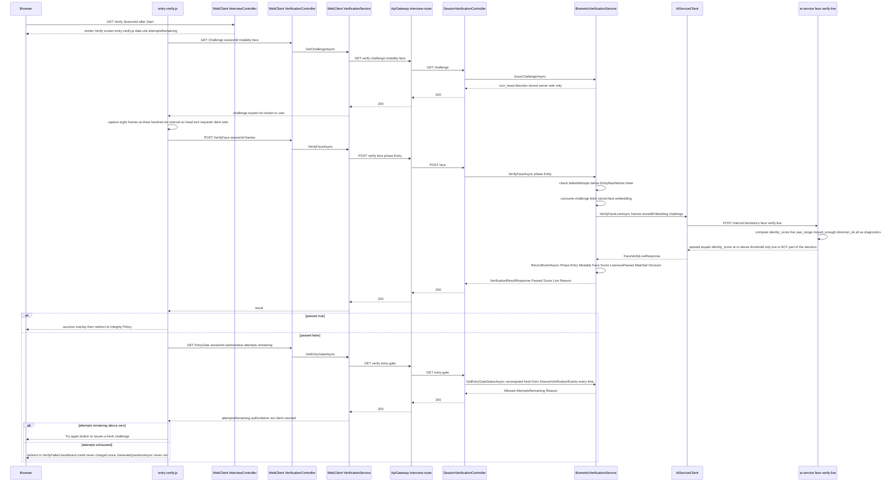
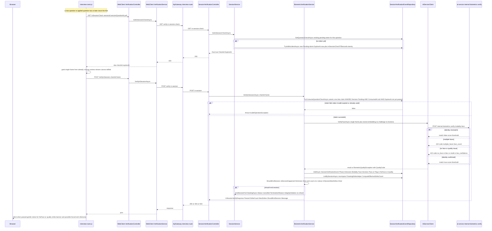
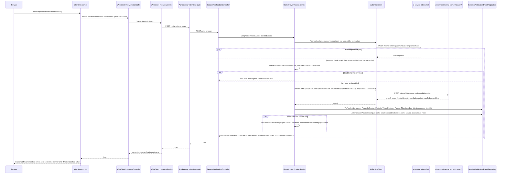
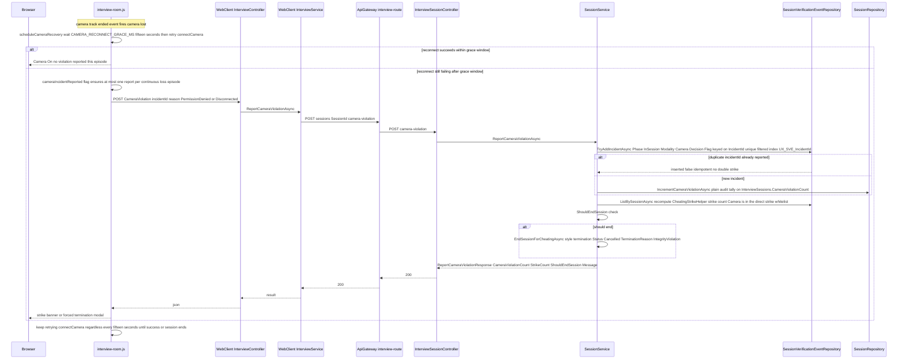
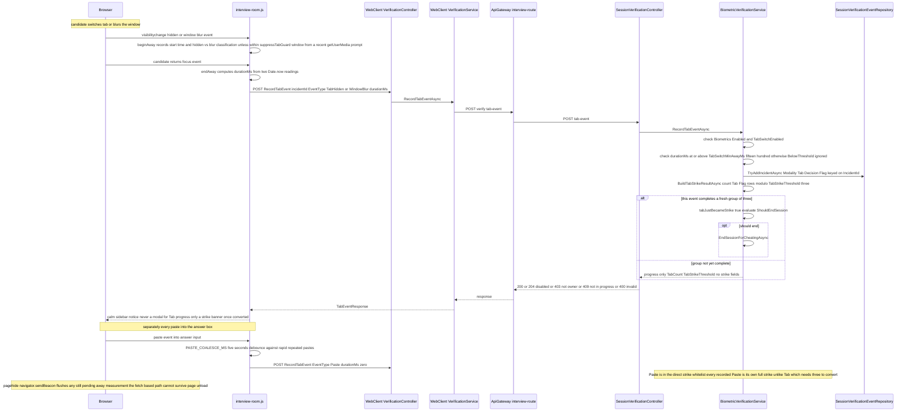
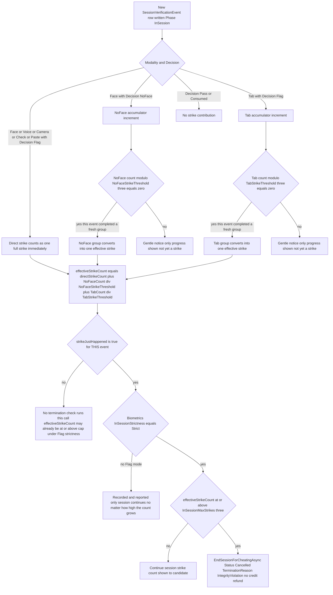

# G5 — Biometric Verification & Integrity Enforcement

Batch: Phase 5. Components covered: InterviewAPI, ai-service (`biometrics/`), WebClient. All files
cited below were re-read directly for this batch, including the full 927-line
`BiometricVerificationService.cs`, the full `SessionVerificationController.cs`, ai-service's
`biometrics/router.py` and both `liveness_*.py` files in full, and the relevant WebClient
controllers/views/JS. T1–T6 terminology rules remain in force. This is the chapter where the
Phase 0.5 liveness finding must be stated plainly and first.

---

## Threat model and scope of protection

Before any feature is described, the reader needs to know exactly what this subsystem defends
against and what it does not — everything below follows from this framing, and no feature
description later in this chapter should be read as claiming more than what is stated here.

**1. What the system defends against: substitution.** The threat model this subsystem actually
implements is a person **other than the enrolled candidate** answering on the candidate's behalf —
a proxy test-taker, a coached third party typing over the candidate's shoulder, or someone else
sitting down at the keyboard mid-session. This is defended by continuous identity matching: a
face-embedding comparison at entry and at intervals during the session (F-15, F-16), and a
voice-embedding comparison whenever the candidate answers by speaking (F-17), each independently
checked against the specific enrolled template for that account (G4).

**2. What it does NOT defend against: presentation attacks — on both channels, for two different
reasons.** A **presentation attack** — holding a static printed photo or a replayed video/recording
of the genuine, enrolled candidate up to the camera or microphone — is not defended against by this
system as deployed, on **either** modality, but the two gaps have different root causes and must not
be conflated.

**2a. Face.** The mechanism that would catch a photo/video presentation attack,
**liveness detection**, is computed by ai-service on every entry-gate check but is **explicitly
excluded from the pass/fail decision**:
```python
passed = bool(identity is not None and identity >= threshold)
```
(`ai-service/biometrics/router.py:147`) — note that `identity` (the face-match score) is the only
input to `passed`; `result["live"]` never appears in this expression. The exclusion is not an
oversight; it is stated directly in the surrounding comment (quoted, ≤15 words):
*"Liveness... is intentionally NOT part of the pass/fail decision"* (`router.py:139`).

**2b. Voice.** The reachable voice-answer path was re-verified by direct, full re-read of
`BiometricVerificationService.VerifyVoiceAnswerAsync` (`:454-573`) for this batch: it calls
`AiServiceClient.VerifyVoiceAsync` → `POST /internal/biometrics/verify` (`modality=voice`) —
**the same plain, challenge-free endpoint F-16 uses for face** — never
`/voice/verify-challenge`. **No `VOICE_CONTENT_MIN_SIMILARITY` check and no
`liveness_voice.py` code path execute anywhere on the call chain a real spoken interview answer
takes.** A separate mechanism that *would* add a second layer here — comparing the transcript
against a server-issued, single-use, spoken challenge phrase
(`VOICE_CONTENT_MIN_SIMILARITY = 0.70`, `liveness_voice.py:34`) — is fully implemented
(`BiometricVerificationService.VerifyVoiceAsync`, the *other*, differently-named method; ai-service
`/internal/biometrics/voice/verify-challenge`) but, per F-17 §7's finding, is wired only to
`biometric-wizard.js`'s "verify mode," which has no DOM trigger in any shipped view
(`OPEN_QUESTIONS.md` #22). **The cause here is different in kind from face's**: face is an
instrument that was built, tested, found broken on real hardware, and consciously turned off; voice
is an instrument that was built and never wired to anything the deployed product actually calls. The
practical consequence is the same either way — a replayed recording of the enrolled candidate's own
voice, or (on the face side) a photo/video, is not caught — but the correct engineering framing
differs: face's gap is a *disablement*, voice's is an *unreachable feature*, and §11 of this chapter
treats them as the two distinct limitations they are.

**3. Why the face liveness signal specifically was disabled: an evidence-based decision to disable
an instrument known not to work, not an omission.** The same comment records the measurement that
justified this:
*"real-rig data... showed YawRange of just 0.55-1.61° during a clear, deliberate head turn"*
(`router.py:140-141`, date given as 2026-07-24) — against an **18° threshold**
(`LIVENESS_MIN_YAW_RANGE_DEG = 18.0`, `biometrics/config.py:27`) that assumes a working yaw signal.
The companion module states the underlying diagnosis even more directly: *"not a threshold
problem, the measurement itself isn't moving"* (`liveness_face.py:31-32`). A second, related
signal — the requested head-turn **direction** (left vs. right) — was tested and found actively
wrong roughly 80% of the time on both directions, ruled out as a simple sign-flip bug, and left
unresolved: *"the bug is deeper... TODO: revisit with real-rig experiments before re-enabling"*
(`liveness_face.py:36-42`). **Framed correctly, this is the right call**: shipping a liveness check
that appears to function (returns a `live: true/false` field, gates nothing, but *looks* like an
anti-spoofing control to anyone reading the API surface) would create **false assurance** — a worse
outcome than a documented, evidence-based absence, because false assurance is invisible to the
people relying on it until it fails in production against a real attack.

**4. Consistency check: implementation and product claims agree — a positive finding.** Phase 0.5
§Q3 searched every rendered, user-visible string in WebClient's views and JavaScript for any
promise of liveness or anti-spoofing detection and found **none** — the only places the word
"liveness" appears are code comments and one HTML comment invisible in the rendered page
(`Views/Interview/Verify.cshtml:18-19`, itself an honest acknowledgment that liveness is disabled,
not a claim that it works). The same search found no rendered string anywhere in the reachable
voice-answer UI (F-17) claiming a spoken-phrase or content check either — the Room's voice-answer
flow never surfaces a challenge phrase to read, consistent with §2b's finding that this code path is
never reached. **The product does not promise a capability the implementation does not provide, on
either channel.** This is stated here as a genuinely positive finding, not a formality — many
systems drift into exactly this kind of mismatch, and this one has not.

The remainder of this chapter documents what the system *does* provide (substitution defense via
continuous identity matching, and behavioral integrity monitoring via tab/paste/camera signals) with
the same evidentiary rigor, and returns to the presentation-attack gap and every other limitation in
§11 of each feature and in the chapter-level summary at the end.

---

## F-15. Verify Face (Entry Gate)

### 1. Purpose and scope
A single, mandatory face-identity check the candidate must pass before the Room ever opens —
confirming that the person about to be charged credit and to answer questions is the account's
enrolled face. Scope: identity matching only (§ Threat model above); does not cover in-session
re-checks (F-16) or voice (F-17).

### 2. Actors, preconditions, postconditions

| | |
|---|---|
| Actor | Authenticated candidate with a session past `Init` (`Status="Initialized"`) |
| Precondition | Face already enrolled (G4 F-12); fewer than `Biometrics:EntryMaxRetries` (default 3) prior failed `Entry`-phase attempts for **this session** |
| Postcondition (pass) | One `SessionVerificationEvent` row, `Phase="Entry"`, `Modality="Face"`, `Decision="Pass"`; candidate proceeds to the Integrity Policy screen (G1 F-04) |
| Postcondition (fail, retries remain) | One `Decision≠"Pass"` audit row; candidate may retry with a fresh challenge |
| Postcondition (fail, retries exhausted) | Candidate is sent back to the dashboard; **must create a new session** — the retry budget is per-session, not per-account, so a fresh session always starts with the full budget (`BiometricVerificationService.cs:136-138` comment) |

### 3. Architectural placement
`Browser (entry-verify.js) → WebClient InterviewController.Verify (renders the screen) +
VerificationController.Challenge/VerifyFace/EntryGate (Controllers/Interview/
VerificationController.cs) → WebClient VerificationService → ApiGateway interview-route →
SessionVerificationController.GetChallenge/VerifyFace/GetEntryGateStatus
(SessionVerificationController.cs) → BiometricVerificationService.IssueChallengeAsync/
VerifyFaceAsync/GetEntryGateStatusAsync (BiometricVerificationService.cs) →
Clients/AiServiceClient.VerifyFaceLiveAsync → ai-service POST /internal/biometrics/face/verify-live
→ biometrics/liveness_face.py`. WebClient's `InterviewController.Room` also independently calls the
same `GetEntryGateAsync` before ever opening the Room (G2 F-05 §3), making the entry gate a
defense-in-depth checkpoint enforced at two points: the dedicated Verify screen and the Room's own
entry check.

### 4. Interface contract

| Method | Route | Notes |
|---|---|---|
| GET | `.../verify/challenge?modality=face` | Issues a fresh server-side challenge (a `turn_head` direction, no longer shown or scored — §8) |
| POST | `.../verify/face?phase=Entry` | Multipart `frames` (8 JPEGs); response `VerificationResultResponse {Passed, Score, Live, Reason}` |
| GET | `.../verify/entry-gate` | `EntryGateStatusResponse {FaceEnrolled, Allowed, AttemptsUsed, AttemptsRemaining, Reason}` — the **authoritative** attempt count |

Status codes on `VerifyFace`: 200; 422 `BiometricQualityException` (plain message, e.g. "Not enough
usable frames with a clear face" — `SessionVerificationController.cs:103-106`); 404 session not
found; 503 generic. `EntryGate`/`Challenge` return 404/503 on their own failure paths.

### 5. Processing flow
1. **Challenge issuance** (`IssueChallengeAsync`, `BiometricVerificationService.cs:86-126`): for
   `modality="Face"`, generates a random `left`/`right` direction, serializes it as
   `{"type":"turn_head","direction":...}`, stores it server-side with a TTL
   (`Biometrics:ChallengeTtlSeconds`, default 120s), and returns it to the client (`entry-verify.js`
   requests it but — per §8 below — no longer displays or scores the direction).
2. **Retry-cap check** (`VerifyFaceAsync`, `:139-148`): for `phase="Entry"`, counts prior
   `Decision≠"Pass"` `Entry`/`Face` events for this session; rejects before consuming a challenge or
   calling ai-service if the count already meets `EntryMaxRetries`.
3. **Frame capture**: `entry-verify.js` captures **8 JPEG frames at 300ms intervals**
   (`FRAME_COUNT=8`, `FRAME_INTERVAL_MS=300`, `entry-verify.js:25-26`) after a 3-2-1 countdown, with
   **no head-turn requirement shown to the user** — the guidance text is literally "Hold still and
   look at the camera" (`:177`), consistent with §8's finding that the direction challenge is no
   longer scored.
4. **ai-service call**: `AiServiceClient.VerifyFaceLiveAsync` posts the 8 frames, the stored
   embedding, and the (unused-for-direction) challenge JSON to `/internal/biometrics/face/verify-live`.
   `verify_face_live` (`liveness_face.py:8-56`) requires at least `LIVENESS_MIN_FRAMES=5` usable
   frames, checks frame-to-frame identity consistency (rejecting mid-burst identity drift below
   `LIVENESS_MAX_IDENTITY_DRIFT=0.25`), computes `identity_score` as the **mean** cosine similarity
   across all usable frames against the stored embedding (`:51`), and computes (but does not gate
   on) `live`/`yaw_range`/`direction_ok`.
5. **Decision** (`router.py:147`): `passed = identity is not None and identity >= threshold` — see
   §8e for the exact pseudocode.
6. **Audit write**: `RecordEventAsync` persists `Score=identity_score`, `LivenessPassed=live`
   (recorded even though it did not gate — § below), `Matched=passed`, `Decision="Pass"/"Fail"`.
7. **Client-side attempt handling**: on failure, `entry-verify.js`'s `handleFail`
   (`:216-233`) **re-polls `verify/entry-gate` for the authoritative `attemptsRemaining`** rather
   than trusting or decrementing any client-side counter — the client's own `attemptsRemaining`
   variable (`:21`) is only ever used to seed the initial display from server-rendered page data
   (`Model.AttemptsRemaining`, `Verify.cshtml:25,42`); every update after that comes from a fresh
   server call. **Why client-side counting alone would be insufficient**: `GetEntryGateStatusAsync`
   recomputes `failedAttempts`/`attemptsRemaining` fresh from `SessionVerificationEvents` on every
   call (`BiometricVerificationService.cs:252-256`), so a client that lied about or reset its own
   counter would still be rejected by `VerifyFaceAsync`'s own independent retry-cap check (step 2)
   — the client-side count is a UX convenience only, never a security boundary.


*Figure 5.1 — Verify Face (Entry Gate) sequence, including the authoritative server re-poll on
failure.*

### 6. Data model impact
Writes `SessionVerificationChallenges` (one row per issued challenge, consumed/single-use — §7 R1)
and `SessionVerificationEvents` (one audit row per attempt, `Phase="Entry"`). No credit is deducted
by this feature — confirmed by cross-reference to G2 F-05: `GenerateQuestionAsync`'s deduction logic
only runs after the Room opens, which itself requires `GetEntryGateStatusAsync.Allowed=true`.

### 7. Business rules and invariants
- **R1 (single-use challenge)** — `ConsumeChallengeAsync`
  (`BiometricVerificationService.cs:905-916`) loads the newest active (`ConsumedAt IS NULL,
  ExpiresAt > now`) challenge and marks it consumed in the same call, before the ai-service call
  even runs — a replayed old challenge cannot be reused.
- **R2 (per-session retry budget)** — `EntryMaxRetries` (default 3) counts `Decision≠"Pass"` events
  scoped to the current `SessionId` only; a new session (after exhausting one) starts fresh.
- **R3** — A `Pass` event, once recorded, is permanent for that session: `GetEntryGateStatusAsync`
  checks `faceEvents.Any(e => e.Decision == "Pass")` (`:254`) with no time limit — the entry gate
  never needs to be re-passed once cleared, for the life of that session.
- **R4 (stale code comment, flagged not silently reconciled)** — `SessionVerificationController.cs:
  151-153`'s comment on `GetEntryGateStatus` claims: *"Milestone 4 groundwork... not called from any
  Room UI yet."* **This is contradicted by two independently-confirmed live call sites**: WebClient's
  `InterviewController.Room` calls `VerificationService.GetEntryGateAsync` →
  `api/interview/sessions/{id}/verify/entry-gate` before ever rendering the Room (G2 F-05 §3,
  `InterviewController.cs:243-257`), and `entry-verify.js`'s own `handleFail` re-polls the identical
  endpoint on every failed attempt (§5 step 7, `entry-verify.js:216-233`,
  `VerificationService.cs:90-102` confirms the exact URL match). The comment is stale documentation,
  not a functional defect — the endpoint works correctly and is exercised on every entry-gate visit.

### 8. AI/ML component
Model identity, architecture, and quality gates are documented fully in G4 F-12 §8a–d (same
InsightFace `buffalo_l` ArcFace model, same 512-d L2-normalized embedding) and are not repeated
here; this section focuses on the verification-specific decision rule, per the instruction to reuse
G4's model documentation by reference.

**Decision rule — pseudocode showing only identity is consulted:**
```
frames[8] = captured burst
feats = [face_frame_features(f) for f in frames if usable]
require len(feats) >= LIVENESS_MIN_FRAMES (5)

ref = feats[0].embedding
drift = min(cosine_similarity(ref, f.embedding) for f in feats[1:])
if drift < LIVENESS_MAX_IDENTITY_DRIFT (0.25):
    return live=False, identity_score=None   # inconsistent identity across frames, reject

yaw_range = max(feats.yaw) - min(feats.yaw)         # computed
moved_enough = yaw_range >= LIVENESS_MIN_YAW_RANGE_DEG (18.0)   # computed
direction_ok = (sign of peak yaw matches requested direction)   # computed
live = moved_enough                                  # computed

identity_score = mean(cosine_similarity(f.embedding, stored_embedding) for f in feats)
threshold = _threshold_for("face")   # calibration.json if present, else FACE_MATCH_THRESHOLD 0.35

# THE ACTUAL GATE — live/yaw_range/moved_enough/direction_ok never appear below this line:
passed = (identity_score is not None) and (identity_score >= threshold)
```
This is a direct transcription of `liveness_face.py:8-56` and `router.py:137-148`, arranged to make
explicit which computed values feed the final boolean and which do not.

**e. Formula**: $\mathrm{sim}(\mathbf{a},\mathbf{b}) = \frac{\mathbf{a}\cdot\mathbf{b}}{\lVert\mathbf{a}\rVert \lVert\mathbf{b}\rVert}$,
averaged across the 8-frame burst, compared against `FACE_MATCH_THRESHOLD` (0.35 fixed default;
`calibration.json` override mechanism exists but the file does not exist in this deployment, Phase
0.5 §Q4) via `>=` (match if at or above threshold).

**f. Threshold provenance**: identical, unresolved gap to G4 F-12 §8f — no FAR/FRR/EER has been
measured for this deployment's `0.35` default.

**g–h. Prompt/RAG**: not applicable.

**i. Runtime**: same CPU-bound InsightFace inference as G4; a full entry-gate check processes 8
frames per call rather than 1, so it is proportionally more expensive per request than a single
enrolment frame — no explicit measured latency figure was found in code comments for this specific
endpoint (contrast with the in-session single-frame check, F-16 §2, which does have a measured
range cited in a TODO comment).

**j. Known weaknesses — stated plainly per the chapter's opening threat model**: liveness is
computed but not enforced (§ Threat model); the direction challenge is issued, transmitted, and
computed on the response but **never actually checked against the candidate's real behavior** in
the pass/fail path — a candidate could turn the wrong way, or not turn at all, and still pass, since
only `identity_score` gates the outcome. The **endpoint and schema names are misleading relative to
actual behavior**: `/internal/biometrics/face/verify-live` and `FaceVerifyLiveResponse` both imply
liveness is verified, when in fact only identity is. **Recommended for future work**: rename the
endpoint/response type (e.g. to `verify-identity` or similar) to stop the name itself from implying
a guarantee the implementation does not provide, independent of whether liveness is ever re-enabled.

**k. Academic grounding**: same as G4 F-12 §8k (ArcFace, InsightFace). For liveness/anti-spoofing
specifically, if it is ever re-enabled: George, A. and Marcel, S., "Deep Pixel-wise Binary
Supervision for Face Presentation Attack Detection," ICB 2019, `[CITATION TO VERIFY]` — offered as a
starting reference for future work, not as grounding for the current (disabled) mechanism.

### 9. Failure modes and edge cases

| Scenario | System behaviour | Evidence | User-visible result |
|---|---|---|---|
| Fewer than 5 usable frames (camera stutter, very poor lighting) | `FaceQualityError("Not enough usable frames with a clear face")` → 422 | `liveness_face.py:16-17` | Plain message via `handleFail`; does not consume an attempt server-side per the 422 quality-rejection path (§ note in `entry-verify.js:210-211`) |
| Mid-burst identity swap (someone else steps in front of camera during capture) | `drift < LIVENESS_MAX_IDENTITY_DRIFT` triggers `live=False, identity_score=None` | `liveness_face.py:22-27` | `passed=False` (since `identity_score is None`); recorded as a failed `Entry` attempt, consuming one retry |
| No active challenge (client posts without calling `Challenge` first, or the challenge expired) | `ConsumeChallengeAsync` throws `"No active challenge for this session..."` | `BiometricVerificationService.cs:910-912` | Generic 503 (no dedicated catch for this specific `InvalidOperationException` in `VerifyFace`'s controller action beyond the ones already listed) |
| Retry cap already reached, client still posts | Rejected before any challenge consumption or ai-service call | `BiometricVerificationService.cs:145-147` | "Maximum verification attempts reached for this session. Please create a new session." |
| ai-service unreachable | Generic exception | `SessionVerificationController.cs:111-117` | 503 "Face verification is temporarily unavailable. Please try again shortly." — **does not consume a retry**, since the failure occurs before any `SessionVerificationEvent` is written |

### 10. Security and integrity considerations
IDOR: `EnsureSessionOwnedAsync` on every call. Anti-replay: single-use, TTL-bound challenges (§7 R1)
— though note this anti-replay property covers the *challenge*, not the *biometric sample itself*;
nothing prevents resubmitting a previously-captured (but not previously-submitted) set of frames
within the TTL, since the frames are never bound to the challenge's random value in any
cryptographic sense (the challenge only carries a direction that is not scored, per §8). Reference
embedding never leaves the server (§4 — only a match boolean/score crosses back to the browser).

### 11. Limitations and future work
- **Presentation attacks are not defended against** (chapter-opening Threat model) — the single
  most important limitation of this feature, restated here per instruction not to bury it.
- Threshold uncalibrated (§8f).
- Endpoint/schema naming implies a liveness guarantee that does not exist (§8j) — recommend
  renaming.
- The stale "not called from any Room UI yet" comment (§7 R4) should be corrected or removed.
- The frame-replay gap noted in §10 (challenge anti-replay does not extend to the biometric sample
  itself) is a minor, unexploited-in-this-pass observation.

### 12. Figures
Figure 5.1 (sequence diagram, `diagrams/FIG-5.1.mmd`); Figure 5.7 (state diagram — entry-gate
attempt lifecycle, `diagrams/FIG-5.7.mmd`, shared with F-16); Figure 5.8 (screenshot — entry-gate
verification failure, see `SCREENSHOT_CHECKLIST.md`).

---

## F-16. Verify Face (In-Session)

### 1. Purpose and scope
A periodic, lightweight, single-frame face-identity re-check during an active interview, intended
to catch a substitution that happens **after** the entry gate has already been passed — e.g. the
enrolled candidate steps away and someone else continues answering.

### 2. Actors, preconditions, postconditions

| | |
|---|---|
| Actor | The system itself, on the candidate's behalf — the Room triggers this automatically, not on candidate action |
| Precondition | `Status="InProgress"`; a valid, unexpired, unconsumed check token (`checkId`) issued for the specific current question |
| Postcondition | One `SessionVerificationEvent` row (`Phase="InSession"`, `Modality="Face"`); strike count updated; session possibly ended |

### 3. Architectural placement
`Browser (interview-room.js, automatic) → WebClient VerificationController.InSessionCheck/
VerifyInSession → WebClient VerificationService → ApiGateway interview-route →
SessionVerificationController.GetInSessionCheck (delegates to SessionService.GetInSessionCheckAsync)
/ VerifyInSession → BiometricVerificationService.VerifyInSessionAsync → Clients/AiServiceClient.
VerifyFaceAsync → ai-service POST /internal/biometrics/verify (modality=face) →
biometrics/face_engine.py` (the plain, non-live, single-frame verify path — distinct from F-15's
`verify-live` endpoint).

### 4. Interface contract

| Method | Route | Notes |
|---|---|---|
| GET | `.../verify/in-session-check?sessionQuestionId=` | Polled by the Room; `InSessionCheckDueResponse {Due, CheckId, ExpiresAt}` |
| POST | `.../verify/in-session` | Multipart `checkId`, `frame`; response `InSessionVerifyResponse {Passed, NoFaceDetected, WarningType, StrikeCount, MaxStrikes, ShouldEndSession, Status, TerminationReason, Message}` |

### 5. Processing flow
1. **Scheduling — once per new question, never the first**: `applyNextQuestion` calls
   `captureAndVerifyInSession()` unconditionally after rendering question 2 or later
   (`interview-room.js:602-607`, quoted: *"the first question... is never routed through here"*) —
   the entry gate already verified the same face seconds earlier, so re-checking immediately would
   cost an ai-service call for no new signal.
2. **Check-token issuance** (`SessionService.GetInSessionCheckAsync`, cross-referenced from G2):
   issues at most **one pending `checkId` per `SessionQuestion`**, TTL
   `Biometrics:InSessionCheckTtlSeconds` (default **20 seconds**, confirmed identical between
   `appsettings.json` and the code default per `SessionVerificationController.cs:180-181` comment).
3. **Client capture**: `captureAndVerifyInSession` grabs **one** frame from the already-running
   camera stream (`interview-room.js:1757-1846`) — no burst, no challenge.
4. **Atomic one-time claim**: `BiometricVerificationService.VerifyInSessionAsync`
   (`:300-445`) calls `TryConsumeQuestionCheckAsync` (`SessionVerificationEventRepository.cs:65-79`)
   — a conditional `UPDATE ... WHERE Decision='Pending' AND ConsumedAt IS NULL AND ExpiresAt >=
   @now`. An invalid, expired, or already-used token is rejected before any ai-service call
   (`:314-316`).
5. **Rate-limit reasoning, quoted directly**: the class-level comment explaining why this check is
   throttled by a one-token-per-question design rather than a raw time interval states the actual
   constraint precisely: *"ai-service runs `--workers 1` with synchronous handlers; consider a
   thread pool"* (`BiometricVerificationService.cs:298-299`, the TODO itself), preceded by the
   measured cost: *"each call occupies ai-service for ~130-350ms (single uvicorn worker, no thread
   pool — a burst would stall every other ai-service consumer, not just this check)"*
   (`:295-297`). In plain terms: because ai-service is a single-process, single-worker server, any
   request occupies the *entire* server for its duration — a naive fixed-interval client-side poll
   could starve TTS, STT, grading, and every other candidate's requests, not just this one check. The
   one-token-per-question design is the actual throttle, enforced server-side so it cannot be
   bypassed by a modified client.
6. **ai-service call**: `AiServiceClient.VerifyFaceAsync` (single frame, plain
   `/internal/biometrics/verify`, `modality=face`) — no liveness computation at all in this path
   (distinct from F-15's `verify-live`).
7. **Outcome classification** (`:333-382`): three structured outcome families —
   - **Identity mismatch**: `Decision="Flag"` (a direct strike).
   - **Multiple faces**: caught specifically via `BiometricQualityException` with
     `QualityCode=="multiple_faces"` → `Decision="Flag"`, `WarningType="MultiFace"` (also a direct
     strike).
   - **No face / quality issue**: every other `BiometricQualityException`; `QualityCode is null or
     "no_face"` → `Decision="NoFace"` (accumulates, not a direct strike); any other quality code
     (blur/small/low-confidence/decode) → `Decision="Quality"`, also non-strike, shown as
     actionable guidance ("please hold still," "move closer," etc., `:374-381`).
8. **Strike evaluation** — see the chapter-wide flowchart (§ F-18b's shared strike arithmetic
   section below, since this logic is common to every in-session strike source).


*Figure 5.2 — Verify Face (In-Session) sequence.*

### 6. Data model impact
Writes `SessionVerificationEvents`, `Phase="InSession"`, `Modality="Face"`, plus the earlier
`Modality="Check"` token row that scheduling created (via `GetInSessionCheckAsync`, G2 cross-ref).
`CanGeneratePerformanceReport` is explicitly forced to `false` in every response from this endpoint
(`:432`), even when the check passes — this is a response-shape default, not a session-state change;
the real capability flag is recomputed properly at report-generation time (G6) from the session's
actual terminal state.

### 7. Business rules and invariants
- **R1** — At most one pending check token per `SessionQuestion` (G2 cross-ref,
  `GetInSessionCheckAsync`), consumed exactly once (`TryConsumeQuestionCheckAsync`'s atomic
  predicate).
- **R2** — A single `NoFace`/`Quality` event is **never** by itself a strike — only accumulation to
  `NoFaceStrikeThreshold` (default 3) converts it (§ F-18b's shared strike section has the full
  arithmetic and worked example).
- **R3** — `MultipleFacesError` is a **direct** strike, unlike plain `NoFace` — the code explicitly
  distinguishes "someone else is also in frame" (immediate strike) from "no one is clearly in frame"
  (accumulates) as different-severity signals.

### 8. AI/ML component
Same InsightFace model as F-15/G4; decision rule is the plain, single-frame, **liveness-free**
`/internal/biometrics/verify` path: `score = cosine_similarity(probe, stored); match = score >=
FACE_MATCH_THRESHOLD (0.35 default)` (`router.py:112-114`). No burst, no drift check, no yaw
measurement at all in this path — it was never a liveness check to begin with, so none of F-15's
liveness-disablement discussion applies here; this endpoint's design intent was always identity-only.

### 9. Failure modes and edge cases

| Scenario | System behaviour | Evidence | User-visible result |
|---|---|---|---|
| Check token expired before the client submits (candidate looked away past the 20s TTL) | `TryConsumeQuestionCheckAsync` fails, `InvalidOperationException` | `SessionService.cs:314-316` (cross-ref) | Client's `isVerificationTokenError` check treats this as silent/non-alarming (`interview-room.js:1792-1795`) — the check simply expires and a new one is scheduled for the next question |
| ai-service single-worker contention under load | Not a functional failure, but the documented reason the check frequency is capped at one-per-question rather than more often | `BiometricVerificationService.cs:295-299` | No direct user-visible symptom in normal operation; a structural capacity constraint |
| Candidate briefly looks at notes (single NoFace) | Recorded, not a strike, gentle client notice | `interview-room.js:1805-1809` | "We couldn't see your face — please make sure you're in frame." with no warning count attached |

### 10. Security and integrity considerations
Same IDOR/ownership pattern as every other action in this service. The one-token-per-question design
is itself a security control against ai-service resource exhaustion, not just a UX throttle — stated
explicitly in-code (§5 step 5).

### 11. Limitations and future work
Single-frame, no liveness by design (not a regression — this endpoint never computed liveness).
Server capacity (single ai-service worker) directly constrains how often this check could ever run,
independent of any policy decision — raising check frequency would require the infrastructure change
noted in the TODO (`BiometricVerificationService.cs:298-299`) before it would be safe to do.

### 12. Figures
Figure 5.2 (sequence diagram, `diagrams/FIG-5.2.mmd`); Figure 5.9 (screenshot — interview room with
camera panel active, see `SCREENSHOT_CHECKLIST.md`).

---

## F-17. Verify Voice Answer

### 1. Purpose and scope
Whenever a candidate answers by speaking rather than typing, this feature both transcribes the
recording (F-10/G3) and checks that the speaker's voice matches the enrolled voice template — the
audio arm of the substitution defense described in the chapter's opening.

### 2. Actors, preconditions, postconditions

| | |
|---|---|
| Actor | The candidate, indirectly, via choosing to dictate an answer |
| Precondition | `Status="InProgress"`; voice enrolled (soft precondition — degrades gracefully if not) |
| Postcondition | Transcript always returned; a `SessionVerificationEvent` row written only if biometrics are enabled and voice is enrolled |

### 3. Architectural placement
As established directly in G3 F-10 §3 and re-confirmed by the full read of
`BiometricVerificationService.VerifyVoiceAnswerAsync` in this batch: **every spoken interview
answer goes through `POST .../verify/voice-answer`** — the plain, unverified STT endpoint
(`api/interview/sessions/stt`) is unreachable from the deployed UI (G3 `OPEN_QUESTIONS.md` #16), so
**speaker verification is structurally unavoidable whenever a candidate uses voice input**. It is
**not**, however, unavoidable in general: typing an answer bypasses this entire feature —
`BiometricVerificationService.cs:447-453`'s comment states this is accepted "as-is," reasoning that
the mandatory in-session **face** check (F-16) already provides per-question identity coverage
regardless of input modality, and that forcing a periodic mandatory voice check "would add UX
friction and extra blocking ai-service calls... for a narrow additional threat... not currently
worth that cost."

### 4. Interface contract
`POST .../verify/voice-answer`, multipart `checkId` (client-generated, `window.crypto.randomUUID()`,
`interview-room.js:1371`), `audio`. Response `VoiceAnswerVerifyResponse {Text, VoiceChecked,
VoiceMatched?, Score?, StrikeCount?, MaxStrikes, ShouldEndSession, Duplicate, Message}`.

### 5. Processing flow
1. **Transcription starts immediately**, before any biometric branching:
   `_aiServiceClient.TranscribeAsync(...)` is invoked and stored as an unawaited `Task`
   (`BiometricVerificationService.cs:474`) — so the candidate's transcript is never delayed or
   blocked by the verification logic that follows.
2. **Graceful degradation, three distinct soft-fail branches**, each still returning the transcript:
   - Biometrics disabled entirely (`:477-485`) → `VoiceChecked=false`, no message.
   - No voice enrolled (`:489-498`) → `VoiceChecked=false`, "Voice verification is unavailable
     because no voice enrollment was found."
   - A quality exception or any other exception from the verification call itself (`:525-544`) →
     `VoiceChecked=false`, "could not assess"/"temporarily unavailable" — **the transcript is
     returned regardless**, so an ai-service hiccup never blocks the candidate from submitting a
     typed-up version of what they said.
3. **Idempotency check** (`:500-511`): if `checkId` already has a recorded event, returns the
   existing result rather than re-verifying — protects against a client retry double-charging a
   strike for the same recording.
4. **Speaker verification** (`:513-534`): `AiServiceClient.VerifyVoiceAsync` — the **plain**
   `/internal/biometrics/verify` (`modality=voice`) path, **not** the challenge/content-checking
   `/voice/verify-challenge` endpoint used by F-15-style entry/in-session challenges. **This is the
   key distinction from the content check**: there is no "expected phrase" for a candidate's
   free-form interview answer, so only `cosine_similarity(probe_embedding, stored_embedding) >=
   VOICE_MATCH_THRESHOLD` is evaluated — no `VOICE_CONTENT_MIN_SIMILARITY` check applies here at
   all (that check exists only in `liveness_voice.py`'s `verify_voice_challenge`, used by the
   separate, server-issued-phrase challenge flow, which — per this chapter's audit — appears
   unreachable from the deployed WebClient UI, § below).
5. **Why the speaker embedding still matches despite different spoken content** (cross-reference to
   G4 F-13 §8b): the ECAPA-TDNN model is trained to capture *how the voice sounds* — pitch, timbre,
   resonance — while deliberately being insensitive to *what words are said*. The enrolment sample
   is a fixed introductory sentence (G4 F-13 §5); the interview answer is unscripted, arbitrary
   content. Because the model's whole design purpose is content-independence, comparing these two
   very different utterances is exactly the comparison the model was built to support — a working
   speaker-verification system is *supposed* to say "same speaker" here despite zero word overlap.
6. **Audit + strike evaluation** (`:546-572`, `BuildVoiceAnswerResponseAsync`,
   `:575-619`): a mismatch (`Decision="Flag"`) is a **direct strike**, following the same shared
   `CheatingStrikeHelper` predicate as every other strike source.


*Figure 5.3 — Verify Voice Answer sequence, including the parallel transcription/verification
split.*

### 6. Data model impact
Writes `SessionVerificationEvents`, `Phase="InSession"`, `Modality="Voice"`, keyed on the
**client-generated** `IncidentId`/`checkId` — unlike F-16's server-issued token, this `checkId`
originates in the browser (§5 step 3's idempotency check exists precisely because this value is not
server-controlled, unlike F-16's `TryConsumeQuestionCheckAsync`-guarded token).

### 7. Business rules and invariants
- **R1** — No `VOICE_CONTENT_MIN_SIMILARITY` check applies to voice answers (§5 step 4) — that
  mechanism belongs exclusively to the challenge-phrase flow, which this report's audit of the
  WebClient call graph did not find reachable from any deployed UI (§ below).
- **R2** — Idempotent on `checkId` (§5 step 3) — a client retry cannot double-strike the same
  recording.
- **R3** — Typed answers bypass this feature entirely, by design (§3).

**A related, unreachable code path worth flagging alongside this feature.** `BiometricVerificationService.
VerifyVoiceAsync` (`:177-218`, distinct from `VerifyVoiceAnswerAsync` documented above) implements a
**challenge-phrase** voice check — issuing a server-side Vietnamese phrase (`ChallengePhrases`,
`:49-61`), requiring the candidate to read it aloud, and checking **both** speaker score and phrase
content similarity (`VOICE_CONTENT_MIN_SIMILARITY=0.70`, `liveness_voice.py:34`) via
`/internal/biometrics/voice/verify-challenge`. Its WebClient entry point is
`VerificationController.VerifyVoice` → `api/interview/sessions/{id}/verify/voice`
(`VerificationService.cs:76-88`, `Services/Interview/VerificationService.cs`), which is called only
from `biometric-wizard.js`'s **"verify mode"** branch (`mode="verify"`, `biometric-wizard.js:88`,
trigger elements `#verify-start-btn`/`#verify-session-select`, `:42-43,267-276`). **A repo-wide
search of every Razor view under `source/WebClient/Views` for these two element ids found neither
— they exist in no rendered page.** `Views/Profile/Identity.cshtml` (the wizard's only host page,
read in full in G4) never emits them; `Views/Interview/Verify.cshtml` uses `entry-verify.js`
instead, which never sets `mode="verify"` (that variable does not exist in `entry-verify.js` at
all). **`Status: Implemented but unreachable from the deployed UI`** — the same pattern as G1's
Gemma model and G3's plain STT endpoint. Logged as a new open question.

### 8. AI/ML component
Same SpeechBrain ECAPA-TDNN model as G4 F-13 (identity, architecture, embedding properties
documented there in full, not repeated). Decision rule for this feature specifically: `score =
cosine_similarity(probe, stored); match = score >= VOICE_MATCH_THRESHOLD (0.25 default)` — speaker
score only, no content term, confirmed by reading `router.py:79-114`'s single shared `/verify`
endpoint (the same one F-16 uses for face) and cross-checking that `VerifyVoiceAsync` (the .NET
client method this feature calls) posts to `/internal/biometrics/verify`, not
`/voice/verify-challenge` (`Clients/AiServiceClient.cs:245-267`, confirmed structurally identical to
`VerifyFaceAsync`'s plain-verify pattern in G4/F-16).

### 9. Failure modes and edge cases

| Scenario | System behaviour | Evidence | User-visible result |
|---|---|---|---|
| Biometrics disabled | Transcript-only, `VoiceChecked=false` | `BiometricVerificationService.cs:477-485` | No strike risk at all; voice input behaves like plain STT |
| No voice enrolled | Same graceful degradation | `:489-498` | "Voice verification is unavailable because no voice enrollment was found." |
| Quality rejection (audio too short/undecodable) | `VoiceChecked=false`, transcript still returned | `:525-534` | "Voice verification could not assess this recording." |
| Speaker mismatch | Direct strike | `:546-572` | Client shows "The recorded answer does not match your enrolled voice." plus strike count (`interview-room.js:1385-1394`) |
| Duplicate `checkId` (client retry) | Returns existing result, no new strike | `:500-511` | Transparent to the user |

### 10. Security and integrity considerations
Client-generated `checkId` means the idempotency guarantee is weaker than F-16's server-issued
token in one specific sense: a malicious client could in principle submit the *same* audio under
*different* `checkId` values to force multiple verification attempts for one recording — nothing in
this code path rate-limits by audio content, only by `checkId`. Not identified as exploited or
reproduced; a structural observation for future hardening.

### 11. Limitations and future work
The challenge-phrase content-check mechanism (`VOICE_CONTENT_MIN_SIMILARITY`) exists, fully coded,
but is not reachable from the deployed product (§7) — if the intent was for candidates to
periodically read a server-issued phrase as a stronger check than free-form speaker matching alone,
that intent is not currently realized in the shipped UI. Client-generated `checkId` weakens the
idempotency/rate-limit guarantee relative to F-16's server-issued token (§10).

### 12. Figures
Figure 5.3 (sequence diagram, `diagrams/FIG-5.3.mmd`).

---

## F-18. Report Camera Violation

### 1. Purpose and scope
Enforces the "camera must stay on" rule stated in the Integrity Policy (G1 F-04): the interview
requires a live, continuously-connected camera feed, with no candidate-facing toggle to turn it
off. This feature is how the client reports a sustained camera loss (permission revoked mid-session,
or the device/stream disconnecting) as a countable integrity incident.

### 2. Actors, preconditions, postconditions

| | |
|---|---|
| Actor | The system, automatically, on sustained camera loss |
| Precondition | `Status ∈ {InProgress, Paused}` |
| Postcondition | One `SessionVerificationEvent` (`Modality="Camera"`, `Decision="Flag"` — always a direct strike) and one increment to `InterviewSessions.CameraViolationCount` per genuinely new incident |

### 3. Architectural placement
`Browser (interview-room.js) → WebClient InterviewController.CameraViolation
(InterviewController.cs:692-705) → WebClient InterviewService.ReportCameraViolationAsync →
ApiGateway interview-route → InterviewSessionController.ReportCameraViolation
(InterviewSessionController.cs:404-421) → SessionService.ReportCameraViolationAsync
(SessionService.cs:1347-1402ish, cross-referenced from G2) → SessionVerificationEventRepository +
SessionRepository.IncrementCameraViolationAsync`. Unlike F-15/F-16/F-17, this feature lives in
`SessionService`, not `BiometricVerificationService` — it is a client-reported *event*, not a
server-computed *biometric decision*, though it feeds the exact same shared strike machinery
(`CheatingStrikeHelper`).

### 4. Interface contract
`POST api/interview/sessions/{id}/camera-violation`, body `{IncidentId, Reason}` (`Reason ∈
{"PermissionDenied", "Disconnected"}`). Response `ReportCameraViolationResponse
{CameraViolationCount, StrikeCount, MaxStrikes, Duplicate, ShouldEndSession, Message, Status,
TerminationReason, CanGeneratePerformanceReport, CanSubmitInterviewFeedback}`.

### 5. Processing flow
1. **Mandatory camera, no toggle**: `interview-room.js` calls `startCamera()` unconditionally when
   the Room is active (`:1538`) — there is no UI control anywhere in `Room.cshtml`/
   `interview-room.js` to turn the camera off; the only states are "on" and "attempting to
   reconnect."
2. **Reconnection loop before any report**: on camera loss (the video track's `ended` event,
   `:1498-1502`, or an initial connection failure), `scheduleCameraRecovery`
   (`:1506-1528`) waits `CAMERA_RECONNECT_GRACE_MS = 15000` (15 seconds,
   `:1422`) before attempting `connectCamera()` again — a brief flicker or quick reconnect never
   reaches the reporting step at all.
3. **One violation per continuous loss episode**: `cameraIncidentReported` is a boolean flag, reset
   to `false` only when the camera successfully reconnects (`:1489`, "Camera is back — the next
   disconnect is a NEW episode and may report again") and set to `true` the first time a recovery
   attempt fails after the grace period (`:1518-1521`) — so a camera that stays off for minutes
   produces exactly **one** report, not one every 15 seconds, while the retry loop itself keeps
   running indefinitely (`:1522-1525`, explicitly fixing a prior bug where recovery permanently
   stopped after one failed attempt).
4. **Server-side idempotency**: `TryAddIncidentAsync` keyed on client-supplied `IncidentId`, backed
   by the unique filtered index `UX_SVE_IncidentId` (`db/baseline/05_DevPrep_Interview.sql`,
   confirmed in Phase 0, `WHERE IncidentId IS NOT NULL`) — even if the client-side
   `cameraIncidentReported` flag somehow failed to prevent a duplicate POST, the database itself
   rejects a second row for the same `IncidentId`, and `SessionService.ReportCameraViolationAsync`
   falls back to reading the existing `CameraViolationCount` rather than incrementing again
   (cross-referenced pattern from G2's audit of this method).
5. **Audit tally**: `IncrementCameraViolationAsync` (`SessionRepository.cs:359-...`, cross-ref G2) —
   "a plain increment, no expected-value claim needed like `IncrementAnsweredIfAsync` — this is just
   a tally, not a per-turn guard" (comment, cross-ref).
6. **Strike evaluation**: `Modality="Camera"` is in `CheatingStrikeHelper`'s direct-strike
   whitelist (`Face`, `Voice`, `Camera`, `Check`, `Paste`) — every genuinely new camera-violation
   incident is its own full strike, same weight as a face/voice mismatch.


*Figure 5.4 — Report Camera Violation sequence.*

### 6. Data model impact
Writes `SessionVerificationEvents` (`Modality="Camera"`) and `InterviewSessions.
CameraViolationCount` (a simple audit tally, separate from the strike-count derivation, which is
always recomputed from `SessionVerificationEvents` rather than read off this column).

### 7. Business rules and invariants
- **R1** — Idempotent per `IncidentId`, enforced at both the application layer (`TryAddIncidentAsync`)
  and the database layer (`UX_SVE_IncidentId` unique filtered index).
- **R2** — Every genuinely new camera violation is a direct strike (no accumulation threshold, unlike
  `NoFace`/`Tab`).
- **R3** — Exactly one report per continuous loss episode, enforced client-side by
  `cameraIncidentReported` — a client that failed to reset this flag correctly could under-report,
  but never over-report thanks to the server-side idempotency backstop (R1).

### 8. AI/ML component
Not applicable — this feature is a client-reported connectivity event, not a model-driven decision.

### 9. Failure modes and edge cases

| Scenario | System behaviour | Evidence | User-visible result |
|---|---|---|---|
| Camera permission denied at Room start | `startCamera` fails immediately, `scheduleCameraRecovery("PermissionDenied")` | `interview-room.js:1530-1536` | Same 15s-grace-then-report flow as a mid-session disconnect |
| Brief flicker (camera reconnects within 15s) | No report at all | `:1506-1528` | No strike, no message |
| Duplicate report (client retry) | `Duplicate=true`, no new strike | `SessionService.cs` (G2 cross-ref) | Client returns early on `data.duplicate` (`interview-room.js:1455`) |
| Report call itself fails (network) | Caught, warning shown, not a strike | `interview-room.js:1465-1468` | "Camera incident could not be reported: ..." — the underlying camera-loss condition is unaffected; recovery keeps retrying regardless |

### 10. Security and integrity considerations
Same IDOR/ownership and idempotency patterns as the rest of this chapter. No refund is issued when a
camera-violation strike cap forces termination — consistent with every other cheating-forced end in
this codebase (G2 cross-ref, `EndSessionForCheatingAsync`'s own comment explicitly reasons that
awarding a refund here "would let someone deliberately trigger this to end a session for free,"
`BiometricVerificationService.cs:838-840`).

### 11. Limitations and future work
No mechanism distinguishes an intentional camera-off action from a genuine hardware/driver failure
— both are reported identically as "Disconnected." Not a defect; simply the current scope.

### 12. Figures
Figure 5.4 (sequence diagram, `diagrams/FIG-5.4.mmd`); Figure 5.10 (screenshot — violation/strike
notification, see `SCREENSHOT_CHECKLIST.md`).

---

## F-18b. Tab-Switch / Paste Monitoring

Documented as its own numbered sub-feature with the full template, not folded into F-18, since it
is a materially distinct signal (behavioral, not biometric) with its own two-shaped strike logic.

### 1. Purpose and scope
Detects and records two distinct candidate behaviors during an active interview: leaving the
interview browser tab/window (a possible sign of consulting outside help), and pasting text into
the answer box (a possible sign of copying a pre-written or externally-sourced answer). Phase-1
scope, per the code's own framing, is explicitly evidentiary/monitoring — not every recorded event
is treated with equal severity (§7).

### 2. Actors, preconditions, postconditions

| | |
|---|---|
| Actor | The system, automatically, on tab-visibility change, window blur/focus, or a paste event |
| Precondition | `Biometrics:Enabled` and `Biometrics:TabSwitchEnabled` both true; `Status="InProgress"` |
| Postcondition | One `SessionVerificationEvent` per genuinely reportable event (`Modality="Tab"` or `"Paste"`) |

### 3. Architectural placement
`Browser (interview-room.js, automatic event listeners + sendBeacon) → WebClient
VerificationController.RecordTabEvent → WebClient VerificationService → ApiGateway interview-route →
SessionVerificationController.RecordTabEvent → BiometricVerificationService.RecordTabEventAsync →
SessionVerificationEventRepository`. No ai-service call anywhere in this feature — it is pure
client-signal capture and server-side bookkeeping.

### 4. Interface contract
`POST api/interview/sessions/{id}/verify/tab-event`, body `{IncidentId, EventType, DurationMs}`
(`EventType ∈ {"TabHidden", "WindowBlur", "Paste"}`). This is the **one** endpoint in the whole
verification surface that deliberately does **not** use try/catch-to-HTTP-status mapping — instead
the service returns a typed `Outcome` string, and the controller switches on it explicitly
(`SessionVerificationController.cs:263-274`) to produce a precise status per case: `204` (monitoring
disabled), `403` (not the owner), `409` (not in progress), `400` (invalid event type / missing
incident id), `200` (recorded, ignored-as-too-short, or duplicate — all still "success" from the
client's perspective).

### 5. Processing flow
1. **Departure timing, deliberately timer-free**: `beginAway(hidden)`
   (`interview-room.js:850-861`) records a start timestamp on `visibilitychange`/`blur`;
   `endAway()` (`:863-872`) computes `durationMs` from two `Date.now()` readings on return —
   "no interval to leak across a bfcache freeze" (`:707-708` comment).
2. **Classification**: `TabHidden` if `document.visibilityState` went to `"hidden"`, `WindowBlur` if
   the tab stayed visible but lost OS-level focus (`:703-704,893-895`).
3. **Noise suppression — the field-tested detail**: `suppressTabGuard(ms)`
   (`:730-737`) is called immediately before **every** `getUserMedia` call site in the file (camera
   start, voice recording, biometric wizard reuse) — because a browser's own camera/microphone
   permission prompt steals focus and, on some platforms, hides the tab, which would otherwise be
   recorded as the candidate leaving the interview on every single permission request. This is the
   kind of fix that only comes from testing against a real browser's actual prompt behavior, not
   from reading a specification — the comment says so directly: *"without this they would every
   single time be recorded as the candidate leaving"* (`:727-728`).
4. **Debouncing, two different shapes**: a short flicker below `Biometrics:TabSwitchMinAwayMs`
   (default **1500ms**) is dropped server-side before any row is written
   (`BiometricVerificationService.cs:660-663`) — applies only to `TabHidden`/`WindowBlur`, since
   `Paste` is instantaneous by nature (`DurationMs` is always 0) and is explicitly exempted from
   this filter (`:657-659`). Separately, **client-side** paste-specific coalescing
   (`PASTE_COALESCE_MS=5000`, `interview-room.js:719`) drops repeated paste reports within 5 seconds
   of each other — justified by real field data quoted directly: *"Real testing produced 4 paste
   events within 8 seconds — re-pasting/adjusting a code snippet is a realistic pattern"*
   (`:712-713`), and — critically — this coalescing was added specifically *because* Paste can now
   end a session (a strike-worthy event), so without it "sending every one of those individually
   would burn through the strike cap in seconds for one paste action" (`:713-714`).
5. **Idempotency + strike dispatch**: `TryAddIncidentAsync` (keyed on client-generated
   `IncidentId`, same `sendBeacon`-safe pattern as F-18), then branches on modality:
   - `Paste` → `BuildPasteStrikeResultAsync` (`:704-749`) — **every recorded Paste is unconditionally
     its own full strike** (`strikeJustHappened: true` is hardcoded, `:719-720`, since — per the
     comment — "there is no non-strike outcome for Paste" once a row is written).
   - `TabHidden`/`WindowBlur` → `BuildTabStrikeResultAsync` (`:758-817`) — **N of them
     (`TabStrikeThreshold`, default 3) convert into one effective strike**, the identical
     accumulation shape as `NoFace` (F-16).
6. **Survival past page unload**: `flushPendingTabEvent()` (`interview-room.js:877-887`), wired to
   the `pagehide` event, uses `navigator.sendBeacon` specifically because `fetch()` does not survive
   the page actually going away — this is the last-resort report for a candidate who leaves the tab
   and never returns.


*Figure 5.5 — Tab-Switch / Paste Monitoring sequence, showing both strike shapes.*

### 6. Data model impact
Writes `SessionVerificationEvents`, `Modality="Tab"` or `"Paste"`, `Phase="InSession"`,
`Decision="Flag"` always (there is no non-strike-eligible outcome once a row is written for either
modality — the *accumulation* differs, not the per-row `Decision` value).

### 7. Business rules and invariants
- **R1 (two distinct strike shapes, exact)** — `ModalityPaste` is in `CheatingStrikeHelper`'s
  direct-strike whitelist (`Face`, `Voice`, `Camera`, `Check`, `Paste`); `ModalityTab` is
  deliberately **not**, following the same "every N of them" accumulation as `NoFace`
  (`CheatingStrikeHelper.cs:12-29`).
- **R2** — `TabSwitchMinAwayMs` (1500ms) filters `TabHidden`/`WindowBlur` only; `Paste` is exempt by
  design since its duration is always 0.
- **R3** — Both the server-side duration filter and the client-side `PASTE_COALESCE_MS` debounce
  exist to prevent a single realistic user action (adjusting a pasted snippet repeatedly) from
  burning through the strike cap — but they operate at different layers (server drops sub-threshold
  *duration* events; client suppresses *repeated identical-type* reports within a time window) and
  are not redundant with each other.

### 8. AI/ML component
Not applicable.

### 9. Failure modes and edge cases

| Scenario | System behaviour | Evidence | User-visible result |
|---|---|---|---|
| Camera/mic permission prompt during the interview | Suppressed via `suppressTabGuard`, not recorded as a departure | `interview-room.js:730-737` | No false tab-switch report |
| Monitoring disabled server-side | `TabOutcomeDisabled` | `BiometricVerificationService.cs:643-646` | `204 No Content` — client stays silent |
| Session not `InProgress` (e.g. Paused) | `TabOutcomeNotInProgress` | `:653-654` | `409 Conflict` |
| Rapid re-paste within 5s | Coalesced client-side, only one report sent | `interview-room.js:897-903` | No duplicate strikes for one paste-and-adjust action |
| Candidate never returns to the tab | `sendBeacon` on `pagehide` flushes the pending measurement | `interview-room.js:906-909` | The departure is still recorded even though no `fetch()` response is ever seen by the (now-gone) page |

### 10. Security and integrity considerations
Same IDOR/ownership pattern (returned as `403`/`409` outcomes rather than exceptions, per the
explicit design choice in §4). No new attack surface beyond what F-15–F-18 already establish.

### 11. Limitations and future work
Phase-1 framing (per the code's own comments) treats `Tab` as accumulative rather than an immediate
strike — a deliberate leniency choice for what could otherwise be an easily-triggered false
positive (a notification popup stealing focus, for instance); whether this leniency is calibrated
against any measured false-positive rate is not stated anywhere in the code.

### 12. Figures
Figure 5.5 (sequence diagram, `diagrams/FIG-5.5.mmd`).

---

## Shared strike arithmetic (F-16–F-18b) — full formula and worked example

Every in-session strike source funnels through the same two functions in
`Helpers/CheatingStrikeHelper.cs`, so the arithmetic is documented once here rather than
re-derived per feature.

**`ComputeEffectiveStrikeCount`** (`CheatingStrikeHelper.cs:7-30`):
$$
\text{effectiveStrikeCount} = \text{directStrikeCount} + \left\lfloor \frac{\text{noFaceCount}}{\text{noFaceStrikeThreshold}} \right\rfloor + \left\lfloor \frac{\text{tabCount}}{\text{tabStrikeThreshold}} \right\rfloor
$$
where `directStrikeCount` counts every `Phase="InSession", Decision="Flag"` row with
`Modality ∈ {Face, Voice, Camera, Check, Paste}` (`:12-15`), `noFaceCount` counts
`Modality="Face", Decision="NoFace"` rows (`:16-19`), and `tabCount` counts `Modality="Tab",
Decision="Flag"` rows (`:23-26`). Both thresholds default to **3**
(`Biometrics:NoFaceStrikeThreshold`, `Biometrics:TabStrikeThreshold`).

**`ShouldEndSession`** (`CheatingStrikeHelper.cs:40-46`):
$$
\text{shouldEnd} = \text{strikeJustHappened} \;\wedge\; (\text{strictness} = \texttt{"Strict"}) \;\wedge\; (\text{effectiveStrikeCount} \geq \text{maxStrikes})
$$
`maxStrikes` defaults to **3** (`Biometrics:InSessionMaxStrikes`). The `strikeJustHappened`
conjunct exists specifically so that a session already sitting at or above the cap under
`Strictness="Flag"` does not retroactively terminate the instant an operator flips the config to
`"Strict"` — termination only fires on the exact call that produces a fresh strike (comment,
`CheatingStrikeHelper.cs:35-39`).


*Figure 5.6 — Strike accumulation and termination decision flowchart, shared by every in-session
strike source.*

**Worked example, at default configuration (`NoFaceStrikeThreshold=3`, `TabStrikeThreshold=3`,
`InSessionMaxStrikes=3`, `Strictness="Strict"`):**

- **Pure no-face path**: exactly **9 NoFace events**, with no other strikes, terminate the session —
  $\lfloor 9/3 \rfloor = 3 = \text{maxStrikes}$, and the **9th** NoFace event is the one that
  completes the third group (`noFaceCount % noFaceStrikeThreshold == 0` on that specific event,
  `BiometricVerificationService.cs:396`), so `strikeJustHappened=true` fires exactly there, not
  earlier.
- **Pure tab-switch path**: symmetrically, exactly **9 tab-departure events** (`TabHidden`/
  `WindowBlur`, each meeting the 1500ms minimum) terminate the session on the 9th.
- **Mixed path**: **3 NoFace events** (contributing $\lfloor 3/3 \rfloor = 1$ strike) plus **6 Tab
  events** (contributing $\lfloor 6/3 \rfloor = 2$ strikes) sum to exactly 3 — termination fires on
  whichever of these nine events is chronologically last and is itself the one completing its own
  group, since `ShouldEndSession` is only ever evaluated on the completing event, not retroactively
  on a later unrelated event (§ `ComputeEffectiveStrikeCount`'s formula is recomputed fresh on every
  call, but only a `strikeJustHappened=true` call actually checks the cap).
- **Fastest possible path**: **1 single direct strike** (e.g. one face mismatch, one camera
  violation, or one paste) **is never alone enough** to terminate — it takes 3 direct strikes (from
  any combination of `Face`/`Voice`/`Camera`/`Check`/`Paste` mismatches) to reach the cap on their
  own, since each is worth exactly 1 full strike; e.g. **one face mismatch + one camera violation +
  one paste** (3 direct strikes, 0 accumulated) also terminates on the third of these three events.

---

## §8 AI/ML asset consolidation for this chapter

No new model is introduced in G5 — every verification decision reuses the exact InsightFace
(`buffalo_l` ArcFace) and SpeechBrain (ECAPA-TDNN) models documented fully in G4 F-12/F-13 §8a–d,
applied through three different ai-service endpoints with three different decision shapes:

| Endpoint | Used by | Liveness/content check | Decision |
|---|---|---|---|
| `/internal/biometrics/face/verify-live` | F-15 (Entry) | Computed, **not gated** (chapter Threat model) | `identity_score >= FACE_MATCH_THRESHOLD` |
| `/internal/biometrics/verify` (`modality=face`) | F-16 (In-Session) | None — never was a liveness endpoint | `score >= FACE_MATCH_THRESHOLD` |
| `/internal/biometrics/verify` (`modality=voice`) | F-17 (Voice Answer) | None — speaker-only | `score >= VOICE_MATCH_THRESHOLD` |
| `/internal/biometrics/voice/verify-challenge` | Unreachable from deployed UI (F-17 §7) | Content check present (`VOICE_CONTENT_MIN_SIMILARITY=0.70`) | `speaker_score >= VOICE_MATCH_THRESHOLD AND content_ok` |

**Fusion — confirmed dead code, per T6, with the clearest possible in-code admission.**
`Helpers/FusionDecisionHelper.cs` (§ Phase 0.5 Q4, re-confirmed by a fresh grep in this batch: still
zero callers anywhere in `source/`) would have combined a face score and a voice score into a
**single joint decision surface** via a sigmoid over a weighted sum — in one sentence, instead of
requiring a candidate to independently clear two separate thresholds, a working fusion mechanism
could accept a *slightly* weaker face match if the voice match were strong, and vice versa,
producing one calibrated probability instead of two independent yes/no gates. **This is explicitly
not what happens today.** `GetEntryGateStatusAsync`'s own comment states it directly: *"Voice stays
out of the entry decision (the fusion helper remains dormant for the future in-session strictness
work)"* (`BiometricVerificationService.cs:220-223`). Every decision in this chapter — F-15 through
F-18b — is a single-modality, independently-thresholded gate; no score from one modality ever
influences the pass/fail outcome of another.

**Audit trail as a genuinely good design property.** `SessionVerificationEvents` records `Phase`,
`Modality`, `Score`, `LivenessPassed`, `Matched`, `Decision`, `Detail` (JSON), `IncidentId`,
`CheckSequence` for **every** verification attempt across every feature in this chapter — including
`LivenessPassed`, which is written on every `F-15` event (`RecordEventAsync`'s `livenessPassed:
result.Live` parameter, `BiometricVerificationService.cs:170`) despite never gating the outcome.
**This is worth stating plainly as a strength**: because the diagnostic value is persisted rather
than discarded, a future pass could re-evaluate every historical entry-gate attempt's liveness
signal — using a fixed or corrected yaw measurement, say — without needing to re-run a single
session. The data to answer "would liveness have caught anything, historically, if it had worked"
already exists in this table today.

---

## §11 — Chapter-level limitations (complete, for board review)

1. **Presentation attacks are not defended against.** Stated first, per the chapter's opening
   framing, and restated here for completeness: a static photo or replayed video of the enrolled
   candidate is not caught by any mechanism in this chapter (F-15's liveness computation is
   disabled; F-16/F-17 never had a liveness component).
2. **Every match threshold in this chapter is uncalibrated.** `FACE_MATCH_THRESHOLD=0.35`,
   `VOICE_MATCH_THRESHOLD=0.25` — cross-referenced fully to G4 F-12/F-13 §8f, with the correct
   FAR/FRR/EER framing given there and not repeated here.
3. **Fusion is absent** — a single joint face+voice decision surface was designed
   (`FusionDecisionHelper`) but is entirely unwired (§8 above); every gate in this chapter is
   single-modality.
4. **Liveness is computed but disabled** — the chapter's central finding, restated: real-hardware
   measurement showed the yaw signal does not function, and the team's own documentation forbids
   presenting fabricated calibration data as real accuracy (`EVAL.md`, G4 cross-ref).
5. **The O(n) cross-account dedup scan** (G4's enrolment-bonus mechanism, `IsCanonicalBonusAccountAsync`)
   does not scale — cross-referenced from G4, not re-derived, since it is an enrolment-time cost, not
   a verification-time one, but it draws on the same face-embedding infrastructure this chapter
   verifies against.
6. **Single-worker ai-service constrains check frequency** — `BiometricVerificationService.cs:
   295-299`'s own TODO states the constraint plainly: raising the in-session check frequency beyond
   one-per-question is not safe until ai-service runs more than one synchronous worker.
7. **Two verification code paths are implemented but unreachable from the deployed UI**: the
   challenge-based `verify/face?phase=InSession`/`verify/voice` flow (only triggerable via
   `biometric-wizard.js`'s "verify mode," which has no DOM trigger in any shipped view, F-17 §7),
   and — cross-referenced from G3 — the plain `api/interview/sessions/stt` endpoint. Neither is a
   functional defect in the reachable product, but both represent either abandoned earlier
   implementations or forward-looking groundwork never wired up; which is not stated in any code
   comment found.
8. **Client-generated `checkId` in F-17** weakens the idempotency/rate-limit guarantee relative to
   F-16's server-issued token (F-17 §10) — a structural observation, not a reproduced exploit.
9. **A stale code comment** (`SessionVerificationController.cs:151-153`) claims the entry-gate
   status endpoint is not yet called from any Room UI; this report's direct trace confirms it is
   called from two live call sites (F-15 §7 R4).

---

## Resolutions and new items carried into `OPEN_QUESTIONS.md`

- **New #21** — `SessionVerificationController.cs:151-153`'s stale comment on `GetEntryGateStatus`
  (F-15 §7 R4).
- **New #22** — The challenge-based `verify/face?phase=InSession`/`verify/voice` flow is
  unreachable from the deployed WebClient UI; no DOM trigger exists for `biometric-wizard.js`'s
  "verify mode" in any shipped Razor view (F-17 §7).
- **New #23** — Whether the leniency of `Tab`'s accumulative (vs. direct) strike treatment is
  calibrated against any measured false-positive rate is unstated (F-18b §11).
- **New #24** — Client-generated `checkId` in `VerifyVoiceAnswerAsync` allows, in principle, the
  same audio to be submitted under different `checkId` values without a content-based rate limit
  (F-17 §10).
