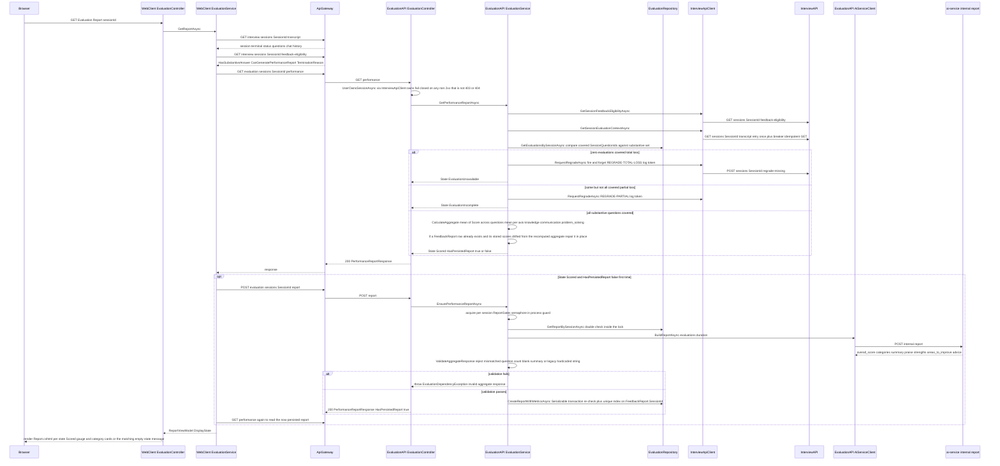
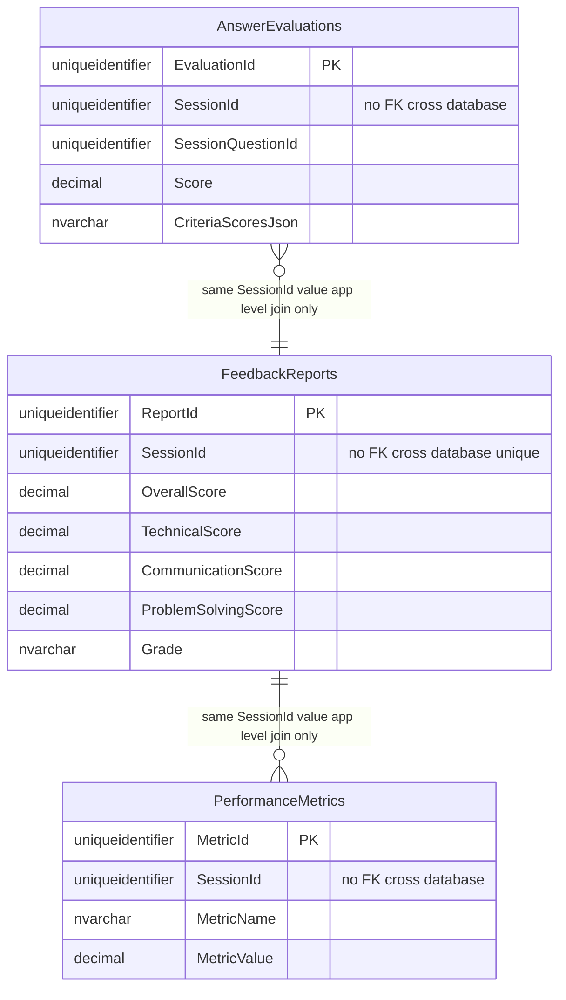

# G6 — Evaluation & Reporting

Batch: Phase 6. Components covered: EvaluationAPI, ai-service, WebClient, with InterviewAPI as a
teammate-adjacent-but-owned cross-service dependency (InterviewAPI is in-scope per `CLAUDE.md`; the
distinction that matters here is that Evaluation's own database has no foreign key into
InterviewAPI's database — see §6). All files cited below were re-read directly for this batch,
including the full 722-line `EvaluationService.cs`, the full `EvaluationController.cs`
(both EvaluationAPI's and WebClient's), `EvaluationRepository.cs`, `EvaluationDbContext.cs`,
`InterviewApiClient.cs`, `ResiliencePolicies.cs`, and `Views/Evaluation/Report.cshtml`. T1–T6
terminology rules remain in force. Single feature (View Evaluation & Reporting), documented in
greater depth than the template's default length, per instruction, because this chapter carries the
system's entire scoring methodology — the part of the report most exposed to academic scrutiny.

---

## Correction to G5, made before this chapter — voice-path threat model amendment

Before writing this chapter, the reachable voice-answer verification path
(`BiometricVerificationService.VerifyVoiceAnswerAsync`, `:454-573`) was re-verified by a full,
direct re-read. **Confirmed: it calls only `AiServiceClient.VerifyVoiceAsync` → `POST
/internal/biometrics/verify` (`modality=voice`) — speaker-embedding cosine similarity only. No
content/challenge check (`liveness_voice.py`, `VOICE_CONTENT_MIN_SIMILARITY`) executes anywhere on
this call chain.** This matches what G5's F-17 section already stated in its body (§5 step 4, §7
R1), but G5's **opening threat-model section** had described the presentation-attack gap only for
the face channel. `docs/report/05_G5_biometric_verification_and_integrity.md` has been amended:
point 2 was restructured from a single face-only paragraph into **"2. What it does NOT defend
against: presentation attacks — on both channels, for two different reasons,"** with new sub-points
**2a (Face)** — carrying the original liveness-disabled content — and **2b (Voice)**, new content
stating that the voice-answer path is speaker-embedding-only, that a content/challenge-check
mechanism exists in code but is wired only to `biometric-wizard.js`'s unreachable "verify mode"
(cross-referencing `OPEN_QUESTIONS.md` #22), and drawing the explicit distinction: **face's gap is a
disablement** (built, tested, found broken, consciously turned off) **while voice's gap is an
unreachable feature** (built, never wired to anything the deployed product calls). Point 3's heading
was narrowed to "Why the face liveness signal specifically was disabled" to avoid implying the
reasoning applies to voice too. Point 4 (the consistency-check positive finding) was extended one
sentence to confirm no rendered UI on the reachable voice-answer path claims a content/phrase check
either. No other section of G5 required a change — F-17's body content was already accurate.

---

## F-19. View Evaluation & Reporting

### 1. Purpose and scope
Presents the candidate with an AI-graded performance report for a terminated interview session:
an overall score, three category sub-scores, a letter grade, a narrative summary with strengths and
areas to improve, and a per-question breakdown. Scope: read/aggregate/persist the report; it does
not perform per-answer grading itself (that is G3's `EvaluateAnswerAsync`/async grading queue) —
this feature aggregates already-graded answers and, on first view, triggers the aggregate-summary
call to the judge model.

### 2. Actors, preconditions, postconditions

| | |
|---|---|
| Actor | Authenticated candidate, `[Authorize(Roles="User")]` on the two report-facing EvaluationAPI endpoints (`EvaluationController.cs:110,154`) |
| Precondition | Session belongs to the caller (verified via InterviewAPI, §6); session is terminal (`Completed`/`Cancelled`/`Expired`) |
| Postcondition (first view, eligible) | A `FeedbackReports` row is persisted (idempotently, §7); `PerformanceMetrics` rows recorded |
| Postcondition (later views) | The persisted report is read back directly, no aggregate-summary call repeated |

### 3. Architectural placement
`Browser → WebClient EvaluationController.Report (Controllers/Evaluation/EvaluationController.cs) →
WebClient EvaluationService.GetReportAsync/LoadReportAsync (Services/Evaluation/EvaluationService.cs)
→ ApiGateway evaluation-route (ai-backed timeout policy) → EvaluationAPI EvaluationController.
GetPerformance/EnsureReport/GetAnswerEvaluations → EvaluationAPI EvaluationService → (a)
EvaluationRepository (EvaluationAPI's own `DevPrep_Evaluation` database) and (b)
Clients/InterviewApiClient (cross-service HTTP back to InterviewAPI for eligibility/transcript/
ownership) and (c) Clients/AiServiceClient → ai-service POST /internal/report →
app/services/evaluator.py aggregate/build_report`. WebClient also independently calls InterviewAPI
directly for the raw transcript and feedback-eligibility (`api/interview/sessions/{id}/transcript`,
`.../feedback-eligibility`) *before* ever calling EvaluationAPI — this is why `ReportSessionContext`
(WebClient) and the eligibility check inside EvaluationAPI's own `GetPerformanceReportAsync` can, in
principle, diverge if the two calls race across a session-state change; `LoadReportAsync` guards
against exactly this by requiring `eligibility.Status` to still match `context.Status`
(`WebClient EvaluationService.cs:105-111`), falling back to `EvaluationUnavailable` if they've
drifted.

### 4. Interface contract

| Method | Route | Notes |
|---|---|---|
| GET | `api/evaluation/sessions/{sessionId}/performance` | `[Authorize(Roles="User")]`; `PerformanceReportResponse {State, SessionId, HasPersistedReport, OverallScore, TechnicalScore, CommunicationScore, ProblemSolvingScore, Summary, Strengths, Improvements, Recommendations, Grade}` |
| POST | `api/evaluation/sessions/{sessionId}/report` | `[Authorize(Roles="User")]`; same response shape; triggers first-time generation |
| GET | `api/evaluation/sessions/{id}/answers` | Class-level `[Authorize]` only; `List<EvaluateAnswerResponse>`, per-question breakdown |

Status codes across all three (`EvaluationController.cs`, confirmed by full re-read): 200; 401
(`InterviewApiUnauthorizedException`, or WebClient's own 401 on the authenticated-user-id check);
403 (`InterviewApiForbiddenException`, or `UserOwnsSessionAsync`-false on the `answers` endpoint);
404 (`InterviewApiSessionNotFoundException`); 409 `Conflict`
(`SessionNotEligibleForPerformanceReportException`, or — `EnsureReport` only —
`AggregateReportNotReadyException`); 503 (`InterviewApiTimeoutException`/
`InterviewApiDependencyException`/`EvaluationDependencyException`/`EvaluationPersistenceException`,
or the generic catch-all).

### 5. Processing flow — the five-state read path, then the one-time generation path

**Read path** (`GetPerformanceReportAsync`, `EvaluationService.cs:226-322`, full re-read this
batch):
1. Fetch eligibility from InterviewAPI (`GetSessionFeedbackEligibilityAsync`).
2. **State: `ExpiredNoResult`** if `Status=="Expired"` (`:236-237`) — return immediately, no further
   work.
3. Throw `SessionNotEligibleForPerformanceReportException` if status is neither `Completed` nor
   `Cancelled` (`:239-243`) — this is a **409**, not one of the five states; a session that's still
   `InProgress`/`Paused`/etc. is a caller error, not a lifecycle state to render.
4. **State: `NoEvaluatedAnswers`** if `!HasSubstantiveAnswer` (`:245-246`).
5. Throw `SessionNotEligibleForPerformanceReportException` again if `!CanGeneratePerformanceReport`
   (`:248-249`) — this is the `SessionCapabilityPolicy` gate from G2 (recall: `Cancelled` +
   `IntegrityViolation` never qualifies, regardless of substantive-answer count).
6. Fetch the full transcript context from InterviewAPI; cross-check `context.Status ==
   eligibility.Status`, else throw `InterviewApiDependencyException` (`:251-256`) — a defensive
   consistency check between two separate InterviewAPI calls.
7. Compute `substantiveQuestionIds` from the transcript; **State: `NoEvaluatedAnswers`** again if
   this set is empty (`:265-266`, a second, later-discovered path to the same state as step 4).
8. Load persisted `AnswerEvaluations`, keep the latest row per question (`GroupBy... OrderByDescending
   GeneratedAt... First()`, `:269-276` — tolerant of a re-grade having produced more than one row
   historically for the same question, though the read path always prefers the newest).
9. **State: `EvaluationUnavailable`** if zero questions are covered (`:285-292`) — triggers recovery
   (§ below).
10. **State: `EvaluationIncomplete`** if some but not all are covered (`:294-299`) — also triggers
    recovery.
11. **State: `Scored`** otherwise (`:301`) — computes the aggregate (§ Scoring methodology below)
    and, if a persisted `FeedbackReport` already exists but its stored values have drifted from a
    fresh recompute, repairs it in place (`AggregateRequiresRepair`, § Self-healing below) before
    returning.

**Generation path** (`EnsurePerformanceReportAsync`, `:324-453`, triggered by WebClient only on the
very first `Scored` view where `HasPersistedReport==false`, `WebClient EvaluationService.cs:150-184`)
— see § Two-tier idempotency below for the concurrency-control detail, and § Server-side AI-output
validation for the `ValidateAggregateResponse` step.


*Figure 6.1 — View Evaluation & Reporting: read path (five-state resolution), generation path
(first-view aggregate build), and the recovery hooks.*

### 6. Data model impact — cross-database integrity, the IDOR defence, and the trade-off

`AnswerEvaluations`, `FeedbackReports`, `PerformanceMetrics` all carry a plain `SessionId` `Guid`
column with **no foreign key to `InterviewSessions`** — confirmed directly by re-reading
`EvaluationDbContext.OnModelCreating` in full (`:18-42`): it configures only keys, a unique index,
and default-value SQL, never a `HasOne`/`WithMany` relationship, because `InterviewSessions` lives
in a **separate SQL Server catalog** (`DevPrep_Interview` vs. `DevPrep_Evaluation`) that EF Core
cannot reference across. **This is the same fact stated in `Program.cs:69-70`'s comment** (Phase 0
evidence, re-affirmed): "Evaluation tables have no UserId of their own" — and, confirmed here, no
`SessionId` FK either.

**The IDOR defence this necessitates**: since the database cannot enforce "this session belongs to
this caller," every EvaluationAPI action that touches session data checks ownership **per request**,
over HTTP, against InterviewAPI's `GET api/interview/sessions/{id}/owns`
(`InterviewApiClient.OwnsSessionAsync`, `:23-...`, full re-read this batch). **Fail-closed, verified
directly**: the method returns `false` (not owner) only on `403`/`404` (`:36-37`); every other
non-success outcome — `401` (throws `InterviewApiUnauthorizedException`, `:33-34`), `408`/`429`/`5xx`
(throws via `LogOwnershipDependencyFailure`, `:39-44`), any other non-2xx (`:46-47`), or a
malformed/unsuccessful envelope (`:49-54`) — **throws rather than defaulting to `true`**. The
calling controller action (`EvaluationController.cs:53-54,218-219`) treats "ownership could not be
confirmed" as a request failure (401/503), never as "assume access is fine" — a genuine fail-closed
design, not merely a documented intention.

**The trade-off, stated plainly**: referential integrity is sacrificed for service autonomy — each
service owns its schema and can evolve independently, at the cost of every cross-service read
needing an extra network round trip (with its own resilience policy, § below) instead of a database
join, and at the cost of no database-level guarantee that an `AnswerEvaluation.SessionId` actually
corresponds to a real `InterviewSessions` row at all (a dangling reference is possible in principle,
e.g. if InterviewAPI's row were ever deleted outside the soft-delete convention — not observed, not
reproduced, a structural observation).


*Note: this fragment covers `DevPrep_Evaluation` database tables only. A separate, unrelated table
also named `FeedbackReports` exists in the teammate-owned `DevPrep_Feedback` database
(moderation/report-abuse, `db/baseline/07_DevPrep_Feedback.sql`, Phase 0 §F.11) and is not
represented here or anywhere in this report's diagrams — the two must never be conflated.*

### 7. Business rules and invariants

**Two-tier idempotency for report generation — three layers, each catching what the others do
not:**
1. **In-process, per-session `SemaphoreSlim`** (`ReportGates`, a `static ConcurrentDictionary<Guid,
   SemaphoreSlim>`, `EvaluationService.cs:15,340-341`): serializes concurrent requests for the
   **same session within one process instance** — two browser tabs hitting `POST /report`
   simultaneously on the same EvaluationAPI worker process will have one wait for the other. **What
   it does NOT catch**: two different process instances (a second replica, or a process restart
   racing a still-in-flight request) — an in-memory lock has no cross-process reach.
2. **Database transaction with `Serializable` isolation, plus a re-check inside it**
   (`EvaluationRepository.CreateReportWithMetricsAsync`, `:48-59`, full re-read): opens a
   `Serializable`-isolation transaction, re-queries for an existing report by `SessionId` **inside**
   that transaction, and if one now exists (a race with another process that committed between this
   request's semaphore-guarded check and this point), commits the empty transaction and returns the
   *existing* row rather than inserting a duplicate. **What it catches that layer 1 does not**:
   cross-process concurrency — two separate EvaluationAPI instances (or a restarted process) racing
   to create the first report for a session.
3. **The unique index `FeedbackReports.SessionId`** (`EvaluationDbContext.cs:30`,
   `entity.HasIndex(e => e.SessionId).IsUnique()`): the last-resort schema guard — even if layers 1
   and 2 were both somehow bypassed (a bug, a direct database write, a future code path that forgets
   to use `CreateReportWithMetricsAsync`), the database itself physically cannot hold two rows with
   the same `SessionId`. **What it catches that the others do not**: everything neither application
   layer anticipated, including future code that doesn't go through this exact method.

**Why three layers rather than one**: each is cheap relative to what it protects against and each
closes a gap the layer "below" it cannot — the semaphore avoids the transaction/lock overhead for
the overwhelmingly common case (one request at a time), the transaction closes the cross-process gap
the semaphore structurally cannot reach, and the unique index is defense-in-depth against any future
code path, not just this one.

**Recovery / self-healing — what failure this compensates for.** `RequestRegradeIfNeededAsync`
(`:172-224`, full re-read; already documented in G3 as the compensating mechanism for InterviewAPI's
**in-memory grading queue**, which loses all pending work on a process crash) is called from exactly
the two lines in `GetPerformanceReportAsync` that decide a coverage shortfall (`:289-290,296-297`) —
placed there deliberately, per the code's own comment, because an earlier attempt hooked the recovery
call inside `EnsurePerformanceReportAsync` instead and "never fired for either failure mode"
(`:377-379`), since by the time that method's own race-guard check runs, the two counts can only
differ under a same-request, millisecond-scale race that the per-session gate already makes
"effectively unreachable" (`:370-375`). **Per-request dedup**: `_regradeAttemptedThisRequest`
(instance field, `EvaluationService` is `AddScoped` so this is request-scoped) stops
`GetPerformanceReportAsync`'s up-to-three internal calls within one HTTP request
(`EnsurePerformanceReportAsync` calls it at `:348`, and again indirectly via the two return paths at
`:338,346`) from firing three separate regrade requests for one page load (`:17-27` comment,
explaining precisely why: without this, every log entry showing "cooldown suppressed" would
conflate "we asked ourselves twice in one request" with "the user is genuinely refreshing," making
the signal useless). **Server-side cooldown**: InterviewAPI's own 60-second per-session cooldown (G3
cross-ref, `SessionService.cs:1833-1849`) is the second layer, catching genuine repeat page-loads
across separate requests. **Log tokens, quoted exactly**: `REGRADE-TOTAL-LOSS` fires only on the
zero-evaluations branch, `REGRADE-PARTIAL` only on the some-but-not-all branch, both prefixed
`REGRADE-` so every attempt is countable in one grep regardless of branch (`:200-206` comment).

**Aggregate self-healing** (`AggregateRequiresRepair`, `:559-564`, re-read): compares a persisted
`FeedbackReport`'s four numeric fields and its `Grade` string against a **freshly recomputed**
aggregate from the current `AnswerEvaluations` set on every `Scored`-state read
(`GetPerformanceReportAsync:303-319`); on mismatch, `UpdateReportAggregateAsync` rewrites the
persisted row in place. This means a `FeedbackReport`'s numeric fields are not a one-time snapshot —
they are **re-derived and repaired opportunistically on every view**, so a late-arriving re-graded
answer (from the recovery mechanism above) that changes the mean score is reflected the next time
anyone views the report, without any separate "recompute" job.

**Server-side validation of AI output — a designed safeguard, not incidental checking.**
`ValidateAggregateResponse` (`:467-495`, re-read) rejects the ai-service `/internal/report` response
outright if: `NumQuestions` doesn't match the number of evaluations actually sent (`:471`); the
summary object is null; `Praise`/`Advice` are blank after sanitization (`:476-481`); or —
specifically — the praise text **exactly matches one of three hardcoded legacy strings**,
`IsLegacyScoreBandSummary` (`:511-514`): *"Excellent performance!"*, *"Good performance!"*, *"Keep
practicing!"* (case-insensitive). `ValidateSummaryItems` (`:497-509`) further requires `Strengths`
to have 1–4 non-blank items and `AreasToImprove` 0–4. **This is named here explicitly as a strong
point of the design**: it is a concrete, automated defense against a degraded or drifting model
response — if the judge model ever regressed to echoing a template string instead of genuinely
grounded praise (the exact failure mode the three legacy strings appear to guard against, based on
their specificity), this validation catches it and the request fails loudly
(`EvaluationDependencyException`) rather than silently persisting a templated, non-evidence-grounded
report.

### 8. AI/ML component — scoring methodology (the academically exposed part)

This feature does not call the judge model for **per-answer** grading (that happens in G3, at
answer-submission time) — it calls the judge **once**, per session, for the **whole-session
narrative summary** (`_summary_prompt`, G3 F-09 §8, not re-derived here), and separately performs
**pure arithmetic aggregation** over already-graded per-question scores. Both are documented fully
here since this is where a reader evaluates the report's actual number.

**a. `CalculateAggregate` — confirmed MEAN across questions, by direct re-read
(`EvaluationService.cs:518-542`).** 
$$
\text{OverallScore} = \mathrm{round}\left(\frac{1}{n}\sum_{i=1}^{n} \text{Score}_i\right)
$$
(`Math.Round(evaluations.Average(e => e.Score))`, `:520`) — a plain arithmetic mean of each
question's already-computed `Score` (itself the weighted-and-medianed result of G3's per-answer
grading, §k below), rounded once. Per-axis scores (`TechnicalScore`, `CommunicationScore`,
`ProblemSolvingScore`) are each the mean of that axis's values, parsed out of every question's
stored `CriteriaScoresJson`, **skipping questions where that axis is absent** rather than treating a
missing value as zero (`AxisAverage`, `:527-534`: `.Where(item => item.ContainsKey(axis))` before
averaging).

**This must not be conflated with G3's self-consistency median** (explicit cross-reference, per
instruction): G3's `statistics.median(...)` combines **3 repeated judge runs of the same single
answer** into one score, at grading time, inside ai-service; **this** feature's `Math.Round(...
.Average(...))` combines **N different, already-finalized questions'** scores into one session-level
number, at report time, inside EvaluationAPI. They are different operations, at different layers,
combining different things — median-of-repeated-runs (variance reduction on one measurement) versus
mean-of-distinct-measurements (a session-level summary statistic).

**b. Axis-to-column naming translation — a non-obvious mapping, stated exactly.** The Gemini rubric
(G3) produces axes named `knowledge`, `problem_solving`, `communication`. `CalculateAggregate`
constructs `AggregateResult` positionally as `(overallScore, AxisAverage("knowledge"),
AxisAverage("communication"), AxisAverage("problem_solving"), GradeFor(overallScore))`
(`:536-541`), and the record's own field order (`:717-722`) is `(OverallScore, **TechnicalScore**,
CommunicationScore, ProblemSolvingScore, Grade)` — so **`TechnicalScore` is populated from the
`knowledge` axis**, not from any dimension separately named "technical" anywhere in the grading
rubric. This naming translation is consistent end-to-end: WebClient's own `FormatCriterionLabel`
(`Services/Evaluation/EvaluationService.cs:360-374`, re-read) independently maps
`"knowledge"→"Technical"` for the per-question breakdown display, so the translation is applied
identically at both the aggregate and per-question level — not a mismatch, but worth stating
explicitly since "Technical" appears nowhere in the actual grading prompt (G3), only in the persisted
column name and the UI label.

**c. Grade bands — `GradeFor` (`:566-573`), no derivation recorded.**
```
A  if overallScore >= 85
B  if overallScore >= 70
C  if overallScore >= 55
D  otherwise
```
**Stated plainly, per instruction: no comment, document, or derivation for these three cut-offs
(85/70/55) was found anywhere in the codebase.** They are presented here as what the code does, not
as a validated grading scale.

**d. A third, independently-chosen set of bands exists on the display side — noted for
completeness, not conflated with (c).** `Report.cshtml`'s own `Band` function (color) uses **80/60**
(`:26-27`, `score >= 80 ? success : score >= 60 ? warning : primary`), and its `HeroTitle` uses the
same 80/60 split for wording (`:48-49`); its separate `CommentFor` function uses **85/70**
(`:44-45`), which **does** match `GradeFor`'s and ai-service's `_band_comment`'s (G3) cutoffs
exactly. **Three independently-defined threshold sets exist across this system for conceptually
similar "how good is this score" bucketing** — `GradeFor` (85/70/55, letter grade),
`_band_comment`/`CommentFor` (85/70, "Strong"/"Solid"/"Needs improvement," consistent with each
other), and `Band`/`HeroTitle` (80/60, display color and hero wording) — with no single source of
truth and no code comment explaining why the display color bands differ numerically from the letter
grade and comment bands. Not a functional defect (nothing crashes, nothing contradicts a stated
requirement), but a documentation/maintenance observation: a future change to one would not
automatically stay consistent with the others.

**e. The 50/30/20 rubric weights — restated, not re-derived (cross-ref G3 §8f, `OPEN_QUESTIONS.md`
#14).** The per-question `Score` that this feature averages was itself computed in G3 as
$0.5 \cdot \text{knowledge} + 0.3 \cdot \text{problem\_solving} + 0.2 \cdot \text{communication}$,
annotated in code only as "(design section 4.2)," with no such document locatable in the repository.
**Not re-derived, justified, or given literature support here — that would be inventing a
justification the codebase does not provide, which the report's evidence rule forbids.**

**f. The load-bearing sentence for §11, stated once here in full**: **the score a candidate sees is
a large-language-model judgement, run through fixed rubric weights whose provenance is unrecorded,
averaged across questions, and mapped to a letter grade at cut-offs that are likewise unrecorded. It
is not a psychometrically validated instrument** — no reliability (e.g. inter-rater or test-retest
consistency) or validity (e.g. correlation with an external, independent measure of interview
performance) evidence for this scoring pipeline exists anywhere in this codebase. This sentence is
stated here plainly, once, in the section a reviewer is most likely to scrutinize, rather than
hedged or buried.

**k. Academic grounding**: LLM-as-judge and self-consistency citations already given in full in G3
F-09 §8k (Zheng et al. 2023; Wang et al. 2023 — both `[CITATION TO VERIFY]`), not repeated here. For
simple mean aggregation of repeated/multiple measurements, no specialized citation is offered — it
is standard descriptive statistics, not a technique requiring domain-specific grounding.

### 9. Failure modes and edge cases

| Scenario | System behaviour | Evidence | User-visible result |
|---|---|---|---|
| Session `Expired` (ran out of time, no substantive answers) | `ExpiredNoResult`, immediate return | `EvaluationService.cs:236-237` | "This interview expired without an evaluation result." |
| Session `Cancelled` for `IntegrityViolation` | `CanGeneratePerformanceReport=false` → `SessionNotEligibleForPerformanceReportException` → WebClient redirects to Session Details instead of the Report page | `EvaluationController.cs:41-46` (WebClient), cross-ref G2 `SessionCapabilityPolicy` | "A performance report is not available because this interview ended after an integrity-policy violation. You can still review the session details and submit Interview Feedback." |
| All grading jobs lost (InterviewAPI crash mid-session, G3 cross-ref) | `EvaluationUnavailable`, regrade triggered, `RecoveryInProgress=true` on WebClient | `EvaluationService.cs:285-292`; `WebClient EvaluationService.cs:206-224` | "Evaluation is still processing... refresh in a moment" — not shown as a permanent failure |
| ai-service `/internal/report` returns a template/degraded summary | `ValidateAggregateResponse` rejects it | `EvaluationService.cs:467-495,511-514` | `EvaluationDependencyException` → 503; the candidate sees "Evaluation unavailable" rather than a low-quality persisted report |
| Two browser tabs both trigger first-time report generation simultaneously | `ReportGates` semaphore serializes; second tab reads the first tab's result | `EvaluationService.cs:340-346` | Both tabs converge on the same report, no duplicate ai-service call, no duplicate row |
| `FeedbackReport` exists but scores have drifted (e.g. a re-grade changed an answer's score) | Repaired in place on next `Scored` read | `EvaluationService.cs:303-319` | Candidate sees the corrected score without any explicit "recalculate" action |

### 10. Security and integrity considerations
Covered fully in §6 (cross-database IDOR defence, fail-closed ownership check). `[Authorize(Roles=
"User")]` on the two report-facing endpoints is stricter than `EvaluateAnswer`/`GetAnswerEvaluations`,
which only require the class-level `[Authorize]` plus the explicit `UserOwnsSessionAsync` check —
two different but both-effective authorization strategies within the same controller.

**Resilience asymmetry, both rationales quoted directly** (`ResiliencePolicies.cs`, full re-read):
- **ai-service: breaker only, no retry.** *"Grading and report-building calls are slow (60s timeout)
  and expensive on the GPU; an automatic retry doubles a user's wait on a dependency that has already
  failed"* (`:32-34`).
- **InterviewAPI: retry once (jittered 200–399ms), then breaker.** *"Every call this client makes is
  a side-effect-free GET... short (15s timeout) and sit in front of a user-visible report, so riding
  out a single blip is worth ~300ms"* (`:42-44`); jitter specifically *"because InterviewAPI runs
  four grading workers in parallel; a fixed delay would line their retries up into a second
  synchronised burst"* (`:75-76`).
- **The shared-breaker risk is self-documented and independently confirmed to exist as a tracked
  item**: `InterviewApiClient.cs:200-213` (Phase 0 evidence, re-affirmed) notes
  `RequestRegradeAsync` shares its circuit breaker with `OwnsSessionAsync`/
  `GetSessionEvaluationContextAsync` — a persistent regrade failure could open the breaker for
  unrelated ownership/transcript calls. Phase 0.5 §Q8 confirmed `docs/architecture/
  code-followups.md` **exists** and contains exactly this item, "C-03," status "accepted risk, Batch
  5.5b. Not scheduled" — this is not a dangling comment reference but a real, already-triaged,
  consciously-deferred risk.

### 11. Limitations and future work

- **The load-bearing sentence from §8f, restated for the Definition-of-Done record**: the score is
  an LLM judgement aggregated by fixed weights whose provenance is unrecorded; it is not a
  psychometrically validated instrument.
- **`FeedbackReport.TheoryScore` — declared but unused.** Confirmed again by a fresh grep in this
  batch (`grep -rn "TheoryScore" source/EvaluationAPI/`): exactly one match, the property
  declaration (`Models/FeedbackReport.cs:16`). No read or write site exists anywhere in
  `EvaluationService.cs`, `EvaluationRepository.cs`, or any DTO/controller re-read for this chapter.
  **`Status: Declared but unused`** (schema column and EF property both exist; never populated,
  never read).
- **`EvaluationAPI`'s `AiServiceClient.PlanQuestionsAsync` — implemented but unused from this
  service's call graph.** Confirmed again this batch: the method exists
  (`Clients/AiServiceClient.cs`, `POST /internal/questions/plan`), but grepping
  `EvaluationController.cs` and `EvaluationService.cs` (both fully re-read) finds no call site.
  **`Status: Implemented but unused`** — joins the "unreachable capability" theme running through
  this report (Gemma in G1/G3, the plain STT endpoint in G3, the challenge-based voice/face verify
  flow in G5): a fourth instance of code that exists, compiles, and is wired to a real endpoint, but
  that nothing in the deployed call graph ever exercises.
- Three independently-chosen score-band threshold sets exist with no single source of truth (§8d).
- No FK-backed referential integrity between `AnswerEvaluations`/`FeedbackReports`/
  `PerformanceMetrics` and `InterviewSessions` (§6) — a deliberate service-autonomy trade-off, not
  an oversight, but one that leaves a theoretical dangling-reference risk unguarded by the database.
- Grade cut-offs (85/70/55) have no recorded derivation (§8c).

### 12. Figures
Figure 6.1 (sequence diagram, `diagrams/FIG-6.1.mmd`); Figure 6.2 (state diagram — five lifecycle
states, `diagrams/FIG-6.2.mmd`); Figure 6.3 (screenshot — evaluation report page, Scored state, see
`SCREENSHOT_CHECKLIST.md`).

---

## Resolutions and new items carried into `OPEN_QUESTIONS.md`

- **New #25** — Three independently-defined score-band threshold sets (`GradeFor` 85/70/55,
  `CommentFor`/`_band_comment` 85/70, `Band`/`HeroTitle` 80/60) with no single source of truth and
  no comment explaining the numeric divergence (§8d).
- **New #26** — `EvaluationAPI.AiServiceClient.PlanQuestionsAsync` confirmed unused from this
  service's own call graph on a fresh re-check this batch — joins the report's "unreachable
  capability" theme (§11).
- **Resolved** — Phase 0.5 §Q7 (`FeedbackReport.TheoryScore`) re-confirmed by direct re-grep this
  batch; no new information, status unchanged (`Status: Declared but unused`, §11).
