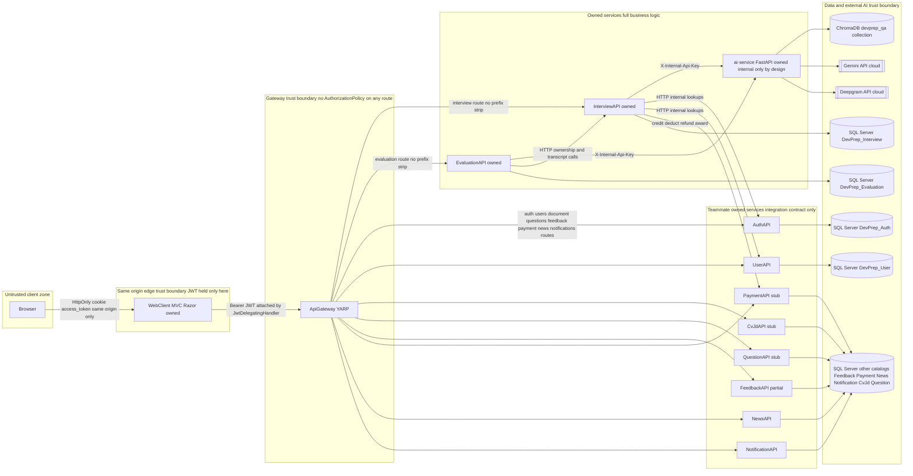
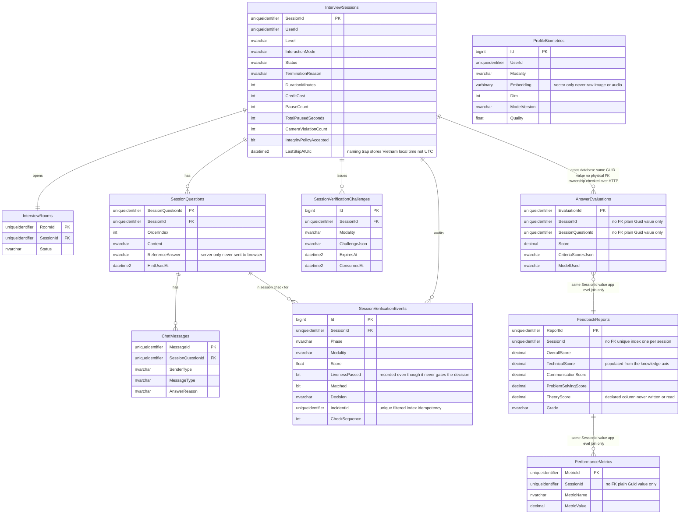

# 07 — Cross-Cutting Architecture

Phase 7. Draws on evidence already established in chapters 00–06; every restated claim below was
re-verified against source in this batch (three files were newly, directly re-read for this
chapter: `Services/Shared/JwtDelegatingHandler.cs` in full, the installed
`starlette/middleware/cors.py` in full, and `source/ApiGateway/Program.cs`'s middleware section),
and every number carries its original citation. T1–T6 terminology rules remain in force.

---

## 1. System context

*Figure 7.1 — System context. Boxes for the eight gateway-routed teammate-owned services are
shown at the integration-contract level only, per the mission's ownership boundary; their internals
are out of scope for this report. Trust-boundary labels mark exactly where the JWT lives, where
authorization actually happens, and which network segment is internal-only by design.*

Ten SQL Server catalogs are shown grouped for space; §8 lists which four are in this report's
direct scope. The eight teammate-owned services are drawn as opaque boxes deliberately — this
report documents only the endpoint/method/request/response shape it observes as a caller, never
their internal logic, per the mission's constraint #9.

## 2. Layering and the same-origin proxy pattern

Every AI-touching call in this system follows the same shape: **browser → WebClient controller →
ApiGateway → owned service → (ai-service | DB)** — never browser directly to Gateway, and never
browser directly to ai-service. This is a deliberate security property, not an accident of routing
convenience, and it rests on one specific mechanism: `JwtDelegatingHandler`
(`source/WebClient/Services/Shared/JwtDelegatingHandler.cs`, re-read in full for this chapter).

The JWT is stored as an **HttpOnly cookie** (`access_token`/`refresh_token`) — never readable by
client-side JavaScript at all, by construction. `JwtDelegatingHandler.SendAsync`
(`:38-60`) is a `DelegatingHandler` wired into every WebClient-to-Gateway `HttpClient`
(`Services/Shared/ServiceCollectionExtensions.cs:59,68`, Phase 2 evidence); it reads the cookie
value **server-side**, checks whether the token is within `ExpiryMarginSeconds=60` of expiring
(`:63-89`, parsing the JWT's `exp` claim without verifying its signature — signature verification is
the receiving service's job, not this handler's), and — if so — **transparently refreshes it**
before attaching it as the `Authorization: Bearer` header on the outbound request
(`:91-157`). The refresh itself is concurrency-safe: a process-wide `SemaphoreSlim` plus a
30-second result cache keyed on the old refresh token (`:99-114`) means multiple requests racing a
near-expiry token in the same moment trigger exactly one refresh call to `AuthAPI`'s
`/api/auth/refresh`, not one per request — the comment states the reason directly: refresh-token
rotation would otherwise make every losing concurrent request fail with a 401
(`:16-17` comment, cross-ref).

**Why this matters as a security property, stated plainly**: a bearer token capable of reaching
privileged, session-mutating, and credit-charging endpoints (G2) never has to be readable by, or
stored in, browser-accessible JavaScript state (`localStorage`, a JS variable, etc.) — the standard
attack surface for token theft via XSS is closed by construction, because there is no code path in
which client-side script ever holds the token. The trade-off is that WebClient itself becomes a
trusted intermediary for every privileged call — a compromise of WebClient's own server process (not
covered by this report's scope) would defeat this property, since it is the one place the token is
ever assembled in the clear.

## 3. Authentication and authorization topology — stated plainly

**The Gateway sets no `AuthorizationPolicy` on any route.** Re-verified in this batch: `grep -r
"AuthorizationPolicy" source/ApiGateway/` returns zero matches, consistent with the full read of
`source/ApiGateway/Program.cs` (Phase 0, re-confirmed here). The Gateway's only access-control
logic is a blanket rejection of any request whose path contains a segment literally equal to
`"internal"` (case-insensitive), returning 404 before the request ever reaches `MapReverseProxy()`
(`ApiGateway/Program.cs:106-121`) — this exists specifically to stop a prefix-stripped route from
being used to reach an internal-only endpoint (e.g. `POST /api/payment/api/internal/credit/refund`),
not as a general authorization mechanism.

**WebClient controllers carry no `[Authorize]` attribute anywhere** (confirmed by grep across every
controller documented in G1–G6). Authentication is enforced two ways instead: manual
`Request.Cookies["access_token"]` presence checks on individual actions (e.g.
`Controllers/Profile/ProfileController.cs:88,125,136,217,237`, Phase 0 evidence), or by catching a
401 response propagated up from the Gateway/backend call and redirecting to login
(`Controllers/Shared/CandidateAuthenticationRedirect.cs:9-13`, Phase 0 evidence).

**All real authorization lives in the backend services**: `[Authorize]`/`[Authorize(Roles=...)]`
attributes on InterviewAPI/EvaluationAPI controllers (documented per-endpoint across G1–G6), plus
explicit per-request ownership checks where the data model itself cannot enforce it — most notably
EvaluationAPI's `UserOwnsSessionAsync` → InterviewAPI `GET /owns` call (G6 §6), which this report
confirmed fails closed on any non-2xx response other than 403/404.

**What a reader should not assume, stated directly**: the Gateway is not, and should not be treated
as, an authorization boundary. Every route it exposes is reachable by any caller who can reach the
Gateway's network address at all (subject to the internal-segment 404 above); whether that caller is
then permitted to *do* anything is decided entirely downstream, per-service, per-endpoint. This is
an architecturally consistent, defensible design (each service is the sole authority over its own
resources) but it means there is no single place in this system where "is this request allowed at
all" can be answered by inspecting the Gateway configuration alone.

## 4. Internal service-to-service auth

`X-Internal-Api-Key` gates every ai-service `/internal/*` and `/internal/biometrics/*` endpoint, via
**two independent implementations** (Phase 0 evidence, re-affirmed): a router-level FastAPI
dependency for the biometrics router (`biometrics/security.py:13-15`,
`require_internal_api_key`), and a manual per-endpoint function call for the general `/internal/*`
router (`app/api/internal.py:21-24`, `_check_key`). **Both fail open**: if `INTERNAL_API_KEY` is
empty/unset, the check passes unconditionally (`security.py:14`; `internal.py:23`, comment: "Empty
key = open, for local dev only"). The committed configuration — `appsettings.json` on both
InterviewAPI and EvaluationAPI, and the root `.env` — sets a **non-empty** key value (Phase 0 §E,
key name `AiService:InternalApiKey`/`INTERNAL_API_KEY`, value redacted per this report's secrets
policy), so **the fail-open path is a local-development convenience that is not exercised in the
committed configuration, not the deployed posture.** It is named here as a design decision worth
revisiting regardless: a configuration mistake (an empty key reaching a real deployment) would
silently disable authentication on every internal ai-service endpoint rather than failing loudly,
which is the riskier failure mode for a security control to have.

## 5. The unauthenticated ai-service surface — the largest security-surface item in this report

Confirmed directly (G1, re-verified here): `/parse/*` (CV/JD parsing), `/interview/*` (the stateful
session router, including the unreachable Gemma path), `/evaluate`, `/catalog`, and the static `/ui`
mount carry **no authentication check of any kind** — neither of the two `X-Internal-Api-Key`
mechanisms above is applied to these routers at all (confirmed by reading each router file for no
`Header`/`X-Internal-Api-Key`/`_check_key` reference, Phase 0). This is combined with two further
facts, one now fully resolved:

- **`ALLOWED_ORIGINS=*` with `allow_credentials=True`** (`app/main.py:45-51`). **Resolved this
  batch** by reading the actual installed `starlette/middleware/cors.py` in full
  (`ai-service/.venv/Lib/site-packages/starlette/middleware/cors.py`): its `send` method contains
  an explicit branch, quoted directly — *"If credentials are allowed, then we must respond with the
  specific origin instead of `'*'`"* (`cors.py:166-168`) — `if self.allow_all_origins and
  self.allow_credentials: self.allow_explicit_origin(headers, origin)`, which reflects the literal
  request `Origin` header. **This is not an inert misconfiguration**: it functions as an
  effectively unrestricted-origin, credentialed CORS policy — any website's JavaScript, from any
  origin, receives a browser-trusted, credentialed response from ai-service, wherever its port is
  reachable. `OPEN_QUESTIONS.md` #3 is resolved with this evidence.
- **`docker-compose.override.yml:26-28`'s own self-warning** (Phase 0 §2.2, re-affirmed): the
  override file that publishes ai-service's host port for local testing/tunneling carries an
  in-repo comment stating plainly that doing so exposes these unauthenticated routes "to the public
  internet." The base `docker-compose.yml` publishes **no** ai-service port at all — internal-only
  by default (§9) — so the risk is scoped to whoever runs the override file with a tunnel active, a
  scenario the codebase itself already flags.

**Written straight**: in the base deployment topology, this combination is not reachable from
outside the Docker network, because no host port is published for ai-service in the file that
actually ships. In the override/dev-tunnel configuration the codebase also ships, it is reachable,
unauthenticated, and — per the CORS finding above — reachable with credentials from any browser
context that a candidate's browser might otherwise trust. This is the single largest security-surface
item this report identifies, and it is scoped precisely: default deployment = not exposed;
override + tunnel = exposed, exactly as the codebase's own comment already says.

## 6. Timeout ladder

A deliberately layered timeout budget, confirmed across three files (Phase 2 §9, re-verified):
$$
\text{ai-service (60s)} < \text{ApiGateway (90s)} < \text{WebClient (95s)}
$$
for the default request path (`EvaluationAPI/Program.cs:62`, `InterviewAPI/Program.cs:96,118`;
`ApiGateway/appsettings.json`'s `ai-backed` policy; `WebClient/Services/Shared/
ServiceCollectionExtensions.cs:40-58`), and $300\text{s} < 330\text{s} < 335\text{s}$ for the
document-parsing path. **The principle, stated once**: each inner layer's timeout must be strictly
shorter than the layer that calls it, so that when something hangs, the *innermost* budget expires
first and the failure surfaces as a clean, purpose-authored error at that boundary — never as an
outer layer abandoning a request whose inner work might still complete moments later, and never as
a raw client-side `HttpClient.Timeout` exception reaching the user instead of the Gateway's own
504. The margins are explicitly called "load-bearing, not decoration" in the source comment
(`ServiceCollectionExtensions.cs:44-51`, quoted in G2). **Development overrides**: the base
90s/330s Gateway policy is widened to 300s/330s in `appsettings.Development.json:18-20` — purely to
avoid tripping the ladder while stepping through code in a debugger, not a production posture change.

## 7. Resilience topology

Circuit breakers are instantiated **once per dependency, per process**, and registered as
`Singleton` in DI — both InterviewAPI's and EvaluationAPI's `ResiliencePolicies` classes state the
reason directly, and identically (the EvaluationAPI copy is a deliberate, documented duplication of
the InterviewAPI one, not a shared library — `EvaluationAPI/Http/ResiliencePolicies.cs:9-14`, G6
§10): a circuit breaker counts consecutive failures **inside the policy object itself**, so a
per-request registration would build a fresh breaker on every call, never accumulate failures, and
never open. Both services use identical breaker parameters — `FailuresBeforeBreaking=5`,
`BreakDuration=30s` — for both dependency directions.

**Asymmetric retry policy, by design**: ai-service gets **breaker only, no retry** (grading/report
calls are slow — 60s timeout — and GPU-expensive; an automatic retry would double a user's wait
against an already-failed, already-busiest resource, per `ResiliencePolicies.cs:32-34`).
InterviewAPI gets **one retry, jittered 200–399ms, then the breaker** (every call
EvaluationAPI makes to InterviewAPI is a side-effect-free GET, so a single retry is safe; jitter
specifically avoids InterviewAPI's four parallel grading workers' retries synchronizing into a
second burst, per `:75-76`, G6 §10).

**The shared-breaker risk, self-documented and independently confirmed as a tracked item** (G6 §10,
Phase 0.5 §Q8): `RequestRegradeAsync` shares its `HttpClient`/breaker instance with
`OwnsSessionAsync`/`GetSessionEvaluationContextAsync` (one client registered once in `Program.cs`,
not per-method), so a persistent regrade failure could open the breaker for unrelated
ownership/transcript calls. `docs/architecture/code-followups.md` — confirmed to exist and to
contain this exact item as "C-03," status "accepted risk, Batch 5.5b. Not scheduled" — means this is
not a discovery of this report but an already-triaged, consciously-deferred engineering decision.

## 8. Data and time

**Ten separate SQL Server catalogs**, confirmed from `infra/docker-compose.yml`'s per-service
`*_DB_CONNECTION_STRING` environment variables (Phase 0 §2): `DevPrep_Auth`, `DevPrep_User`,
`DevPrep_CvJd`, `DevPrep_Question`, `DevPrep_Interview`, `DevPrep_Evaluation`, `DevPrep_Feedback`,
`DevPrep_Payment`, `DevPrep_News`, plus notifications' own catalog — one per service, no shared
database. **No cross-database foreign keys exist anywhere this report's scope touched**:
`AnswerEvaluations`/`FeedbackReports`/`PerformanceMetrics.SessionId` are plain `Guid` columns with
no FK to `InterviewSessions` (G6 §6, `EvaluationDbContext.OnModelCreating` re-read in full, no
`HasOne`/`WithMany` present). Ownership across this boundary is enforced entirely over HTTP,
per-request (G6 §6's fail-closed `OwnsSessionAsync` trace).

**Time is stored as naive Vietnam local time throughout**, not UTC and not `DateTimeOffset`:
`VietnamTime.Now => DateTime.UtcNow.AddHours(7)` (`Helpers/VietnamTime.cs:9`, both InterviewAPI's
and EvaluationAPI's identical copies), matched by the SQL default `DATEADD(HOUR,7,SYSUTCDATETIME())`
on every relevant column across both databases (Phase 0 §B). This works correctly only because every
timestamp in these tables was produced by the same convention — no type-level marker distinguishes
it from true UTC, so a future integration with any UTC- or `DateTimeOffset`-based system would
silently be off by 7 hours with no compiler or runtime warning (G2 cross-cutting note). **The
specific naming trap, restated**: `InterviewSessions.LastSkipAtUtc` is named as though it holds UTC
but, per its own adjacent code comment, stores the identical `VietnamTime.Now` convention as every
other column — "named per the task spec, not a new UTC convention" (`Models/InterviewSession.cs:
74-79`, G2).

*Figure 7.2 — Consolidated ER diagram, `DevPrep_Interview` and `DevPrep_Evaluation` tables, each
column's database made explicit to prevent conflation with the unrelated, teammate-owned
`FeedbackReports` table in `DevPrep_Feedback` (Phase 0 §F.11) — that table is never shown in this
report's diagrams.*

## 9. Deployment topology

Docker Compose, confirmed by the full read of `infra/docker-compose.yml`/`docker-compose.override.yml`
(Phase 0 §2): **only two host ports are published in the base file** — `7000:8080` (ApiGateway) and
`5130:8080` (WebClient); every backend service, including ai-service and SQL Server, is
internal-network-only by default (`infra/docker-compose.yml:124-125` comment on ai-service, and the
absence of a `ports:` block on every other backend service). The override file adds host access for
SQL Server (`1433:1433`, for SSMS) and ai-service (`8080:8000`, for the test UI or a tunnel) — both
explicitly dev-only additions. **GPU reservation**: ai-service's compose block requests
`driver: nvidia, count: all, capabilities: [gpu]` with no VRAM limit specified
(`infra/docker-compose.yml:148-154`, cross-ref G1's Gemma-VRAM investigation, where no rationale for
non-integration was found despite this open-ended GPU access). **Schema application**: `db-init`
applies `db/baseline/*.sql` on container startup (`infra/docker-compose.yml:82-112`); critically,
**`source/*/Sql/*.sql` incremental migration files are NOT auto-applied** by this process — the two
found in `source/InterviewAPI/Sql/` (`011_add_hint_used_at.sql`, `012_add_last_skip_at.sql`) are
already reflected in the current `db/baseline/05_DevPrep_Interview.sql`, meaning the baseline was
manually re-exported after those migrations ran by hand — a process step that leaves no automated
trace and must be remembered by whoever next changes the schema (Phase 0 §3.12).

## Figures
Figure 7.1 (system context, `diagrams/FIG-7.1.mmd`); Figure 7.2 (consolidated ER diagram,
`diagrams/FIG-7.2.mmd`).
